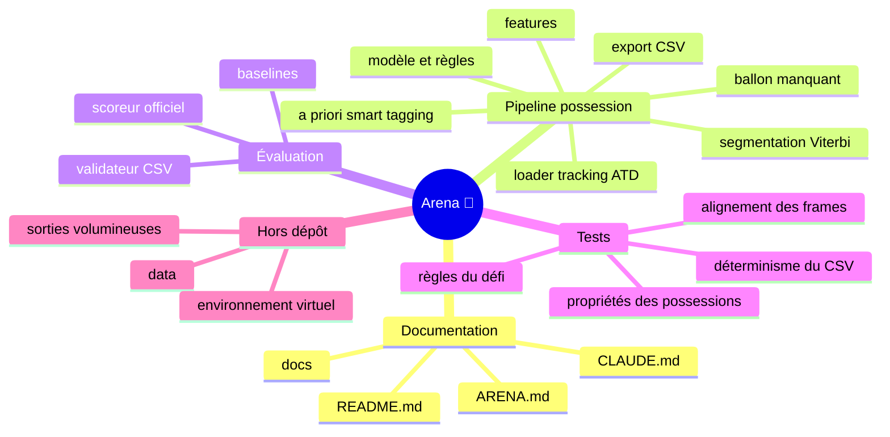

# Arborescence du dépôt (2026-11-07)

Deux vues : l'arborescence **réelle actuelle** (documentation, configuration des agents et données
locales seulement) et l'arborescence **cible** 🎯 (non réalisée : aucun code du pipeline n'existe
encore, voir `docs/ARCHITECTURE.md` §7 et `docs/DECISIONS.md`).

---

## 1. Arborescence réelle actuelle

- `Arena/` (racine du dépôt)
  - `ARENA.md`: résumé du défi en français, avec la section « Clarification des organisateurs » (elle prime)
  - `CLAUDE.md`: workflow, règles du défi et roster des subagents
  - `README.md`: présentation du projet (EN puis FR)
  - `.gitignore`: ignore `data/`, les vidéos, `.venv/`, `/.claude`
  - `data/`: données du match (**jamais commit**) ; `tactical/` et `broadcast/`, voir `docs/KNOWN_ISSUES.md` pour les fichiers manquants
  - `docs/`: documentation canonique (10 fichiers, rédigés en français puis en anglais)
    - `REQUIREMENTS.md`: exigences
    - `DOMAIN_NOTES.md`, `BUSINESS_RULES.md`: concepts, règles de possession et règles du défi
    - `ARCHITECTURE.md`, `DECISIONS.md`: pipeline cible et décisions (D-001 à D-007)
    - `TESTING.md`, `DEV_WORKFLOW.md`: tests, commandes et soumission
    - `KNOWN_ISSUES.md`, `LESSONS_LEARNED.md`, `ROADMAP_NEXT_STEPS.md`
  - `.claude/`: workflow des agents
    - `CLAUDE2.md`: configuration, chemins de données et règles du défi
    - `HOW_TO_USE_AGENTS.md`: comment invoquer les agents
    - `GIT_ADD_GUIDE.md`: règles `git add`
    - `ARBORESCENCE.MD`: ce fichier
    - `settings.local.json`: permissions locales
    - `commands/atomic-commits.md`: commande de plan de commits
    - `agents/`: `repo-explorer.md`, `pipeline-analyst.md`, `rules-guard.md`, `code-reviewer.md`, `test-impact.md`, `debugger.md`, `implementer.md`, `knowledge-curator.md`, `docs-writer.md`, `web-scraper.md`, `pr-describer.md`, `readme-writer.md`, `commit-planner.md`
    - `agents/feat/`: `feat-tracking-io.md`, `feat-possession-model.md`, `feat-evaluation.md`, `feat-rules-compliance.md`, `feat-viz-debug.md`
    - `agent-memory/`: `MEMORY.md` pour `code-reviewer`, `commit-planner`, `docs-writer`, `implementer`, `knowledge-curator`, `readme-writer`, `rules-guard`
    - `skills/`: compétences génériques de design et de documentation visuelle (non utilisées par le pipeline)

Le contenu de `docs/` évolue avec la rédaction : la liste ci-dessus est un instantané, la vérité est
le dossier lui-même.

---

## 2. Arborescence cible 🎯

Indicative : les noms exacts seront fixés à l'écriture du code (`docs/ARCHITECTURE.md` §7).
Chaque dossier correspond à une étape du pipeline décrit dans `docs/ARCHITECTURE.md`.

Règles de mise à jour :

- Passer un élément de 🎯 au réel seulement quand il existe dans le dépôt.
- Mettre à jour ce fichier dans le même changement que l'ajout d'un dossier ou d'un composant.
- Ne jamais lister de fichier de données du match comme faisant partie du dépôt public.
