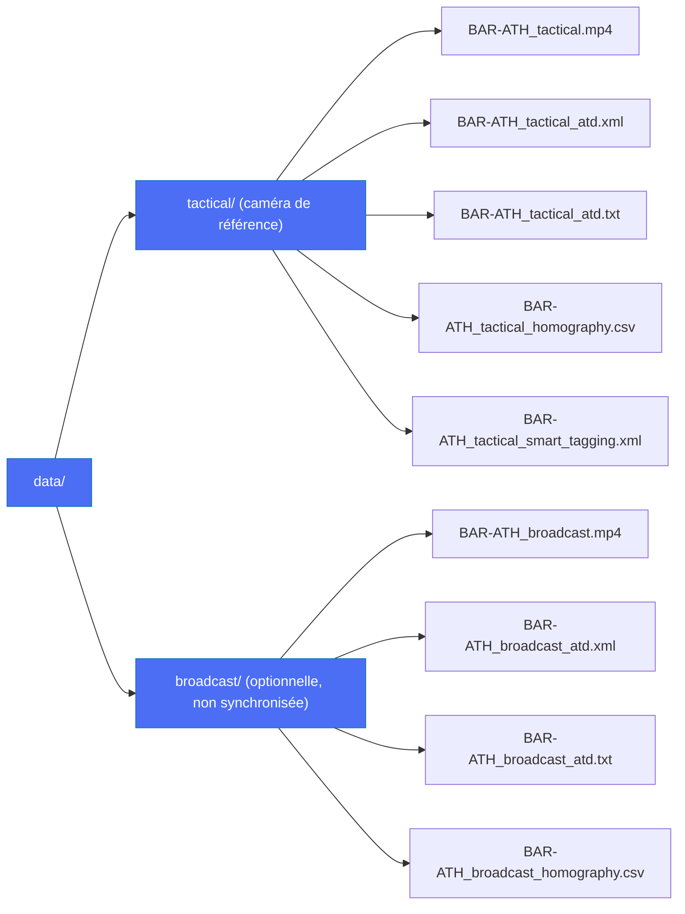
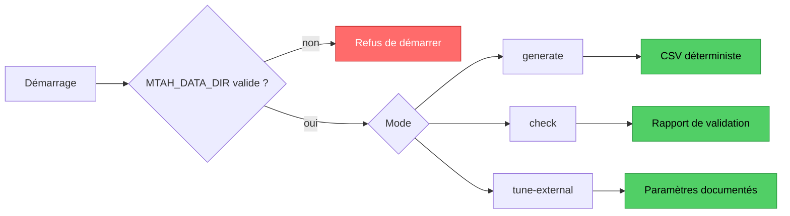

# Configuration et règles du défi

Companion de `CLAUDE.md` (workflow) et de `ARENA.md` (guide complet du défi). Cette note garde ce
qu'un agent doit savoir avant de toucher aux chemins de données, à la reproductibilité, ou à tout ce
qui approche les règles du défi « More than a Hack 2027, Phase 1 : possession du ballon ».

Légende : 🎯 = cible, pas encore réalisé.

---

## 1. Ce qui existe

Le dépôt contient la documentation (`CLAUDE.md`, `ARENA.md`, `README.md`, `docs/`), la configuration
des agents (`.claude/`) et les données du match dans `data/`. **Aucun code du pipeline n'existe
encore** : le package `possession/` et son point d'entrée sont une cible 🎯.

Ne jamais affirmer qu'un fichier, une commande ou un module existe sans l'avoir vérifié. En
particulier, le dépôt officiel (`games.py`, `evaluation/`, `starter/`) n'est pas copié ici, et
certains fichiers de `data/` peuvent manquer (le tracking `BAR-ATH_tactical_atd.txt` et les vidéos
`.mp4` ont été constatés absents) : vérifier avec `Glob` avant de s'appuyer dessus.

---

## 2. Chemins de données

Les données viennent du dépôt officiel `metrica-sports/more-than-a-hack-2027` (voir `ARENA.md` §4.2).
Arborescence attendue sous `data/` :

Règles :

- **`MTAH_DATA_DIR`** : variable d'environnement qui déplace le dossier de données (même nom que
  dans le dépôt officiel, `games.py`). Valeur par défaut : `data/` à la racine du dépôt. Le code
  construit les chemins à partir de cette variable, jamais en dur.
- **Aucune donnée commitée.** `data/`, les vidéos, les exports frame par frame et les extraits
  vidéo ne sont jamais commités ni publiés (redistribuer les données est interdit). `data/` doit
  être dans `.gitignore`.
- **La caméra `tactical` est la référence** : la ligne *i* de la soumission est la frame *i* de cette
  vidéo (199 319 frames). Un fichier d'environ 164 000 lignes signale une broadcast indexée par
  erreur.
- **Alignement des frames** : ATD `frame = frame_id - 1` ; Smart Tagging `frame = round(secondes * 25)` ;
  homographie identique à la soumission.
- **Coordonnées normalisées (0 à 1)** ; pour des mètres, multiplier par 105,3 x 68,0.
- **Le ballon manque sur environ 41 % des frames notées** (`NaN`) : tout code doit gérer ce cas.

---

## 3. Reproductibilité

- **Seeds fixes** : toute source d'aléa (numpy, `random`, bibliothèque de ML) est initialisée par
  une seed constante, déclarée à un seul endroit et consignée dans le document technique.
- **Un seul point d'entrée 🎯** : `python -m possession.run` régénère le CSV de soumission,
  **identique octet pour octet**, à partir des données seules. Un fichier que le dépôt ne sait pas
  régénérer à l'identique est interdit.
- **Dépendances figées** 🎯 : `requirements.txt` à versions exactes, dans un environnement
  virtuel (Python 3.13 disponible, `kloppy` à installer).
- **Fichiers intermédiaires permis** : les étapes peuvent écrire des fichiers intermédiaires, à
  condition qu'ils restent hors du dépôt (ignorés par git) et qu'ils soient régénérables par
  `python -m possession.run`.
- **Sortie** : `frame,label`, 199 319 lignes, labels `H`/`A`/`D`/`X`, aucune cellule vide, validée par
  `validate_submission.py` du dépôt officiel sur **le fichier exact** envoyé. Les trois états
  de la vérité terrain sont `H`, `A`, `D` ; `X` est l'abstention.
- **Logs** `[START]` `[ENTITY]` `[CALL]` `[RESULT]` `[STATE]` (voir `CLAUDE.md` §2.4), sans donnée
  du match recopiée en masse dans les logs.

---

## 4. Règles du défi

Source : `ARENA.md` §7 **et le mail de clarification des organisateurs, qui PRIME** en cas de
différence. Ces règles sont non négociables ; en cas de doute, `@rules-guard` avant d'agir, et une
issue sur le dépôt officiel **avant** de construire.

### Interdit

1. **Vérifier la sortie contre la vidéo.** Regarder la vidéo pour *comprendre* ce qu'est une
   possession reste permis ; la regarder pour *contrôler* ou corriger nos résultats ne l'est pas
   (ce point précise `ARENA.md` §7, qui disait « regarder la vidéo pour déboguer »).
2. **Produire des labels manuels** pour ce match, en n'importe quelle quantité et pour n'importe
   quel usage (soumission, entraînement, validation). Corriger à la main le tracking ou la sortie
   de l'algorithme est aussi interdit, tout comme des règles ou constantes liées à des frames
   précises du match.
3. **Envoyer les données ou les vidéos à un service d'IA hébergé dans le cloud** (ChatGPT, Claude,
   Gemini…). Un modèle local est autorisé. Cela vaut pour les agents : jamais de contenu
   du match (frames, tracking, extraits, vidéo) dans une requête vers un service externe. Cela
   inclut l'assistant de code lui-même (Claude Code est hébergé) : ne pas lui faire lire ni
   afficher `data/`. L'IA reste permise pour écrire, relire ou déboguer le **code**, avec
   uniquement des résultats agrégés en retour.
4. **Entraîner, ajuster ou calibrer sur la vérité terrain de possession ou sur la vidéo fournie**,
   y compris les 5 minutes publiques (frames 11 185 à 18 684). **Tout réglage de paramètres se fait
   uniquement sur des données externes** (autres matchs, licence vérifiée).
5. **Utiliser la vérité terrain privée** ou toute donnée humaine sur ce match (Opta, StatsBomb,
   Wyscout, LaLiga, tracking corrigé…).
6. **Redistribuer les données** : les commiter, publier des exports frame par frame ou des
   extraits vidéo.
7. **Soumettre un fichier que le dépôt ne peut pas régénérer à l'identique.**

### Permis

- Toute méthode, si les organisateurs peuvent l'inspecter et si le document technique l'explique ;
  règles, HMM/Viterbi, apprentissage, modèle pré-entraîné, LLM local.
- **Checks automatiques sur les seules données fournies** (validité du CSV, nombre de lignes,
  alignement des frames, déterminisme, cohérence interne).
- **Fichiers d'étapes intermédiaires** produits par le pipeline.
- **Tout jeu de données dont on a le droit d'usage** (licence vérifiée, source et quantité
  consignées dans le document technique) : réglage, entraînement, pseudo-labels produits par un
  algorithme.
- Améliorer ou remplacer le tracking avec ses propres algorithmes.

### Conséquences pratiques

- Les 5 minutes publiques de vérité terrain ne servent **jamais** à choisir ou ajuster un
  paramètre. Un éventuel score dessus est au mieux un test de plomberie (le pipeline tourne, le
  score est plausible) ; le contrôle d'usage revient à `@rules-guard`. Une fenêtre de 5 minutes ne
  départage de toute façon pas les options (`smooth125` y paraît meilleur et est moins bon sur le
  match complet).
- Les constantes du modèle viennent de principes physiques documentés (par exemple une durée
  minimale de contrôle) ou de données externes, jamais du match lui-même.
- Aucune règle ni constante liée à un numéro de frame précis, hors bornes de mi-temps officielles
  de `ARENA.md` §4.7.

---

## 5. Modes d'exécution 🎯

Pas de mode obligatoire : un seul chemin de production suffit. Si des modes sont ajoutés, ils
passent par `python -m possession.run` et ne changent jamais la sortie de production.

| Mode 🎯 | Données | Sortie | Usage |
|---|---|---|---|
| `generate` (défaut) | `MTAH_DATA_DIR`, match fourni | le CSV de soumission | régénérer le fichier à envoyer |
| `check` | CSV déjà produit | rapport de validation | format, longueur, alignement, déterminisme ; aucune comparaison à la vérité terrain pour régler quoi que ce soit |
| `tune-external` | **données externes uniquement** | paramètres consignés | seul endroit où des paramètres peuvent être ajustés |

---

## 6. Avant de modifier quelque chose

- Vérifier d'abord que ce que tu veux modifier existe (`Glob`, `Grep`) ; la source de vérité du
  défi est `ARENA.md`, puis `docs/` (et `docs/DECISIONS.md` pour ce qui est décidé).
- Ne jamais committer de donnée du match, de vidéo ni d'export frame par frame ; ne jamais utiliser
  `git add data*`, `git add .` ni `git add -A`.
- Ne jamais envoyer de contenu du match à un service d'IA hébergé dans le cloud.
- Tout changement qui touche à l'usage de la vérité terrain publique, aux données de réglage, aux
  sources externes ou à une règle du défi passe d'abord par `@rules-guard`.
- Un paramètre ajouté se justifie par un principe physique ou une donnée externe documentée, et se
  reflète dans `docs/DECISIONS.md` dans le même changement.
- Ne pas présenter un choix technique comme décidé tant que `docs/DECISIONS.md` ne le dit pas.
- Les écarts connus et limites sont dans `docs/KNOWN_ISSUES.md`.
