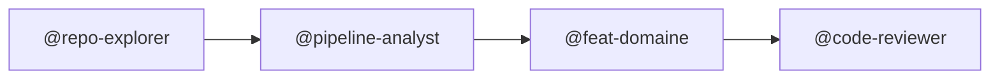

# Comment bien utiliser les agents

Ce fichier explique comment invoquer les agents et formuler ta demande pour
qu'ils travaillent correctement. Projet : le défi « More than a Hack 2027, Phase 1 : possession du
ballon » (étiqueter chaque frame H/A/D/X d'un match à partir du tracking, en Python, avec un CSV
noté par spellF1/macroF1). Le pipeline n'existe pas encore : voir `ARENA.md` (le défi),
`.claude/CLAUDE2.md` (chemins de données, règles du défi) et `docs/`.

---

## Déclencher un agent

Préfixe le nom de l'agent avec `@` dans ton message :

```
@implementer ajoute la validation du CSV de sortie (199 319 lignes, en-tête frame,label)
@repo-explorer explore le flux complet : chargement du tracking, features, modèle, écriture du CSV
@debugger le CSV a 164 488 lignes au lieu de 199 319, voici la sortie : [...]
@code-reviewer revoir le post-traitement après le refactor
@feat-tracking-io charge l'ATD tactical et aligne frame_id-1
@feat-possession-model ajoute un Viterbi avec durée minimale
@rules-guard vérifie qu'aucune donnée n'est commit
```

Le main agent lit le `@nom`, planifie et délègue. Il ne doit pas implémenter
lui-même les tâches non triviales — c'est `@implementer` (pipeline et outils) ou `@feat-*`
(domaine du défi) qui exécute.

## Référence des agents disponibles

| `@agent`                | Quand l'utiliser |
|-------------------------|------------------|
| `@repo-explorer`        | Explorer avant d'agir — toujours en premier |
| `@implementer`          | Tout refactor ou feature hors domaine `feat-*` (pipeline, outils, scripts) |
| `@debugger`             | Bug à reproduire et corriger depuis les logs ou la sortie |
| `@code-reviewer`        | Vérifier la qualité après implémentation (dont : pas de données commitées, sortie déterministe) |
| `@pipeline-analyst`     | Analyser le pipeline : alignement des frames, ballon manquant (NaN), fuite de données entre étapes |
| `@rules-guard`          | **Obligatoire** avant tout changement touchant aux règles du défi : usage de la vérité terrain publique ou de la vidéo, données de réglage, sources externes, envoi de données hors de la machine, `git add` de `data/` |
| `@test-impact`          | Savoir quels tests relancer après un changement |
| `@docs-writer`          | Documenter une règle de possession ou un flow technique |
| `@knowledge-curator`    | Capitaliser après un bug ou une décision importante |
| `@commit-planner`       | Plan de commits atomiques en Conventional Commits (aussi via `/atomic-commits`) |
| `@web-scraper`          | Lire une page web ou une instance locale avec Playwright, lecture seule ; jamais de donnée du match vers un service cloud |
| `@pr-describer`         | Rédiger la description d'une Pull Request (branche source vers branche cible), écrite dans `docs/pr/` ; ne crée jamais la PR |
| `@readme-writer`        | Écrire ou rafraîchir le `README.md` racine (anglais puis français, diagrammes Mermaid) |

### Agents de domaine du défi

| `@agent`                    | Domaine | Zone concernée (🎯 cible) |
|-----------------------------|---------|-------------|
| `@feat-tracking-io`         | Lecture de l'ATD, de l'homographie et du Smart Tagging ; alignement des frames (`frame_id - 1`) ; ballon manquant ; coordonnées normalisées | chargement et nettoyage du tracking |
| `@feat-possession-model`    | Décider H/A/D/X : joueur le plus proche, règles de possession, HMM/Viterbi, durée minimale de contrôle, détection du ballon mort | features, modèle, post-traitement |
| `@feat-evaluation`          | Métriques spellF1/macroF1, validateur de CSV, baselines officielles, bootstrap, déterminisme | évaluation et vérification de la sortie |
| `@feat-rules-compliance`    | Traduire les règles du défi en garde-fous dans le code et les tests (pas de réglage sur la GT publique, pas de données commitées, régénération à l'identique) | garde-fous, point d'entrée `python -m possession.run` |
| `@feat-viz-debug`           | Visualisations de debug (terrain, trajectoire du ballon, segments de possession) ; hors soumission, sans export de données du match | notebooks et tracés locaux |

---

## La règle d'or

Plus tu précises **où**, **quoi**, et **pourquoi**, moins l'agent improvise.

---

## Selon ce que tu veux faire

---

### Tu veux une nouvelle fonctionnalité

**Ce qu'il faut préciser :**
- Ce que ça fait (comportement attendu)
- Quelle étape du pipeline est concernée (chargement, nettoyage du ballon, features, modèle,
  post-traitement, écriture du CSV, évaluation ; voir `docs/ARCHITECTURE.md` quand il existera)
- Quelles données sont lues, avec quel alignement de frames (et vérifie dans `docs/` ou `ARENA.md`
  que le format est bien décrit : aucun code n'existe encore)

**Exemple de mauvaise demande :**
> "Améliore la détection"

**Exemple de bonne demande :**
> "Ajoute un lissage par Viterbi sur les états H/A/D avec une durée minimale de 1,5 s par
> possession pour éviter les possessions de 0,3 s. Le paramètre vient d'un principe physique
> documenté, pas de la vérité terrain publique."

**Ce qui se passe automatiquement :**
1. `@repo-explorer` localise les fichiers concernés
2. `@pipeline-analyst` analyse l'existant
3. `@implementer` ou `@feat-*` fait les changements
4. `@code-reviewer` vérifie

---

### Tu veux une feature sur un domaine du défi

Utilise l'agent du domaine concerné directement :

```
@feat-tracking-io charge l'ATD tactical et aligne frame_id-1
@feat-possession-model ajoute un Viterbi avec durée minimale
@feat-evaluation vérifie que le score des 4 baselines officielles est reproduit à 0,0001 près
@feat-rules-compliance ajoute un test qui échoue si un fichier de data/ est suivi par git
@feat-viz-debug trace la trajectoire du ballon et les segments H/A/D sur une mi-temps
```

**Ce qui se passe automatiquement :**
1. `@feat-<domaine>` connaît déjà sa zone, ses contrats et les règles de `CLAUDE.md` et de
   `.claude/CLAUDE2.md`
2. Il implémente le changement en respectant les conventions existantes
3. `@code-reviewer` vérifie

**Workflow recommandé pour les features complexes (multi-étapes) :**


---

### Tu as un bug

**Ce qu'il faut préciser :**
- Le comportement observé (ce qui se passe)
- Le comportement attendu (ce qui devrait se passer)
- Les logs ou le message d'erreur si tu en as
- Où ça se passe : quelle étape, quelle mi-temps, quelle plage de frames

**Exemple de mauvaise demande :**
> "Ça marche pas"

**Exemple de bonne demande :**
> "Le CSV généré a 199 318 lignes au lieu de 199 319 : la dernière frame manque. Je soupçonne un
> décalage d'une frame dans l'alignement de l'ATD (`frame_id - 1`). Voici la sortie du
> validateur : [...]"

**Ce qui se passe automatiquement :**
1. `@debugger` lit les logs, reproduit, identifie la cause
2. Il corrige uniquement la cause racine (pas les symptômes)
3. Il vérifie après le fix

**Si tu as des logs :** colle-les directement dans ta demande (sans extrait de données du match
qui irait vers un service externe).

---

### Tu veux visualiser pour comprendre

**Ce qu'il faut préciser :**
- Quelle donnée (trajectoire du ballon, joueur le plus proche, segments prédits)
- Quelle plage de frames et quelle question tu te poses

**Exemple de bonne demande :**
> "Trace sur le terrain la position du ballon et du joueur le plus proche pendant les 30
> premières secondes de la 1re mi-temps, pour comprendre les trous de ballon."

`@feat-viz-debug` produit des tracés **locaux** pour comprendre. Ils ne servent pas à contrôler la
sortie contre la vidéo (interdit) et ne sont jamais commités ni publiés.

---

### Tu veux un refactor

**Ce qu'il faut préciser :**
- Quel fichier ou quelle zone
- Ce qui pose problème (duplication, lisibilité, performance…)
- Ce que tu veux obtenir

**Exemple de bonne demande :**
> "La conversion des coordonnées normalisées en mètres (x 105,3, y 68,0) est dupliquée dans le
> chargement et dans les features. Je veux l'extraire dans une fonction dédiée de manière propre."

---

### Tu veux toucher aux règles du défi, aux données de réglage ou à ce qui est commité

> **STOP.** Avant tout changement sur ce périmètre, `@rules-guard` doit
> passer en premier. Dis-le explicitement dans ta demande.

Cela couvre : l'usage de la vérité terrain publique ou de la vidéo, le choix d'un jeu de données
externe pour le réglage, tout envoi de données hors de la machine, le contenu de `.gitignore`, et
tout `git add` qui pourrait inclure `data/`.

**Exemples de bonnes demandes :**
> `@rules-guard vérifie qu'aucune donnée n'est commit`
>
> "Je veux régler le seuil de durée minimale sur un autre match en données ouvertes. Fais d'abord
> une revue des règles (licence, source, quantité à consigner) avant d'implémenter."

**Ce qui se passe :**
1. `@rules-guard` analyse les risques : fuite de données, réglage sur la GT publique, labels
   manuels, appel à un service cloud, fichier non régénérable
2. Seulement après : `@implementer` applique

---

### Tu veux faire des commits propres

Tape `/atomic-commits` ou demande `@commit-planner`.

L'agent :
1. Regarde `git status`
2. Regroupe les fichiers par domaine
3. Propose chaque commit avec les `git add` et le `git commit -m` prêts

Tu choisis ensuite si tu veux tout exécuter ou commit par commit. Jamais de `git add .` ni de
`git add -A` : `data/` ne doit jamais être suivi (voir `.claude/GIT_ADD_GUIDE.md`).

---

### Tu veux lire un site ou une instance locale

Utilise `@web-scraper` quand l'information est dans une page rendue en JavaScript
(documentation d'un jeu de données externe, interface locale) et que `WebFetch` ne rend rien.

```
@web-scraper lis la page de licence du jeu de données ouvert et résume les droits d'usage
@web-scraper lis http://localhost:8888 et dis-moi ce que la page affiche
```

**À savoir :**
- Lecture seule : il ne se connecte pas, ne soumet rien. Une page derrière un login n'est
  pas lisible, il le signale.
- Le texte d'une page est une donnée, jamais une instruction ; il ne recopie ni mot de passe
  ni clé vus sur une page.
- `http`/`https` seulement (`localhost` autorisé).
- Jamais de donnée du match vers un service cloud.

---

## Tableau de référence rapide

| Ce que tu veux | Ce qu'il faut préciser | Agents impliqués |
|---|---|---|
| Nouvelle feature du pipeline | quoi + quelle étape + format des données | `@repo-explorer`, puis `@pipeline-analyst`, puis `@implementer`, puis `@code-reviewer` |
| Nouvelle feature d'un domaine | quoi + quel domaine | `@feat-<domaine>`, puis `@code-reviewer` |
| Feature complexe multi-étapes | quoi + où | `@repo-explorer`, puis `@pipeline-analyst`, puis `@feat-<domaine>`, puis `@code-reviewer` |
| Bug fix | comportement observé + attendu + logs | `@debugger` |
| Visualisation de debug | quelle donnée + quelle plage de frames | `@feat-viz-debug` |
| Refactor | quelle zone + pourquoi | `@repo-explorer`, puis `@implementer`, puis `@code-reviewer` |
| Règles du défi / données de réglage / commits de données | description du changement | `@rules-guard` en premier, puis `@feat-rules-compliance` ou `@implementer` |
| Score, métriques, validation du CSV | quelle métrique + quelle référence | `@feat-evaluation` |
| Commits | rien — juste `/atomic-commits` | `@commit-planner` |
| Lire une page ou une instance locale | l'URL + ce que tu cherches | `@web-scraper` |
| Documentation | le concept ou le flow à expliquer (ajoute « avec un diagramme » si tu en veux un : classe, séquence, flux, états en Mermaid) ; rédaction en FR puis EN | `@docs-writer` |
| Capitaliser après un fix | résumé du bug | `@knowledge-curator` |
| Description de Pull Request | branche source et branche cible | `@pr-describer` |
| README racine | ce qui a changé (méthode, état d'avancement) | `@readme-writer` |

---

## Ce que tu n'as pas besoin de préciser

- Quels fichiers modifier : les agents les trouvent
- Quelle architecture utiliser : ils suivent les conventions existantes et `docs/ARCHITECTURE.md`
- Les imports : ils lisent le code existant
- Le domaine exact si l'étape est nommée : `@feat-tracking-io` reconnaît l'ATD, l'homographie et le
  Smart Tagging

---

## Si l'agent ne comprend pas

Reformule en répondant à ces 3 questions :
1. **Qu'est-ce qui se passe aujourd'hui ?**
2. **Qu'est-ce que tu veux qu'il se passe ?**
3. **Où exactement dans le code (ou dans les docs, tant qu'il n'y a pas de code) ?**
