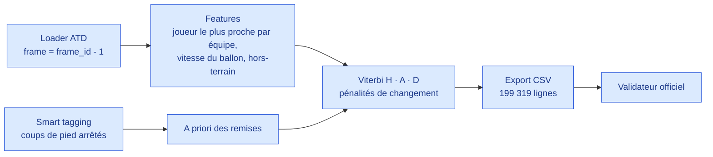

# CLAUDE.md — Workflow & Subagents Guide

> Ce fichier définit les règles non-négociables, les subagents disponibles,
> et le flow de travail attendu pour toute tâche non triviale.

---

## 0) Contexte projet

**Arena — More than a Hack 2027, Phase 1 : possession du ballon.** Défi organisé par Metrica Sports,
le FC Barcelona (Barça Innovation Hub) et Mobile World Capital Barcelona. Pour chaque frame du
match **FC Barcelona (H) vs Athletic Club (A)**, dire quelle équipe a le ballon (`H` ou `A`), ou si
le ballon est mort (`D`), ou s'abstenir (`X`). 199 319 frames à 25 fps, dont 158 857 notées.
Le seul livrable noté est un **CSV** (`frame,label`) ; le classement se fait au **spellF1**
(les possessions comptent comme des objets entiers), le macroF1 départage les ex æquo. Le seuil à
battre est un spellF1 de **0,2433** (baseline `smooth50`). Date limite : **17 novembre 2026**.

Résumé complet du défi (en français) : `ARENA.md`. En cas de doute, le code officiel de
`evaluation/possession_metrics.py` fait foi pour les métriques.

**État actuel (2026-11-17) : le pipeline existe et a produit la soumission de l'équipe
CulersFromSN.** Code dans `arena/` (loader, features, priors, decode, pipeline, config) et
`scripts/` (`make_submission.py`, réglage externe), tests synthétiques dans `tests/`, résultats
du réglage dans `tuning/`. Le dépôt officiel est attendu à côté (`../more-than-a-hack-2027`, ou
`MTAH_OFFICIAL_DIR`) et les données du match dans son `data/` (ou `MTAH_DATA_DIR`), **jamais
commit**. Méthode et paramètres : `docs/TECHNICAL_REPORT.md` et `docs/TUNING.md` ; limites :
`docs/KNOWN_ISSUES.md`. Ne rien présenter comme fait tant que ce n'est pas dans le code ou dans
`docs/DECISIONS.md`.

Pipeline réel :



Documentation de référence (canonique, bilingue FR puis EN) :

- Exigences : `docs/REQUIREMENTS.md`.
- Concepts du domaine : `docs/DOMAIN_NOTES.md` ; règles (possession **et** règles du défi) : `docs/BUSINESS_RULES.md`.
- Architecture : `docs/ARCHITECTURE.md` ; décisions et choix techniques : `docs/DECISIONS.md`.
- Tests : `docs/TESTING.md` ; commandes de développement et soumission : `docs/DEV_WORKFLOW.md`.
- Limites et écarts connus : `docs/KNOWN_ISSUES.md` ; leçons : `docs/LESSONS_LEARNED.md`.
- Feuille de route : `docs/ROADMAP_NEXT_STEPS.md`.
- Configuration, chemins de données et règles du défi : `.claude/CLAUDE2.md`.

**Roadmap :** voir `docs/ROADMAP_NEXT_STEPS.md`. Ne pas supposer qu'une fonctionnalité existe
avant de l'avoir vérifiée dans le code (et, tant qu'il n'y a pas de code, dans la documentation).

---

## 1) Principes de base

- Toujours planifier avant d'agir.
- Utiliser les subagents de manière intentionnelle.
- Chercher les améliorations proches qui réduisent la friction future.
- Logger les opérations importantes.
- Vérifier les changements avec les tests ou le meilleur équivalent disponible.
- Corriger les bugs à partir des preuves, pas des suppositions.
- **Respecter les règles du défi avant toute optimisation** (§5) : un score obtenu en les violant est disqualifiant.

---

## 2) Workflow non négociable

### 2.1 Planifier d'abord

Avant toute implémentation :

- Inspecter les fichiers concernés.
- Rédiger un plan court et explicite.
- Identifier les hypothèses et les risques.
- Commencer les edits seulement après cette étape.

Pour toute tâche non triviale, mettre à jour le plan au fur et à mesure.

### 2.2 Déléguer avec intention

Quand la tâche dépasse un simple edit mono-fichier, déléguer à des subagents spécialisés.

Chaque subagent doit avoir :
- un scope étroit,
- un objectif clair,
- un résultat exploitable,
- et pas de responsabilité hors sujet.

### 2.3 Auto-amélioration

Ne pas s'arrêter au fix minimal si des améliorations proches réduisent la friction future.

Toujours chercher :
- validation manquante,
- logs absents ou inexploitables,
- documentation obsolète,
- tests cassés ou absents,
- incohérences de nommage,
- drift de configuration,
- code mort ou dupliqué.

Faire des améliorations ciblées sans churn inutile.

### 2.4 Logs obligatoires

Tout flux significatif (chargement des données, génération du CSV, évaluation) doit laisser des logs utiles.

Structure attendue :
- `[START]` : opération qui démarre.
- `[ENTITY]` : fichier, mi-temps, plage de frames ou possession concernée.
- `[CALL]` : dépendance appelée (lecture d'un fichier, appel d'une bibliothèque).
- `[RESULT]` : succès ou échec avec détail actionnable (ex. nombre de frames sans ballon).
- `[STATE]` : état suivant.

Règles :
- logger les identifiants et les transitions d'état,
- ne jamais logger de contenu brut des données du match (coordonnées frame par frame) dans des fichiers destinés à être partagés,
- rendre les échecs actionnables,
- améliorer les logs si le debug est difficile.

### 2.5 Tests automatiques

Après chaque changement :

1. Lancer les tests les plus pertinents.
2. Lancer le lint ou type-check si applicable.
3. Si aucun test formel n'existe, exécuter la meilleure vérification disponible et le mentionner clairement.

Ne jamais affirmer qu'une modification fonctionne sans vérification.

### 2.6 Corriger depuis les preuves

Quand des logs ou une sortie runtime montrent un bug :

1. Reproduire si possible.
2. Lire les logs attentivement.
3. Identifier le vrai point de défaillance.
4. Corriger la cause racine, pas seulement le symptôme.
5. Relancer la vérification.

---

## 3) Flow de travail

### Phase 1 — Exploration

- `@repo-explorer` : structure générale, fichiers concernés.
- `@pipeline-analyst` : chemin loader → features → modèle → CSV, fuites de données, NaN, alignement des frames.

### Phase 2 — Plan

- Fusionner les résultats.
- Écrire un plan explicite.
- Lister les hypothèses et risques.
- Définir l'ordre des edits.
- Si le format d'une donnée intermédiaire change : le loader d'abord, les features ensuite, le modèle en dernier.

### Phase 3 — Implémentation

- Utiliser `@implementer` si la tâche est non triviale.
- Avant tout commit ou push, tout appel réseau, tout ajout de dépendance, toute utilisation d'un
  jeu de données externe, et tout réglage ou entraînement : `@rules-guard`.
- Ajouter ou ajuster les logs sur les flux significatifs.
- Garder les changements ciblés.

### Phase 4 — Revue et tests

- `@code-reviewer` : qualité, conformité aux règles du défi, logs, naming.
- `@test-impact` : tests à relancer.
- Exécuter automatiquement les tests ciblés.

### Phase 5 — Debug

Si applicable : `@debugger`.

- Lire les logs.
- Reproduire.
- Corriger la cause racine.
- Revérifier.

### Phase 6 — Knowledge capture

Après un bug corrigé, un incident important, ou une décision sensible :

- Résumer le problème.
- Documenter la cause racine.
- Noter les fichiers touchés.
- Écrire la règle à retenir pour éviter la régression.
- Ajouter la vérification ou le test qui protège désormais ce cas.

Utiliser `@knowledge-curator` pour garder cette mémoire courte, structurée et exploitable.

### Phase 7 — Documentation explicative

Quand une règle, un concept technique, ou un flow mérite une explication claire :

- Résumer le sujet ou la question.
- Expliquer simplement ce qu'il faut comprendre.
- Donner les règles importantes, exceptions et exemples utiles.
- Écrire ou mettre à jour un fichier dans `docs/`.

Utiliser `@docs-writer` pour transformer les explications utiles en documentation réutilisable.

### Agents de domaine (pipeline de possession)

Pour une feature qui touche un domaine précis, utiliser directement l'agent `feat-*` correspondant
plutôt que `@implementer` générique — voir `.claude/HOW_TO_USE_AGENTS.md` et
`.claude/agents/feat/` pour le détail :

- `feat-tracking-io` — chargement de l'ATD, alignement `frame_id - 1`, ballon manquant, homographie, smart tagging.
- `feat-possession-model` — features (joueur le plus proche…), HMM/Viterbi, durée minimale de contrôle, détection de `D`.
- `feat-evaluation` — spellF1 / macroF1, baselines officielles, validation et export déterministe du CSV.
- `feat-rules-compliance` — garde-fou des règles du défi (voir §5).
- `feat-viz-debug` — visualisations de debug locales, jamais dans la soumission.

---

## 4) Règles des visualisations et du code d'exploration

- Les visualisations (tracés du terrain, courbes de possession) sont des **outils de debug locaux**.
  Elles ne font jamais partie du CSV ni du dépôt public de livraison, sauf script documenté.
- Une visualisation sert à **comprendre** les données (ex. où est le ballon quand il manque).
  Elle ne sert **jamais** à contrôler la sortie du pipeline contre la vidéo (interdit, §5).
- Les notebooks d'exploration ne contiennent pas de données du match en sortie de cellule
  (pas d'export frame par frame ni d'extrait vidéo) : vider les sorties avant tout commit.
- Pas de duplication de logique : le calcul des labels vit dans le package du pipeline, pas dans un notebook.
- La couleur ne porte jamais seule le sens (H / A / D distingués aussi par un libellé ou un motif).

---

## 5) Règles du défi et règles de code (non négociables)

Source : `ARENA.md` §7 **et** le mail de clarification des organisateurs (section dédiée dans
`ARENA.md`), qui **prime** sur le reste.

### 5.1 Interdit

- **Vérifier la sortie contre la vidéo.** Regarder pour comprendre la possession : oui ;
  contrôler ses résultats : non.
- **Annoter à la main ce match**, corriger à la main le tracking ou la sortie, ou écrire une règle
  ou une constante liée à des frames précises du match.
- **Entraîner, ajuster ou calibrer sur la vérité terrain de possession (publique ou privée) ou sur la
  vidéo fournie.** Les 5 minutes publiques servent uniquement de test de plomberie.
- Utiliser toute donnée humaine sur ce match (Opta, StatsBomb, Wyscout, LaLiga, tracking corrigé…).
- **Envoyer les données ou la vidéo du match à un service d'IA hébergé** (ChatGPT, Claude, Gemini…).
  Un LLM local est autorisé. **Cela vaut pour cet assistant lui-même** : Claude Code est un service
  hébergé. Donc, dans une session Claude Code : ne pas lire ni afficher le contenu de `data/` (tracking,
  homographie, smart tagging, vérité terrain, vidéo), ne pas lancer de commande qui imprime des lignes
  de ces fichiers, ne pas coller de coordonnées, de frames ou d'extraits du CSV dans un prompt.
  Écrire le code qui lit les données est permis ; l'exécuter en local et ne remonter que des
  résultats agrégés (nombres de frames, scores, messages d'erreur sans données) l'est aussi.
  Pour inspecter les données elles-mêmes : un notebook lu par un humain, ou un LLM local.
- **Redistribuer les données** : commit de `data/`, exports frame par frame, extraits vidéo.
- Soumettre un CSV que le dépôt ne peut pas régénérer à l'identique.

### 5.2 Autorisé

- Toute méthode, tout langage, tout modèle pré-entraîné, à condition que les organisateurs puissent
  l'inspecter et que le document technique l'explique.
- **Utiliser une IA (hébergée ou locale) pour aider à écrire, relire ou déboguer le code** : c'est
  permis, tant qu'aucune donnée du match ne lui est envoyée (voir 5.1).
- Checks automatiques utilisant **uniquement** les données fournies ; fichiers d'étapes intermédiaires.
- Utiliser la vidéo, le tracking, le smart tagging comme **entrées**, si l'algorithme n'a pas été
  entraîné sur la vérité terrain ni sur la vidéo.
- Entraîner ou régler les paramètres **uniquement sur des données externes** dont on a les droits
  (vérifier la licence de chacune et la documenter).

### 5.3 Règles de code

- **Déterminisme** : seed fixe, ordre stable ; relancer la commande de régénération produit le même CSV octet pour octet.
- **Un seul point d'entrée** (`python scripts/make_submission.py --name CulersFromSN`) qui régénère le CSV de soumission et le valide avec le validateur officiel.
- **Alignement des frames** : la ligne *i* du CSV est la frame *i* de la vidéo tactical ; ATD
  `frame = frame_id - 1`, smart tagging `frame = round(secondes × 25)`. Vérifier la longueur : 199 319 lignes (164 000 = caméra broadcast indexée par erreur).
- **Valeurs manquantes** : le ballon vaut `NaN` sur 41 % des frames notées. Tout code qui lit le ballon gère ce cas explicitement, sans correction silencieuse.
- **Validation d'entrées** : vérifier la forme des fichiers lus (nombre de frames, colonnes, `valid` de l'homographie) avant d'utiliser les données ; une entrée invalide est journalisée, jamais corrigée en silence.
- **`X`** : à utiliser en plein milieu d'une possession quand le ballon est perdu de vue (gratuit au spellF1) ; pas aux transitions probables.
- **Valider le fichier exact envoyé** avec `evaluation/validate_submission.py`.
- **Dépendances figées** (`requirements.txt`) et dépôt public **sans les données**.

---

## 6) Modèles par défaut pour les subagents

| Subagent | Modèle recommandé | Usage |
|---|---|---|
| `@repo-explorer` | **Haiku** | Exploration rapide et read-only |
| `@test-impact` | **Haiku** | Analyse rapide de l'impact tests |
| `@pipeline-analyst` | **Sonnet** | Analyse du pipeline : loader, features, modèle, CSV, fuites de données |
| `@code-reviewer` | **Sonnet** | Revue qualité, conformité aux règles du défi, cohérence |
| `@debugger` | **Sonnet** | Reproduction, triage, correction guidée |
| `@implementer` | **Sonnet** | Implémentation standard |
| `@implementer` | **Opus** | Cas très complexes, refactor majeur, architecture |
| `@knowledge-curator` | **Haiku** | Mise à jour des limites connues, leçons apprises, décisions |
| `@docs-writer` | **Haiku** | Documentation claire des concepts, règles et notes techniques |
| `@rules-guard` | **Sonnet** | Garde-fou des règles du défi avant commit, réseau, dépendance, données externes, réglage |
| `@commit-planner` | **Haiku** | Plan de commits atomiques en Conventional Commits |
| `@web-scraper` | **Haiku** | Lecture de pages web publiques (documentation, licences de jeux de données) via Playwright |
| `@pr-describer` | **Haiku** | Titre et description d'une Pull Request à partir des commits et du diff (écrit dans `docs/pr/`) |
| `@readme-writer` | **Sonnet** | Rédaction et mise à jour du `README.md` racine, bilingue, avec diagrammes Mermaid |

Règles de choix :
- **Haiku** pour lecture rapide, triage, faible latence (dont la lecture de pages web par `@web-scraper`).
- **Sonnet** pour analyse approfondie et implémentation standard.
- **Opus** pour les sujets à fort impact architectural.

---

## 7) Subagents disponibles

Les définitions complètes (frontmatter : `name`, `description`, `tools`, `model`, `permissionMode`)
sont dans `.claude/agents/` : c'est la source de vérité, ne pas les dupliquer ici.

| Agent | Fichier | Rôle |
|---|---|---|
| `repo-explorer` | `agents/repo-explorer.md` | Carte rapide du code, lecture seule. À utiliser au début de toute tâche non triviale. |
| `pipeline-analyst` | `agents/pipeline-analyst.md` | Analyse loader → features → modèle → CSV ; fuites, NaN, alignement. Lecture seule. |
| `test-impact` | `agents/test-impact.md` | Plus petit périmètre de tests / lint impacté. |
| `code-reviewer` | `agents/code-reviewer.md` | Revue de correction, de logs, de nommage et des règles du défi. |
| `debugger` | `agents/debugger.md` | Reproduit, isole la cause racine, corrige au minimum, vérifie. |
| `implementer` | `agents/implementer.md` | Exécute le plan approuvé avec des edits ciblés et des tests. |
| `knowledge-curator` | `agents/knowledge-curator.md` | Capitalise bugs, décisions et leçons dans `docs/`. |
| `docs-writer` | `agents/docs-writer.md` | Documentation bilingue FR puis EN dans `docs/`, diagrammes Mermaid. |
| `rules-guard` | `agents/rules-guard.md` | **À utiliser avant** tout commit/push, appel réseau, nouvelle dépendance, donnée externe, réglage. Ne code pas. |
| `commit-planner` | `agents/commit-planner.md` | Plan de commits atomiques ; invocable aussi via `/atomic-commits`. |
| `web-scraper` | `agents/web-scraper.md` | Lecture de pages publiques (Playwright), lecture seule. |
| `pr-describer` | `agents/pr-describer.md` | Rédige la description d'une PR dans `docs/pr/`. Ne commit, ne push, ne crée jamais la PR. |
| `readme-writer` | `agents/readme-writer.md` | Écrit ou rafraîchit le `README.md` racine (EN puis FR, Mermaid). |
| `feat-tracking-io` | `agents/feat/feat-tracking-io.md` | Chargement ATD, alignement des frames, ballon manquant. |
| `feat-possession-model` | `agents/feat/feat-possession-model.md` | Features, HMM/Viterbi, détection de `D`. |
| `feat-evaluation` | `agents/feat/feat-evaluation.md` | Métriques, baselines, validation et export du CSV. |
| `feat-rules-compliance` | `agents/feat/feat-rules-compliance.md` | Garde-fou des règles du défi. |
| `feat-viz-debug` | `agents/feat/feat-viz-debug.md` | Visualisations de debug locales. |

---

## 8) Commandes rapides

```bash
# Lancer une exploration complète
@repo-explorer explore how the ATD tracking is loaded and aligned to the submission frames

# Analyser le pipeline avant un changement
@pipeline-analyst trace how a missing ball (NaN) propagates from the loader to the final label

# Revue après implémentation
@code-reviewer review the recent changes to the segmentation step (determinism, rules compliance, logs)

# Impact tests
@test-impact identify the minimal test scope for this change

# Debug depuis les logs
@debugger the CSV has 199 318 lines instead of 199 319, here are the logs: [...]

# Capitaliser après un fix important
@knowledge-curator document what should be retained from this bug fix

# Écrire une documentation explicative
@docs-writer explain the half-time scoring window and write it in docs/

# Garde-fou des règles avant un changement sensible
@rules-guard check that no match data is staged and no external dataset is used without a documented licence

# Plan de commits atomiques
@commit-planner propose commits for the current git status

# Lire une page publique (licence d'un jeu de données externe)
@web-scraper lis la page de licence de ce jeu de données et résume ce qu'elle autorise

# Feature sur un domaine du pipeline
@feat-possession-model add a Viterbi smoothing with a minimum possession duration
```

---

## 9) Règle d'or

Le main agent ne doit jamais improviser : il doit d'abord comprendre, ensuite planifier, puis déléguer, implémenter, vérifier et seulement après conclure.

---

## 10) Coordination multi-agents

### 10.1 Principe général

Le système doit fonctionner comme une équipe coordonnée, pas comme une collection
d'agents indépendants. La coordination doit être explicite, observable et vérifiable.

### 10.2 Patterns de coordination

Utiliser le pattern le plus simple possible selon le besoin :

- **Orchestrator → Subagents** : pour les tâches découpables avec un pilote central.
- **Parallel exploration** : pour analyser plusieurs zones du code en même temps.
- **Generator → Verifier** : pour les changements sensibles ou les sorties importantes.
- **Sequential pipeline** : quand une étape dépend fortement de la précédente.
- **Shared state / shared notes** : uniquement si le contexte doit être consolidé.
- **Avoid multi-agent** : si une seule analyse suffit, ne pas complexifier inutilement.

### 10.3 Règles de coordination

- Chaque agent doit avoir un rôle unique.
- Chaque sortie d'agent doit être actionnable.
- L'agent principal garde la décision finale.
- Les subagents ne doivent pas se contredire silencieusement.
- Si deux agents divergent, l'agent principal tranche avec preuves.
- Les handoffs doivent être courts, structurés et traçables.

### 10.4 Format de rendu attendu

Chaque subagent doit répondre avec :

- ce qui a été analysé,
- les fichiers ou zones concernées,
- les risques ou problèmes trouvés,
- les recommandations concrètes,
- les ambiguïtés restantes.

Ne pas renvoyer de longs récits inutiles. Un petit diagramme Mermaid peut accompagner
la réponse quand il clarifie un flux ou une relation (voir §12.6).

### 10.5 Quand utiliser plusieurs agents

Utiliser plusieurs subagents seulement si :

- le travail est réellement parallèle,
- plusieurs parties du système doivent être comparées,
- le coût d'exploration centralisée est trop élevé,
- ou le risque de manquer un impact croisé est important.

Sinon, rester simple.

---

## 11) High-stakes workflows

Ici, le risque élevé n'est pas financier mais **réglementaire** : une violation des règles du défi
(§5) peut annuler la soumission. Pour ces cas :

- ne jamais exécuter une action irréversible sans validation claire (commit de données, envoi vers un service externe, écrasement du CSV de soumission),
- privilégier les suggestions et prévisualisations avant l'exécution (`git status`, `git diff --stat`),
- conserver des logs détaillés des décisions,
- exiger des tests et vérifications plus stricts avant l'envoi final,
- signaler toute incertitude au lieu de l'ignorer, y compris un doute sur une règle : **ouvrir une issue AVANT de construire** (dépôt officiel),
- maintenir une séparation stricte entre analyse, recommandation, et action.

Pour ces cas, la précision et la traçabilité priment sur la vitesse.

---

## 12) Capitalisation de connaissance

Les corrections importantes, incidents, décisions sensibles et régressions évitées
doivent laisser une trace durable dans la documentation du projet.

Le but est de :
- éviter de relire tout le repo pour retrouver un bug déjà compris,
- éviter de corriger plusieurs fois le même problème,
- accélérer les futures implémentations,
- conserver les décisions techniques importantes (elles alimentent le document technique à rendre).

### 12.1 Quand documenter

Documenter après :
- un bug non trivial corrigé,
- une régression identifiée,
- une décision d'architecture importante,
- un doute ou une violation évitée sur les règles du défi,
- une règle de possession sensible découverte,
- une limitation connue non encore corrigée.

### 12.2 Quoi documenter

Documenter au minimum :
- le problème observé,
- le contexte,
- la cause racine,
- le correctif appliqué,
- les fichiers touchés,
- la vérification ou le test ajouté,
- la règle à retenir pour éviter la récidive.

Les entrées doivent être courtes, datées, structurées et actionnables.

### 12.3 Fichiers à maintenir

Maintenir les fichiers suivants si le projet le justifie (liste canonique) :

- `docs/REQUIREMENTS.md` → exigences fonctionnelles et non fonctionnelles, périmètre, livrables.
- `docs/DOMAIN_NOTES.md` → concepts du domaine, glossaire, alignement des frames.
- `docs/BUSINESS_RULES.md` → règles de possession et règles du défi (interdits / autorisés).
- `docs/ARCHITECTURE.md` → pipeline, composants, flux, écarts connus et cible — à tenir à jour avec le code.
- `docs/DECISIONS.md` → décisions d'architecture, choix techniques, arbitrages durables.
- `docs/KNOWN_ISSUES.md` → bugs connus, limites, contournements temporaires.
- `docs/LESSONS_LEARNED.md` → causes racines, apprentissages, règles à retenir.
- `docs/TESTING.md` → stratégie de test (alignement, métriques, déterminisme, validation CSV).
- `docs/DEV_WORKFLOW.md` → toutes les commandes (environnement, run, évaluation, validation, soumission) — à tenir à jour à chaque script ajouté.
- `docs/ROADMAP_NEXT_STEPS.md` → feuille de route et prochaines étapes.

**Convention bilingue :** chaque document de `docs/` est rédigé en **français d'abord, puis en
anglais** (section FR suivie de la section EN, mêmes titres et même contenu). Les deux versions
sont mises à jour dans le même changement.

### 12.4 Workflow de capitalisation

Après un fix non trivial ou une décision sensible :

1. Corriger et vérifier.
2. Identifier ce qui mérite d'être retenu.
3. Mettre à jour le fichier documentaire approprié.
4. Garder l'entrée concise et facile à relire.
5. Mentionner explicitement le test ou la vérification qui protège désormais ce cas.

### 12.5 Subagents dédiés

Utiliser `@knowledge-curator` après :
- un bug important,
- une modification sensible,
- une décision d'architecture,
- un incident (CSV invalide, fichier manquant, règle mal comprise),
- ou toute découverte qui doit guider les prochaines implémentations.

Utiliser `@docs-writer` quand :
- une règle de possession est complexe,
- un concept n'a pas été bien compris,
- un flow technique mérite une explication durable,
- une réponse utile doit être transformée en documentation dans `docs/`.

### 12.6 Diagrammes en texte (Mermaid)

Quand un diagramme explique mieux qu'un paragraphe (relations entre entités, flux
entre étapes, états d'un label, architecture), l'ajouter **dans le `.md`** sous forme
de bloc ```` ```mermaid ```` — jamais d'image ni d'outil externe. Types : `classDiagram`,
`erDiagram`, `sequenceDiagram`, `flowchart`, `stateDiagram-v2`. Ne dessiner que ce que
le code fait réellement (la cible va dans un diagramme séparé), rester petit, et mettre
le diagramme à jour dans le même changement que le code. Détail et pièges de syntaxe :
section « Diagrams » de `.claude/agents/docs-writer.md`.

**Règle absolue : jamais d'ASCII art.** Toute flèche, tout schéma, toute relation,
tout flux ou toute illustration s'écrit en Mermaid — pas de flèches en caractères
(`↓ │ ├──`), pas de caractères de boîte, pas de cadres `+---+`, pas d'arbres en texte.
Les tableaux Markdown restent autorisés pour des données tabulaires ordinaires. Cette
règle vaut pour tout agent qui écrit (docs, rapports, réponses). L'ASCII déjà présent
dans un document qu'on édite se convertit en Mermaid en gardant exactement le même
sens (pas de couleurs ni de style ajoutés) ; les sorties de commandes ou de logs
réels ne sont pas des illustrations et restent en texte.

**Couleurs :** dans un diagramme neuf, les nœuds de statut ou de résultat se colorent
avec la palette du projet (`classDef` en fin de diagramme) : jaune = en attente,
vert = valide / réussi, rouge = erreur / invalide / interdit, bleu = étape, violet =
autorité, orange = alerte / interdit par le règlement du défi. Valeurs exactes dans la section « Diagrams » de
`.claude/agents/docs-writer.md`. Un diagramme converti depuis de l'ASCII ne reçoit pas
de couleurs, sauf demande.
