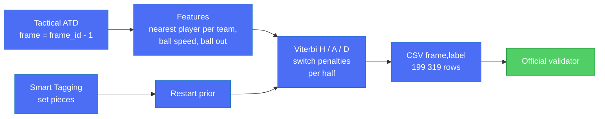
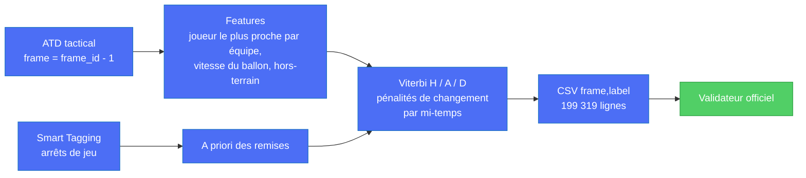

# Arena — More than a Hack 2027, Phase 1: ball possession

Team **CulersFromSN**. For every frame of FC Barcelona vs Athletic Club, the pipeline outputs who has the ball (`H` / `A`), dead ball (`D`) or abstention (`X`), from the automatic tracking data (ATD).

[English](#english) | [Français](#français)

---

## English

- [Problem](#-problem)
- [Method](#-method)
- [Data used and compliance](#-data-used-and-compliance)
- [Results (external data only)](#-results-external-data-only)
- [Reproduction](#-reproduction)
- [Repository layout](#-repository-layout)
- [Documentation](#-documentation)

### 🎯 Problem

The match has 199 319 frames at 25 fps. The challenge (Metrica Sports, FC Barcelona Barça Innovation Hub, Mobile World Capital Barcelona) asks for one label per frame: `H` (home team has the ball), `A` (away team), `D` (dead ball) or `X` (abstain). The only graded deliverable is a CSV `frame,label`, ranked by spellF1. spellF1 matches whole possessions by temporal overlap, so a flicker that splits one possession in two can lose both matches. The method is therefore built to avoid fragmenting possessions. macroF1 breaks ties.

### ⚙️ Method

No model is trained. The tactical ATD is the main input. Each half is decoded on its own.

- ✅ **Nearest-player evidence** - the score of each team is the distance from the ball to its nearest tracked player (capped at 15 m). It is ignored when the ball moves faster than 15 m/s (ball in flight, speed computed from positions).
- ✅ **Viterbi H / A / D** - a decoder with switch penalties (H to A: 1 s of evidence; into or out of D: 2 s). A change of state happens only if sustained evidence pays for it.
- ✅ **Missing ball carries the state** - when the ball is not tracked (NaN), there is no evidence and the current state continues.
- ✅ **Ball out = dead** - ball more than 1 m outside the lines favours `D`.
- ✅ **Smart Tagging restart prior** - each set piece adds a `D` bonus before the restart (10 s) and a bonus for the tagged team after it (2 s).
- ❌ **Smart Tagging phase prior** - implemented and tested, **disabled** (`phase_team_bonus = 0`): mixed results on external data.
- ℹ️ **Homography** - used as an input check only (`loader.check_homography`). The decoder works in pitch metres.
- ❌ **Videos and broadcast data** - not used.

Parameters are in `arena/config.py`. Inside the graded halves the output is `H`, `A` or `D`; `X` is written outside them.



### 📦 Data used and compliance

- **Inputs**: the provided match assets (tactical ATD, Smart Tagging, homography check). They are never in this repository.
- **Tuning**: external data only. Metrica Sports sample data, https://github.com/metrica-sports/sample-data (pinned commit `e706dd5`), used for tuning only. Attribution: *Metrica Sports sample data, https://github.com/metrica-sports/sample-data*.
- **Compliance**: nothing was tuned on the match, on its public ground truth or on its video. No match data, video or frame-by-frame export is committed. The pipeline runs locally, with no remote service. No random draw on the match path.

### 📊 Results (external data only)

Official spellF1 on **Metrica sample games** (external data, not the competition match). These are tuning figures, not a score on the competition match.

| spellF1 (official scorer) | Metrica game 1 | Metrica game 2 |
|---|---|---|
| Official baseline (majority vote) | 0.307 | 0.317 |
| Submitted parameters | 0.435 | 0.409 |

Details and limits: [docs/TECHNICAL_REPORT.md](docs/TECHNICAL_REPORT.md), [docs/TUNING.md](docs/TUNING.md).

### 🔁 Reproduction

1. Python 3.11, virtual environment, pinned dependencies:

   ```bash
   python3.11 -m venv .venv
   .venv/bin/python -m pip install -r requirements.txt
   ```

   On Windows: `py -3.11 -m venv .venv` then `.\.venv\Scripts\python.exe -m pip install -r requirements.txt`.
2. Clone the official repository as a sibling: `../more-than-a-hack-2027` (or set `MTAH_OFFICIAL_DIR`). Its code is imported from disk, never copied.
3. Unpack the match data into its `data/` folder (or set `MTAH_DATA_DIR`). They are not in this repository.
4. Regenerate the submission and validate it with the official validator:

   ```bash
   python scripts/make_submission.py --name CulersFromSN
   ```

   This writes `submissions/CulersFromSN.csv` (ignored by Git), prints aggregates and a SHA-256 prefix, and exits with the validator's exit code. The file is byte-identical on every run.
5. Tests (synthetic data only):

   ```bash
   python -m pytest -q tests
   ```

6. Re-run the tuning (external data, git required; `ARENA_EXTERNAL_DIR` changes the folder, default `external/sample-data`):

   ```bash
   python scripts/get_external.py
   python scripts/tune_external.py
   python scripts/tune_stage3.py
   python scripts/robustness_external.py
   ```

   Tuning writes into `tuning/` and does not change `arena/config.py`: its values are copied by hand.

### 🗂️ Repository layout

```text
arena/      pipeline code: loader, features, priors, decode (Viterbi), pipeline, config, official, external_metrica
scripts/    make_submission, get_external, tune_external, tune_stage3, robustness_external
tests/      synthetic unit tests
tuning/     tuning outputs (results, stage3, robustness) as JSON
docs/       technical report, tuning notes, architecture, decisions, workflow
.claude/    development tooling only (agent definitions), not part of the pipeline
```

### 📚 Documentation

- [docs/TECHNICAL_REPORT.md](docs/TECHNICAL_REPORT.md) - approach, data, results, limits.
- [docs/TUNING.md](docs/TUNING.md) - how the parameters were chosen on external data.
- [docs/DEV_WORKFLOW.md](docs/DEV_WORKFLOW.md) - commands and environment variables.
- Other notes in `docs/`: architecture, decisions, known issues, business rules.

[Back to top](#arena--more-than-a-hack-2027-phase-1-ball-possession)

---

## Français

- [Problème](#-problème)
- [Méthode](#-méthode)
- [Données utilisées et conformité](#-données-utilisées-et-conformité)
- [Résultats (données externes uniquement)](#-résultats-données-externes-uniquement)
- [Reproduction](#-reproduction-1)
- [Structure du dépôt](#-structure-du-dépôt)
- [Documentation](#-documentation-1)

### 🎯 Problème

Le match compte 199 319 frames à 25 fps. Le défi (Metrica Sports, FC Barcelona Barça Innovation Hub, Mobile World Capital Barcelona) demande un label par frame : `H` (l'équipe à domicile a le ballon), `A` (équipe extérieure), `D` (ballon mort) ou `X` (abstention). Le seul livrable noté est un CSV `frame,label`, classé au spellF1. Le spellF1 apparie des possessions entières par recouvrement temporel : un scintillement qui coupe une possession en deux peut faire perdre les deux appariements. La méthode est donc conçue pour ne pas fragmenter les possessions. Le macroF1 départage les ex æquo.

### ⚙️ Méthode

Aucun modèle n'est entraîné. L'ATD tactical est l'entrée principale. Chaque mi-temps est décodée séparément.

- ✅ **Indice du joueur le plus proche** - le score de chaque équipe est la distance entre le ballon et son joueur suivi le plus proche (plafonnée à 15 m). Il est ignoré quand le ballon va plus vite que 15 m/s (ballon en vol, vitesse calculée à partir des positions).
- ✅ **Viterbi H / A / D** - décodeur avec pénalités de changement (H vers A : 1 s d'indices ; entrée ou sortie de D : 2 s). Un changement d'état n'a lieu que si des indices soutenus le justifient.
- ✅ **Ballon manquant : l'état continue** - quand le ballon n'est pas suivi (NaN), il n'y a aucun indice et l'état courant se poursuit.
- ✅ **Ballon sorti = mort** - un ballon à plus de 1 m hors des lignes favorise `D`.
- ✅ **A priori des remises en jeu (Smart Tagging)** - chaque arrêt de jeu ajoute un bonus `D` avant la remise (10 s) et un bonus pour l'équipe taguée après (2 s).
- ❌ **A priori des phases Smart Tagging** - implémenté et testé, **désactivé** (`phase_team_bonus = 0`) : résultats mitigés sur données externes.
- ℹ️ **Homographie** - utilisée comme simple contrôle d'entrée (`loader.check_homography`). Le décodeur travaille en mètres sur le terrain.
- ❌ **Vidéos et données broadcast** - non utilisées.

Les paramètres sont dans `arena/config.py`. Dans les mi-temps notées la sortie est `H`, `A` ou `D` ; `X` est écrit en dehors.



### 📦 Données utilisées et conformité

- **Entrées** : les fichiers du match fournis (ATD tactical, Smart Tagging, contrôle d'homographie). Ils ne sont jamais dans ce dépôt.
- **Réglage** : données externes uniquement. Données d'exemple Metrica Sports, https://github.com/metrica-sports/sample-data (commit épinglé `e706dd5`), utilisées pour le réglage seulement. Attribution : *Metrica Sports sample data, https://github.com/metrica-sports/sample-data*.
- **Conformité** : rien n'a été réglé sur le match, sur sa vérité terrain publique ni sur sa vidéo. Aucune donnée du match, vidéo ou export frame par frame n'est commité. Le pipeline tourne en local, sans service distant. Aucun tirage aléatoire sur le chemin du match.

### 📊 Résultats (données externes uniquement)

spellF1 officiel sur les **matchs d'exemple Metrica** (données externes, pas le match du concours). Ce sont des chiffres de réglage, pas un score sur le match du concours.

| spellF1 (scoreur officiel) | Metrica match 1 | Metrica match 2 |
|---|---|---|
| Baseline officielle (vote majoritaire) | 0.307 | 0.317 |
| Paramètres soumis | 0.435 | 0.409 |

Détails et limites : [docs/TECHNICAL_REPORT.md](docs/TECHNICAL_REPORT.md), [docs/TUNING.md](docs/TUNING.md).

### 🔁 Reproduction

1. Python 3.11, environnement virtuel, dépendances figées :

   ```bash
   python3.11 -m venv .venv
   .venv/bin/python -m pip install -r requirements.txt
   ```

   Sous Windows : `py -3.11 -m venv .venv` puis `.\.venv\Scripts\python.exe -m pip install -r requirements.txt`.
2. Cloner le dépôt officiel à côté : `../more-than-a-hack-2027` (ou définir `MTAH_OFFICIAL_DIR`). Son code est importé depuis le disque, jamais copié.
3. Décompresser les données du match dans son dossier `data/` (ou définir `MTAH_DATA_DIR`). Elles ne sont pas dans ce dépôt.
4. Régénérer la soumission et la valider avec le validateur officiel :

   ```bash
   python scripts/make_submission.py --name CulersFromSN
   ```

   Cela écrit `submissions/CulersFromSN.csv` (ignoré par Git), affiche des agrégats et un préfixe SHA-256, et sort avec le code de sortie du validateur. Le fichier est identique octet pour octet à chaque exécution.
5. Tests (données synthétiques uniquement) :

   ```bash
   python -m pytest -q tests
   ```

6. Relancer le réglage (données externes, git requis ; `ARENA_EXTERNAL_DIR` change le dossier, par défaut `external/sample-data`) :

   ```bash
   python scripts/get_external.py
   python scripts/tune_external.py
   python scripts/tune_stage3.py
   python scripts/robustness_external.py
   ```

   Le réglage écrit dans `tuning/` et ne modifie pas `arena/config.py` : ses valeurs sont recopiées à la main.

### 🗂️ Structure du dépôt

```text
arena/      code du pipeline : loader, features, priors, decode (Viterbi), pipeline, config, official, external_metrica
scripts/    make_submission, get_external, tune_external, tune_stage3, robustness_external
tests/      tests unitaires synthétiques
tuning/     sorties du réglage (results, stage3, robustness) en JSON
docs/       rapport technique, notes de réglage, architecture, décisions, workflow
.claude/    outillage de développement uniquement (définitions d'agents), hors pipeline
```

### 📚 Documentation

- [docs/TECHNICAL_REPORT.md](docs/TECHNICAL_REPORT.md) - approche, données, résultats, limites.
- [docs/TUNING.md](docs/TUNING.md) - comment les paramètres ont été choisis sur données externes.
- [docs/DEV_WORKFLOW.md](docs/DEV_WORKFLOW.md) - commandes et variables d'environnement.
- Autres notes dans `docs/` : architecture, décisions, limites connues, règles métier.

[Retour en haut](#arena--more-than-a-hack-2027-phase-1-ball-possession)
