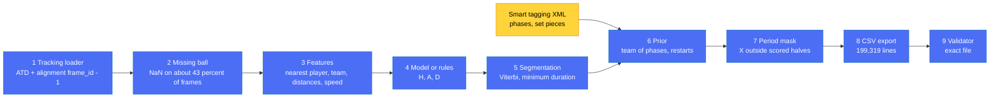
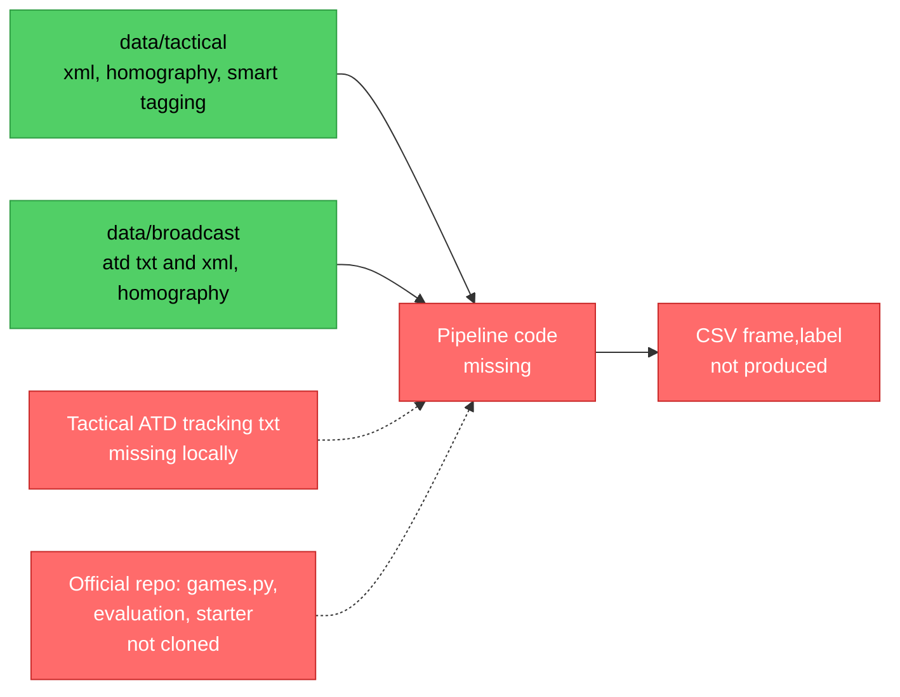
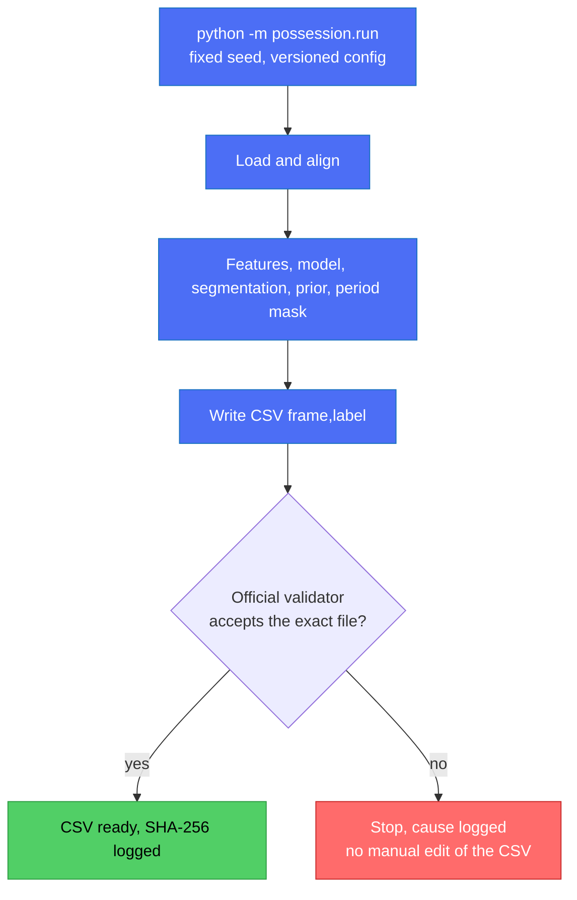
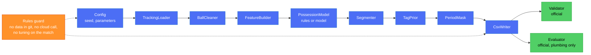
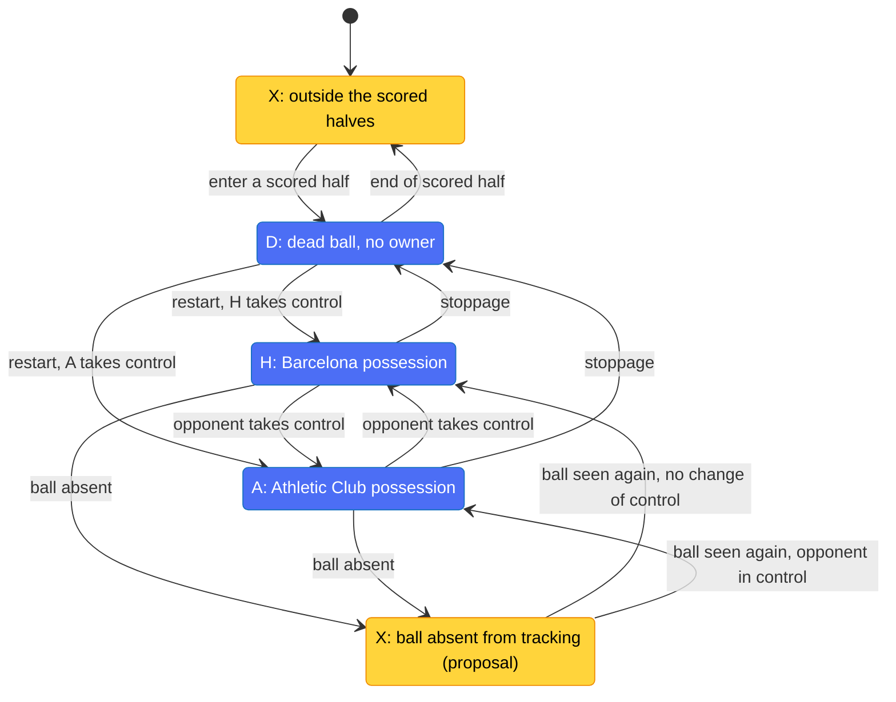
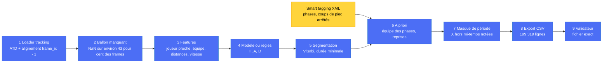
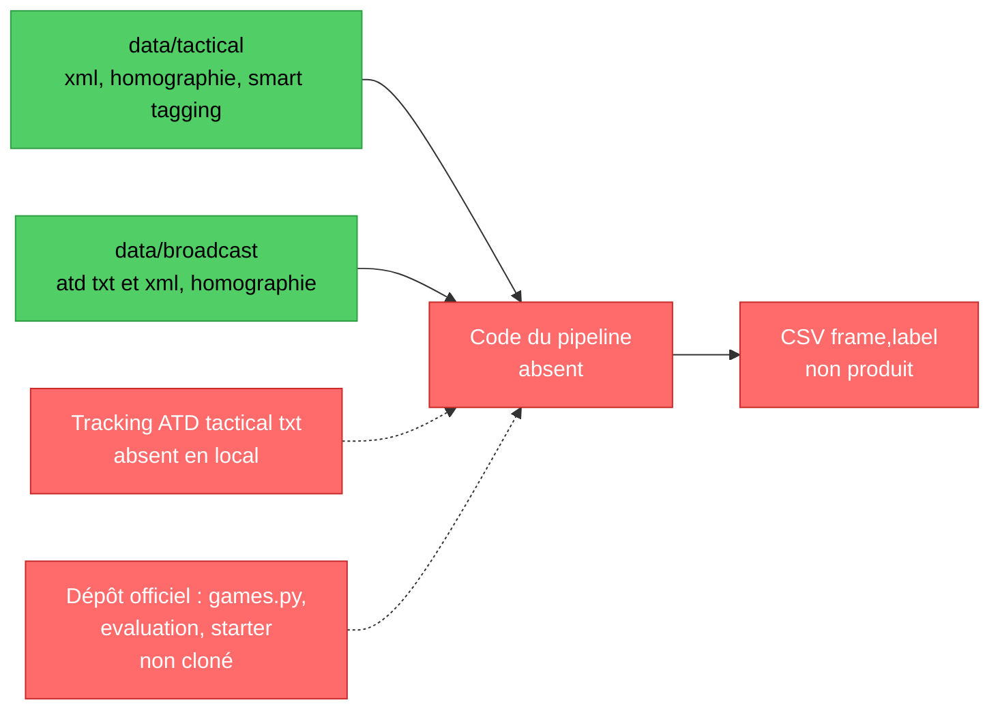
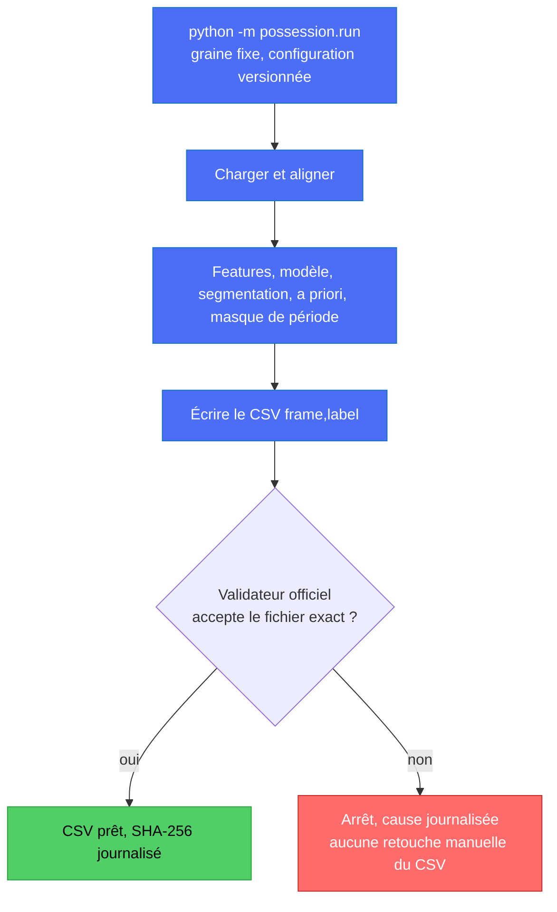
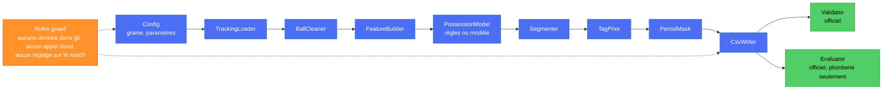
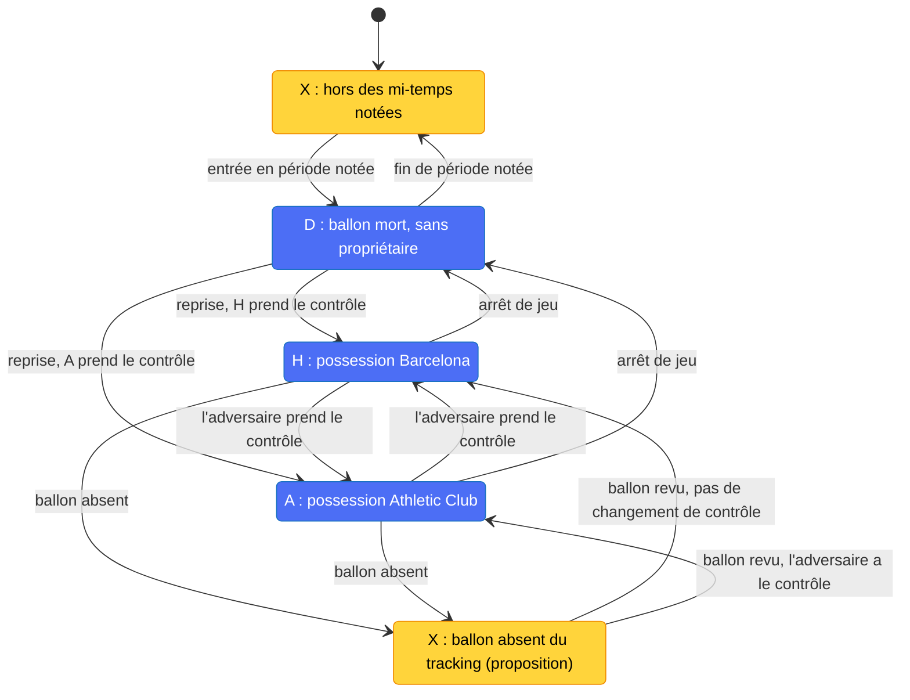

<a id="top"></a>

# ⚽ More than a Hack 2027 — Phase 1: ball possession

For every frame of FC Barcelona vs Athletic Club, say which team has the ball, or whether the ball is dead. / Pour chaque frame de FC Barcelona contre Athletic Club, dire quelle équipe a le ballon, ou si le ballon est mort.

[English](#english) | [Français](#français)

> **🎯 = target, not built yet.** At the date of this README (2026-11-07) **no application code exists** in this repository. It holds the challenge guide, the documentation, the Claude agent configuration and (locally, never committed) part of the match data. Everything described as "pipeline" below is a plan. / **🎯 = cible, pas encore réalisé.** À la date de ce README (2026-11-07), **aucun code applicatif n'existe** dans ce dépôt. Tout ce qui est décrit comme « pipeline » est un plan.

---

## English

### 📑 Table of contents

- [⚽ The challenge](#-the-challenge)
- [🔤 The four labels](#-the-four-labels)
- [📏 Scoring](#-scoring)
- [📦 The data](#-the-data)
- [🧠 Target approach](#-target-approach)
- [🧮 Worked example](#-worked-example)
- [✨ Features](#-features)
- [🔀 Data flow](#-data-flow)
- [🧱 Architecture](#-architecture)
- [📁 Project structure](#-project-structure)
- [🚫 Challenge rules](#-challenge-rules)
- [🚧 Status and missing files](#-status-and-missing-files)
- [🔁 How to reproduce](#-how-to-reproduce)
- [🧪 Testing and validation](#-testing-and-validation)
- [📚 Documentation index](#-documentation-index)
- [🤖 Claude workspace](#-claude-workspace)
- [📅 Calendar](#-calendar)
- [👥 Team](#-team)
- [🤝 Contributing, license, author](#-contributing-license-author)

---

### ⚽ The challenge

**One question per frame, one score.** The hackathon *More than a Hack 2027, Phase 1: ball possession* is organised by **Metrica Sports**, **FC Barcelona (Barça Innovation Hub)** and **Mobile World Capital Barcelona**, at the Talent Arena in Barcelona. Official repository: <https://github.com/metrica-sports/more-than-a-hack-2027>.

- **The match** - FC Barcelona (`H`, home) vs Athletic Club (`A`, away), LaLiga EA Sports 2024-25, matchday 2.
- **The size** - **199,319 frames** at 25 fps (about 2 h 15 of video), of which **158,857 are scored** (about 106 minutes of play).
- **The task** - for each frame, say which team has the ball, or that the ball is dead, from the automatic tracking data (ATD).
- **The output** - a CSV `frame,label` with exactly 199,319 lines. It is the only scored item.
- **100 % automatic scoring** - no jury, no pitch. In 2026 the edition was open and judged; in 2027 there is one question and one score.

- **File format** - header exactly `frame,label`, `frame` from 0 to 199318 in order, labels `H`, `A`, `D`, `X` (case tolerated), no empty cell, UTF-8, no index column.

```text
frame,label
<frame>,<label>
```

Why the strict format: a file of about 164,000 lines means the *broadcast* camera was indexed by mistake, and a one-line shift would silently move every label.

[⬆ Back to top](#top)

---

### 🔤 The four labels

| Label | Meaning |
|---|---|
| `H` | Barcelona has the ball, ball alive |
| `A` | Athletic Club has the ball, ball alive |
| `D` | dead ball (out of play, stoppage) |
| `X` | no answer (abstention) |

- **A dead ball has no owner.** When the ball is dead the answer is `D`, even if the tracking points to a team.
- **The ground truth has three states only:** `H`, `A`, `D`. No "contested", no "transition", no "unknown".
- **Possession rules:** while the ball is alive, one team always has possession. A possession changes when an opponent takes **control** of the ball. A loose or contested ball stays with the last team that had it. A mere touch, a pass deflection that does not intercept, or an aerial duel won without control behind it is **not** a change.
- **A possession is a maximal run of one team with the ball alive.** `H H H A A` is 2 possessions. `H H D D H H` is 2 possessions separated by a stoppage, not one. A dead ball is never a possession.

[⬆ Back to top](#top)

---

### 📏 Scoring

The ranking and the tie-break use two different views of the same labels.

- **spellF1 - ranking.** Every possession counts **as one object**, whatever its length. Predicted possessions are matched one-to-one with the true ones by temporal IoU (overlap in time), then the F1 is averaged over the IoU thresholds 0.3 / 0.4 / 0.5 / 0.6 / 0.7. A constant or random prediction scores 0. A gap smaller than 0.04 is noise on the full match.
- **macroF1 - tie-break.** Mean of the F1 of `H`, `A` and `D` over the scored frames, frame by frame. The floor is about 0.16, not 0. A gap smaller than 0.01 is noise.
- **Threshold to beat: spellF1 0.2433** on the full match (the organisers' `smooth50` baseline).
- **How `X` is counted.** In macroF1 an `X` on a scored frame is an error. In spellF1 each `X` is replaced by your last non-`X` label of the same half (the next one at the start of a half). In the middle of a possession `X` is free, and safer than a guess that would cut the possession in two. At a transition, give a label, otherwise the old label continues after the change.
- **Timing matters.** A delay of 1 frame is free (1.0000), 3 frames give 0.98, 8 frames 0.89, **1 second 0.65**.

**Why possessions must not be fragmented.** Because a possession is one object, a model that flips its label frame by frame creates many tiny false possessions and loses a lot. The aim is not frame-by-frame accuracy but long, correctly placed possessions.

The organisers' four baselines (same algorithm: nearest tracked player to the ball, then a majority vote over a window; only the window changes). Figures published in `ARENA.md`, measured by the organisers:

| Baseline | macroF1 (match) | spellF1 (match) | spellF1 (public 5 min) |
|---|---|---|---|
| raw | 0.6532 | 0.0486 | 0.0378 |
| smooth25 | 0.6752 | 0.1996 | 0.2868 |
| smooth50 | 0.6724 | **0.2433** | 0.3256 |
| smooth125 | 0.6356 | 0.2242 | 0.4242 |

**Trap.** `smooth125` looks best on the public 5 minutes and is worse than `smooth50` on the full match. One missed possession costs about 6 points on that window. The public window is a **plumbing check** only; it never picks a parameter (see [Challenge rules](#-challenge-rules)).

The exact metric definition is `evaluation/possession_metrics.py` in the official repository. If the documentation and the code disagree, **the code wins**.

[⬆ Back to top](#top)

---

### 📦 The data

The match data are **never** in this repository: `data/` is ignored by git, and committing data, publishing frame-by-frame exports or video excerpts is forbidden. This section only **describes** them.

**Two cameras.**

| | tactical (the reference) | broadcast (optional) |
|---|---|---|
| role | line *i* of the submission is frame *i* of this video | **not synchronised** with the tactical |
| tracking records (ATD) | 199,319 | 164,488 |
| usable homography | 100 % | 65.8 % |
| tracking slots | 46 | 51 |
| ball visible | 56.9 % of frames | 50.5 % |

**Expected files** (under `data/`, or under the folder pointed to by the environment variable `MTAH_DATA_DIR`):

- `tactical/` - the video, the ATD metadata (`.xml`), the ATD tracking (`.txt`), the homography (`.csv`) and the smart tagging (`.xml`), all named `BAR-ATH_tactical…`.
- `broadcast/` - the video, the ATD metadata, the ATD tracking and the homography, named `BAR-ATH_broadcast…`.

**What the tracking is.**

- **ATD** - automatic tracking in FIFA/EPTS format (a metadata XML and a raw TXT). Per frame: `x, y, speed` for 46 slots, then `x, y, speed` of the ball. It contains **neither the ball owner nor the alive/dead state**: we must infer them.
- **Normalised coordinates** between 0 and 1. For metres, multiply by 105.3 x 68.0.
- **No player identity.** 46 slots "Track 1…46" for 22 players. They appear, disappear and swap identities. Only the **team** of each slot is known. About 20.5 tracked objects per scored frame.
- **The ball is missing (`NaN`) on 43 % of frames, and on 41 % of scored frames**, mostly in key moments: crowded box, aerial duels, tackles. Plan for it from day one.
- **Smart tagging** - automatic tactical annotation (not a ground truth): 638 phases or set pieces. Each phase carries a team (except `N/A`, which includes all throw-ins), and each set piece marks a restart, hence the end of a dead ball. **Intervals are phases, not possessions**: copying them as they are would import their errors. A free, strong **prior**.
- **Homography** - a 3x3 matrix per frame from normalised pitch coordinates to pixels. Check the `valid` column.

**Frame alignment.**

| Source | Index | Row of the submission |
|---|---|---|
| submission | `0 … 199318` | - |
| ATD | `frame_id` `1 … 199319` | `frame = frame_id - 1` |
| smart tagging | seconds | `frame = round(seconds * 25)` |
| homography | `0 … 199318` | identical |

**Scored periods.** Frames 11,185 to 90,651 (1st half) and 110,808 to 190,197 (2nd half). Everything else is `X`. The 2nd half is scored from frame 110,808 but kicks off later: the **2,934 frames** in between are all `D`. The pipeline must find this by detection, not by a hard-coded frame number.

**Public ground truth.** The first 5 minutes of the 1st half (frames 11,185 to 18,684) are published by the organisers, in the official repository, not here. They serve only to check that the pipeline runs.

[⬆ Back to top](#top)

---

### 🧠 Target approach

> **🎯 Nothing below is implemented.** It is the plan of `docs/ARCHITECTURE.md`. The choice between plain rules and an HMM/Viterbi segmentation is still **open** (decision D-002 in `docs/DECISIONS.md`); no parameter value is fixed.

The pipeline, in order:

1. **Load the tracking and align the frames** 🎯 - read the tactical ATD (and the homography), apply `frame = frame_id - 1`, convert the smart tagging to frames.
2. **Handle the missing ball** 🎯 - about 43 % of frames have no ball (`NaN`). Short gaps could be interpolated; long gaps in the middle of a possession become `X` (free in spellF1). Never an invented value without a trace: every gap is counted and logged.
3. **Features** 🎯 - the tracked player nearest to the ball and its **team** (not its identity, which is unknown), distances, ball speed, ball off the pitch.
4. **Model or rules** 🎯 - a state sequence `H` / `A` / `D` with a minimum control duration and a dead-ball detection (ball out of the pitch, still ball, players regrouped).
5. **Segmentation** 🎯 - smooth the scores into whole possessions, with a penalty for changing label, so that possessions are not fragmented (planned form: HMM/Viterbi, D-002 open).
6. **Smart tagging as a prior** 🎯 - team of each phase and restart after each set piece, without copying the phase intervals as possessions.
7. **Period mask** 🎯 - `X` outside the two scored halves.
8. **CSV export** 🎯 - `frame,label`, 199,319 lines, fixed seed, same file byte for byte on every run.
9. **Validator** 🎯 - the official `validate_submission.py` on the **exact** file that will be sent.



*Target pipeline. Every blue node is 🎯 (not built). Yellow is an input file.*

Tuning rule that shapes the whole design: **every parameter (window, penalty, minimum duration, filled gap) is tuned only on external data from other matches, with a checked licence, never on this match.** Candidate external datasets are listed, unvalidated, in decision D-007. Fallback if none is usable: each value fixed by a documented principle, without optimisation.

[⬆ Back to top](#top)

---

### 🧮 Worked example

Synthetic data made up for this README. **None of it comes from the match.** Each number below was recomputed by hand.

**1. Alignment.** The first ATD row has `frame_id = 1`, so it is submission row `1 - 1 = 0`. The last, `frame_id = 199319`, is row `199318`. A smart-tagging mark at `0.2 s` falls on frame `round(0.2 * 25) = 5`.

**2. Nearest tracked player.** One frame, normalised coordinates, pitch 105.3 m x 68.0 m:

| Object | Team | x, y (normalised) | x, y (metres) |
|---|---|---|---|
| ball | - | 0.500, 0.500 | 52.65, 34.00 |
| slot P | H | 0.520, 0.500 | 54.756, 34.00 |
| slot Q | A | 0.560, 0.520 | 58.968, 35.36 |

- Distance ball to P: dx = 2.106 m, dy = 0, so **2.106 m**.
- Distance ball to Q: dx = 6.318 m, dy = 1.36 m, so sqrt(39.917 + 1.850) = sqrt(41.767) = **6.463 m**.
- The nearest slot is P, so the raw vote of this frame is `H`.

**3. From a noisy vote to possessions.** Twelve synthetic frames. The "minimum control duration" below is an **illustrative value of 3 frames**, not a chosen parameter.

| Step | Sequence | Possessions |
|---|---|---|
| raw nearest-team vote | `H H H A H H H H A A A A` | 4 (3 + 1 + 4 + 4 = 12 frames) |
| after the minimum duration (the 1-frame `A` is absorbed) | `H H H H H H H H A A A A` | 2 (8 + 4 = 12 frames) |

**4. Stoppages and abstention** (the rules the scorer applies):

| Sequence | What the scorer sees | Possessions |
|---|---|---|
| `H H D D H H` | `D` is not a possession and separates the two `H` runs | 2 |
| `H H X X H H` (ball lost mid-possession) | each `X` becomes the last non-`X` label: `H H H H H H` | 1 |
| `H H A A H H` (a wrong guess in the same gap) | nothing to replace | 3 |

Lesson: an honest `X` in the middle of a possession protects it; a wrong guess splits it.

[⬆ Back to top](#top)

---

### ✨ Features

**Implemented (✅): none yet.** No code exists. Per `docs/KNOWN_ISSUES.md` this is a status of the files, the rules and the environment, not a list of bugs.

#### 🎯 Roadmap / target

All lines below are **planned**, not done (`docs/ROADMAP_NEXT_STEPS.md`, `docs/REQUIREMENTS.md`).

- 🎯 Tracking loader with frame alignment `frame_id - 1`, scored periods, smart tagging converted to frames
- 🎯 Explicit handling of the missing ball, counted and logged, never a silent fill
- 🎯 Features: nearest tracked player and its team, distances, ball speed, ball off the pitch
- 🎯 Possession state sequence `H` / `A` / `D` with a minimum control duration
- 🎯 Dead-ball detection from the data (including the long dead block at the start of the 2nd half, found by detection)
- 🎯 Segmentation into whole possessions with a change penalty (D-002 open: rules or HMM/Viterbi)
- 🎯 Smart tagging used as a prior (team of phases, restarts), without copying intervals
- 🎯 CSV export `frame,label`, fixed seed, identical on every run
- 🎯 Validation of the exact file with the official validator; scoring with the official scorer
- 🎯 Automatic checks of the challenge rules (no data in git, no cloud call, determinism)
- 🎯 Local debug visualisations that help **understand** possessions, without checking results against the video

[⬆ Back to top](#top)

---

### 🔀 Data flow

**Today.** There is no pipeline: only inputs and documents exist, and the official tools are not cloned.



*Green: present locally (never committed). Red: missing.*

**Target.** The full flow is the diagram of [Target approach](#-target-approach). The runtime flow of one run adds the checks and the stop condition:



*Target (🎯), not built.*

[⬆ Back to top](#top)

---

### 🧱 Architecture

**Target components** (indicative names, from `docs/ARCHITECTURE.md`; none exists). One responsibility each:

- **Config** - versioned parameters, seed, data paths.
- **TrackingLoader** - reads the ATD and the homography, aligns frames.
- **BallCleaner** - rule for the frames without a ball.
- **FeatureBuilder** - nearest player and team, speed, off-pitch.
- **PossessionModel** - scores `H`, `A`, `D` per frame.
- **Segmenter** - smoothing, minimum duration, change penalty.
- **TagPrior** - smart tagging as a prior.
- **PeriodMask** - `X` outside the scored halves.
- **CsvWriter** - writes `frame,label`.
- **Validator** and **Evaluator** - official tools (not rewritten); the evaluator is a plumbing test only.
- **Rules guard** - checks the challenge rules.



*Target (🎯), not built. The rules guard exists today only as a Claude agent (`rules-guard`).*

**State of one frame** (from `docs/BUSINESS_RULES.md`). `X` has two causes: outside the scored halves, or a ball lost in the middle of a possession (a proposal, BR-10).



[⬆ Back to top](#top)

---

### 📁 Project structure

Listing of what exists (checked on 2026-11-07), then what is planned.

**Exists:**

- `README.md` - this file.
- `ARENA.md` - the full challenge guide (in French). Its section "Clarification des organisateurs" **takes precedence** over the rest.
- `CLAUDE.md` - working rules for the repository and the agents.
- `.gitignore` - ignores `data/`, videos, `evaluation/results/*`, logs, Python caches and virtual environments.
- `docs/` - 10 bilingual documents (see the [documentation index](#-documentation-index)).
- `.claude/` - `CLAUDE2.md` (data paths, reproducibility, challenge rules), `agents/` (18 agent files) and `skills/`.
- `data/` - the match data, **local only, ignored by git, never committed**. Incomplete (see [Status](#-status-and-missing-files)).

**Planned (🎯), not created:**

- `possession/` - the pipeline package, with the entry point `python -m possession.run`. Indicative name.
- `tests/` - tests on synthetic cases, never on the real match frames.
- `requirements.txt` - frozen versions.
- `evaluation/`, `starter/`, `games.py` - the organisers' official tools, to be cloned from the official repository (licence to check before copying them into a public repository).

**Technologies chosen** (decision D-001, `ACCEPTED`): **Python, 3.9 minimum**; **numpy** and **pandas** for computation; **kloppy** to read the ATD (as in the organisers' starter code); a virtual environment and a frozen dependency file. Local execution, files only, no database, no remote service.

**Not decided:** rules versus HMM/Viterbi (D-002 `OPEN`), the test framework and linter (pytest and ruff appear in `docs/DEV_WORKFLOW.md` only as targets), whether `kloppy` or a direct reader is used, the exact Python version to freeze.

[⬆ Back to top](#top)

---

### 🚫 Challenge rules

Full text: `ARENA.md` section 7 and `docs/BUSINESS_RULES.md` (BR-13 to BR-31). **The organisers' clarification email takes precedence** over the guide, earlier emails and individual answers. When in doubt, the strictest reading applies, and you **open an issue before building**.

**Forbidden**

- 🚫 **Checking the output against the video.** Watching the video to *understand* what counts as possession is fine; watching it to *verify or fix* results is not.
- 🚫 **Hand-labelling this match**, in any quantity, for any use (submission, training, validation). Also forbidden: hand-correcting the tracking or the algorithm's output, and rules or constants tied to specific frames of the match.
- 🚫 **Training, adjusting or calibrating on the ground truth or on the provided video**, including the public 5 minutes. Tune **only on external data**.
- 🚫 **Using the private ground truth** or any human data about this match (Opta, StatsBomb, Wyscout, LaLiga, corrected tracking, and so on).
- 🚫 **Sending the data or the video to an AI service** hosted in the cloud (ChatGPT, Claude, Gemini…). A local model is allowed.
- 🚫 **Redistributing the data**: committing it, publishing frame-by-frame exports or video excerpts.
- 🚫 **Submitting a file the repository cannot regenerate identically.**
- 🚫 Using a private or non-shareable model without asking first.

**Allowed**

- ✅ Any method, as long as the organisers can inspect it and the technical document explains it.
- ✅ Automatic checks that use only the provided data (CSV validity, row count, alignment, determinism).
- ✅ Video, ATD, smart tagging or any generated data as **input**, as long as the algorithm was not trained on the ground truth or the provided video.
- ✅ Intermediate step files; a local model; your own tracking improvements; unsupervised methods and algorithm-made pseudo-labels.
- ✅ Any external dataset you have the right to use (licence checked, source and quantity documented).

[⬆ Back to top](#top)

---

### 🚧 Status and missing files

Source of truth: `docs/KNOWN_ISSUES.md` and `docs/ROADMAP_NEXT_STEPS.md`. State on 2026-11-07:

- 🔴 **Main tracking file missing** - `BAR-ATH_tactical_atd.txt` is not in `data/tactical/` (the metadata, homography and smart tagging are). Blocking. Re-download it; **never substitute the broadcast file**, it is not synchronised.
- 🔴 **Video files missing** - both `.mp4` files. Not needed to produce the CSV.
- 🔴 **Official repository not cloned** - `games.py`, `evaluation/` (scorer, validator, metrics, public ground truth) and `starter/` are not at the repository root. Without them there is no local score and no validation of the exact file.
- 🔴 **Environment not ready** - Python 3.13 is installed on the dev machine but not on the PATH, `kloppy` is not installed, no virtual environment, no frozen dependency file.
- 🎯 **No pipeline code** - loader, ball handling, features, rules/segmentation, export, tests: all to write.
- 🎯 **Technical document and public repository** - not started.
- 🎯 **Submission** - not done.

Known traps to design around: the ball is missing on 41 % of scored frames; the 46 slots have no identity; the public 5 minutes mislead if used for tuning; the 2,934-frame dead block in the 2nd half; the `frame_id - 1` shift. See `docs/KNOWN_ISSUES.md` for each one (10 entries).

No score of our own has been measured. Any future score on the public 5 minutes will be a plumbing check, not a performance claim.

[⬆ Back to top](#top)

---

### 🔁 How to reproduce

> **🎯 None of these steps works today.** They are the targets of `docs/DEV_WORKFLOW.md`. Step 1 onward must be validated once the pieces exist. Never invent a result.

Python 3.9 minimum (D-001); 3.13 is what is installed on the dev machine, and the exact version will be frozen in `requirements.txt`.

1. **Clone the team repository** (public, without `data/`). 🎯
2. **Create the virtual environment and install the frozen dependencies.** 🎯 While Python is not on the PATH, use its full path (placeholder below):

   ```bash
   <path-to-python-3.13>/python -m venv .venv
   .venv/Scripts/python.exe -m pip install -r requirements.txt
   ```

   `requirements.txt` does not exist yet and must pin exact versions.
3. **Put the match data in `data/`** at the repository root, or set the environment variable `MTAH_DATA_DIR` to the folder that holds them (same name as in the official `games.py`). Layout in [The data](#-the-data). Never commit them.
4. **Get the official tools** - clone <https://github.com/metrica-sports/more-than-a-hack-2027> next to this repository, or copy its code after checking the licence (open decision). 🎯
5. **Regenerate the CSV with the single entry point:** 🎯

   ```bash
   python -m possession.run
   ```

   This is the **one command that must regenerate the exact same CSV**, byte for byte, from the data alone, with a fixed seed. The package and its arguments are not written yet.
6. **Validate the exact file** and check that a second run gives the same SHA-256 (see [Testing and validation](#-testing-and-validation)). 🎯

The CSV itself is never committed (it is a frame-by-frame export): the repository must be able to regenerate it (D-004).

[⬆ Back to top](#top)

---

### 🧪 Testing and validation

Everything here is a target; the official tools come from the official repository and are not present yet.

```bash
python evaluation/run_evaluation.py                      # score the 4 baselines
python evaluation/run_evaluation.py --bootstrap 1000     # is a gap real?
python evaluation/validate_submission.py <team_name>.csv # exact file to send
python -m pytest                                         # our tests (pytest not decided)
```

- **Validator** - `validate_submission.py` checks the header, the 199,319 lines, the labels and the empty cells. Run it on **the exact file** you send; there is no live leaderboard and no feedback.
- **Scorer** - `run_evaluation.py` is the same scorer as the organisers'. Use it to check that the pipeline runs and the score is plausible. Use `--bootstrap 1000` to know whether a gap is real. Rule of thumb: spellF1 gaps under 0.04 are noise on the full match.
- **Plumbing only.** The public 5 minutes never choose a parameter (D-006).
- **Our tests** (planned in `docs/TESTING.md`): loader and alignment on synthetic cases, CSV validation, property tests on possessions, determinism (same SHA-256 on two runs), challenge-rules checks, log markers `[START]` `[ENTITY]` `[CALL]` `[RESULT]` `[STATE]`.

[⬆ Back to top](#top)

---

### 📚 Documentation index

Every document in `docs/` is written in French first, then English.

| Document | Role |
|---|---|
| [REQUIREMENTS.md](docs/REQUIREMENTS.md) | functional and non-functional requirements, scope, risks, open questions |
| [DOMAIN_NOTES.md](docs/DOMAIN_NOTES.md) | vocabulary: possession, dead ball, alignment, scored periods, scoring |
| [BUSINESS_RULES.md](docs/BUSINESS_RULES.md) | possession rules (BR-01 to BR-12) and competition rules (BR-13 to BR-31) |
| [ARCHITECTURE.md](docs/ARCHITECTURE.md) | target pipeline, components, who decides each label, actual state |
| [DECISIONS.md](docs/DECISIONS.md) | decisions D-001 to D-007 with status |
| [KNOWN_ISSUES.md](docs/KNOWN_ISSUES.md) | limits found on files, rules and environment |
| [LESSONS_LEARNED.md](docs/LESSONS_LEARNED.md) | root causes and rules to remember |
| [TESTING.md](docs/TESTING.md) | testing strategy and completion criteria |
| [DEV_WORKFLOW.md](docs/DEV_WORKFLOW.md) | commands, environments, how to submit |
| [ROADMAP_NEXT_STEPS.md](docs/ROADMAP_NEXT_STEPS.md) | state, milestones, decisions to make, ideas |

Also at the root: [ARENA.md](ARENA.md) (challenge guide, French) and [CLAUDE.md](CLAUDE.md) (working rules).

[⬆ Back to top](#top)

---

### 🤖 Claude workspace

How the work is organised with Claude Code:

- **`CLAUDE.md`** - the non-negotiable workflow: plan first, delegate with intent, verify, respect the challenge rules before any optimisation, capture knowledge.
- **`.claude/CLAUDE2.md`** - data paths (`MTAH_DATA_DIR`), reproducibility, the challenge rules and the optional run modes (target).
- **`.claude/agents/`** - 18 agent files (the folder is ignored by git, so these paths are not links):
  - **Exploration and review** - `repo-explorer`, `pipeline-analyst`, `code-reviewer`, `test-impact`, `debugger`.
  - **Delivery** - `implementer`, `commit-planner`, `pr-describer`, `knowledge-curator`, `docs-writer`, `readme-writer`, `web-scraper`.
  - **Guard** - `rules-guard`: to be used before any commit, push, network call, new dependency or use of the ground truth.
  - **Domain agents `feat-*`** (in `.claude/agents/feat/`) - `feat-tracking-io`, `feat-possession-model`, `feat-evaluation`, `feat-rules-compliance`, `feat-viz-debug`.
- **Match data and agents** - no content of the match (frames, tracking, excerpts, video) goes into a request to an external service.

[⬆ Back to top](#top)

---

### 📅 Calendar

| Milestone | Date |
|---|---|
| registrations open | 1 October 2026 |
| data published | 20 October 2026 |
| **submission deadline** | **17 November 2026** |
| results | before 26 November 2026 |

**Three deliverables:** (1) the **CSV**, the only scored item, named `<team_name>.csv`; (2) a **public code repository** with source, frozen dependencies, instructions and the command that regenerates the exact same file, **without the match data**; (3) a **short technical document** (PDF or MD, a few pages) named `<team_name>.pdf`, covering the approach and why, data used and abandoned, training data (source, annotator, quantity; nothing on this match), the possession rules implemented, handling of missing tracking, limits, and how to reproduce.

Submission goes through a Google Form (link sent by e-mail to registered teams, Google account required). One answer per team, editable; the last one before the deadline counts. The organisers may re-run the winner's repository to check it. Proposed internal milestones are in `docs/ROADMAP_NEXT_STEPS.md` (proposals, not facts).

[⬆ Back to top](#top)

---

### 👥 Team

**3 to 5 members.** With fewer than 3, a team is not eligible for the Innovation Challenge or the Final Pitch. Team name: `<team_name>` (placeholder, to be filled in).

[⬆ Back to top](#top)

---

### 🤝 Contributing, license, author

- **Contributing** - read `CLAUDE.md` and the [challenge rules](#-challenge-rules) first. Before a commit: `git status` lists no file from `data/`, no video, no CSV or frame-by-frame export; no secret in the diff; documentation updated in French and English in the same change; any change that touches the use of the ground truth, tuning data or a challenge rule goes through the `rules-guard` agent. Never use `git add .` or `git add -A`. Never present a model, library or parameter as chosen unless `docs/DECISIONS.md` says so. In case of doubt about a rule, open an issue on the official repository **before** building.
- **License** - none chosen yet; there is no `LICENSE` file. The licence of the official code and of any external dataset must be checked before they are copied or used in the public repository (open decision).
- **Author** - `<team_name>`, a team of 3 to 5 members (placeholder). Challenge by Metrica Sports, FC Barcelona (Barça Innovation Hub) and Mobile World Capital Barcelona.

[⬆ Back to top](#top)

---

## Français

### 📑 Table des matières

- [⚽ Le défi](#-le-défi)
- [🔤 Les quatre étiquettes](#-les-quatre-étiquettes)
- [📏 Notation](#-notation)
- [📦 Les données](#-les-données)
- [🧠 Approche cible](#-approche-cible)
- [🧮 Exemple travaillé](#-exemple-travaillé)
- [✨ Fonctionnalités](#-fonctionnalités)
- [🔀 Flux de données](#-flux-de-données)
- [🧱 Architecture du pipeline](#-architecture-du-pipeline)
- [📁 Structure du projet](#-structure-du-projet)
- [🚫 Règles du défi](#-règles-du-défi)
- [🚧 Avancement et fichiers manquants](#-avancement-et-fichiers-manquants)
- [🔁 Comment reproduire](#-comment-reproduire)
- [🧪 Tests et validation](#-tests-et-validation)
- [📚 Index de la documentation](#-index-de-la-documentation)
- [🤖 Espace de travail Claude](#-espace-de-travail-claude)
- [📅 Calendrier](#-calendrier)
- [👥 Équipe](#-équipe)
- [🤝 Contribuer, licence, auteur](#-contribuer-licence-auteur)

---

### ⚽ Le défi

**Une question par frame, un seul score.** Le hackathon *More than a Hack 2027, Phase 1 : possession du ballon* est organisé par **Metrica Sports**, le **FC Barcelona (Barça Innovation Hub)** et **Mobile World Capital Barcelona**, au Talent Arena de Barcelone. Dépôt officiel : <https://github.com/metrica-sports/more-than-a-hack-2027>.

- **Le match** - FC Barcelona (`H`, domicile) contre Athletic Club (`A`, extérieur), LaLiga EA Sports 2024-25, journée 2.
- **La taille** - **199 319 frames** à 25 fps (environ 2 h 15 de vidéo), dont **158 857 notées** (environ 106 minutes de jeu).
- **La tâche** - pour chaque frame, dire quelle équipe a le ballon, ou que le ballon est mort, à partir du tracking automatique (ATD).
- **La sortie** - un CSV `frame,label` d'exactement 199 319 lignes. C'est le seul élément noté.
- **Notation 100 % automatique** - pas de jury, pas de présentation. En 2026 l'édition était libre et jugée ; en 2027 il y a une seule question et un seul score.

- **Format du fichier** - en-tête exact `frame,label`, `frame` de 0 à 199318 dans l'ordre, labels `H`, `A`, `D`, `X` (la casse est tolérée), aucune cellule vide, UTF-8, sans colonne d'index.

```text
frame,label
<frame>,<label>
```

Pourquoi ce format strict : un fichier d'environ 164 000 lignes signale une caméra *broadcast* indexée par erreur, et un décalage d'une ligne déplacerait silencieusement tous les labels.

[⬆ Retour en haut](#top)

---

### 🔤 Les quatre étiquettes

| Label | Signification |
|---|---|
| `H` | Barcelona a le ballon, ballon vivant |
| `A` | Athletic Club a le ballon, ballon vivant |
| `D` | ballon mort (hors jeu, arrêt) |
| `X` | pas de réponse (abstention) |

- **Un ballon mort n'a pas de propriétaire.** Quand le ballon est mort, la réponse est `D`, même si le tracking désigne une équipe.
- **La vérité terrain n'a que trois états :** `H`, `A`, `D`. Ni « contesté », ni « transition », ni « inconnu ».
- **Règles de possession :** tant que le ballon est en jeu, une équipe a toujours la possession. Elle change quand un joueur adverse prend le **contrôle** du ballon. Un ballon libre ou disputé reste à la dernière équipe qui l'avait. Une simple touche, une déviation de passe qui n'intercepte pas, ou un duel aérien gagné sans contrôle derrière n'est **pas** un changement.
- **Une possession est une suite maximale d'une même équipe, ballon vivant.** `H H H A A` fait 2 possessions. `H H D D H H` fait 2 possessions séparées par un arrêt, et non une seule. Un ballon mort n'est jamais une possession.

[⬆ Retour en haut](#top)

---

### 📏 Notation

Le classement et le départage utilisent deux vues différentes des mêmes labels.

- **spellF1 - classement.** Chaque possession compte **comme un seul objet**, quelle que soit sa durée. Les possessions prédites sont associées une à une aux vraies par IoU temporel (recouvrement dans le temps), puis le F1 est moyenné sur les seuils d'IoU 0,3 / 0,4 / 0,5 / 0,6 / 0,7. Une prédiction constante ou aléatoire donne 0. Un écart inférieur à 0,04 est du bruit sur le match complet.
- **macroF1 - départage.** Moyenne des F1 de `H`, `A` et `D` sur les frames notées, frame par frame. Le plancher est d'environ 0,16, pas 0. Un écart inférieur à 0,01 est du bruit.
- **Seuil à battre : spellF1 0,2433** sur le match complet (baseline `smooth50` des organisateurs).
- **Comment `X` est compté.** En macroF1, un `X` sur une frame notée est une erreur. En spellF1, chaque `X` est remplacé par ton dernier label non-`X` de la même mi-temps (le suivant en début de mi-temps). En plein milieu d'une possession, `X` est gratuit, et plus sûr qu'une supposition qui couperait la possession en deux. Au moment d'une transition, il faut proposer un label, sinon l'ancien continue après le changement.
- **Le timing compte.** Un retard de 1 frame est gratuit (1,0000), 3 frames donnent 0,98, 8 frames 0,89, **1 seconde 0,65**.

**Pourquoi il ne faut pas fragmenter les possessions.** Comme une possession est un seul objet, un modèle qui change de label frame par frame crée beaucoup de petites fausses possessions et perd beaucoup. L'enjeu n'est pas la précision frame par frame, mais des possessions longues et bien placées.

Les quatre baselines des organisateurs (même algorithme : joueur suivi le plus proche du ballon, puis vote majoritaire sur une fenêtre ; seule la fenêtre change). Chiffres publiés dans `ARENA.md`, mesurés par les organisateurs :

| Baseline | macroF1 (match) | spellF1 (match) | spellF1 (5 min publiques) |
|---|---|---|---|
| raw | 0,6532 | 0,0486 | 0,0378 |
| smooth25 | 0,6752 | 0,1996 | 0,2868 |
| smooth50 | 0,6724 | **0,2433** | 0,3256 |
| smooth125 | 0,6356 | 0,2242 | 0,4242 |

**Piège.** `smooth125` paraît le meilleur sur les 5 minutes publiques et est moins bon que `smooth50` sur le match complet. Une seule possession ratée coûte environ 6 points sur cette fenêtre. La fenêtre publique est un **test de plomberie** seulement ; elle ne choisit jamais un paramètre (voir [Règles du défi](#-règles-du-défi)).

La définition exacte des métriques est `evaluation/possession_metrics.py` dans le dépôt officiel. En cas de désaccord entre la documentation et le code, **c'est le code qui fait foi**.

[⬆ Retour en haut](#top)

---

### 📦 Les données

Les données du match ne sont **jamais** dans ce dépôt : `data/` est ignoré par git, et commiter les données, publier des exports frame par frame ou des extraits vidéo est interdit. Cette section ne fait que les **décrire**.

**Deux caméras.**

| | tactical (la référence) | broadcast (optionnelle) |
|---|---|---|
| rôle | la ligne *i* de la soumission est la frame *i* de cette vidéo | **non synchronisée** avec la tactical |
| enregistrements de tracking (ATD) | 199 319 | 164 488 |
| homographie utilisable | 100 % | 65,8 % |
| emplacements de tracking | 46 | 51 |
| ballon visible | 56,9 % des frames | 50,5 % |

**Fichiers attendus** (sous `data/`, ou sous le dossier désigné par la variable d'environnement `MTAH_DATA_DIR`) :

- `tactical/` - la vidéo, les métadonnées ATD (`.xml`), le tracking ATD (`.txt`), l'homographie (`.csv`) et le smart tagging (`.xml`), tous nommés `BAR-ATH_tactical…`.
- `broadcast/` - la vidéo, les métadonnées ATD, le tracking ATD et l'homographie, nommés `BAR-ATH_broadcast…`.

**Ce qu'est le tracking.**

- **ATD** - tracking automatique au format FIFA/EPTS (un XML de métadonnées et un TXT brut). Par frame : `x, y, vitesse` pour 46 emplacements, puis `x, y, vitesse` du ballon. Il ne contient **ni le propriétaire du ballon ni l'état vivant ou mort** : c'est à nous de les déduire.
- **Coordonnées normalisées** entre 0 et 1. Pour des mètres, multiplier par 105,3 x 68,0.
- **Aucune identité de joueur.** 46 emplacements « Track 1…46 » pour 22 joueurs. Ils apparaissent, disparaissent et échangent leurs identités. On ne connaît que l'**équipe** de chaque emplacement. En moyenne 20,5 objets suivis par frame notée.
- **Le ballon manque (`NaN`) sur 43 % des frames, et sur 41 % des frames notées**, surtout dans les moments importants : surface encombrée, duels aériens, tacles. À prévoir dès le premier jour.
- **Smart tagging** - annotation tactique automatique (pas une vérité terrain) : 638 phases ou coups de pied arrêtés. Chaque phase porte une équipe (sauf `N/A`, qui contient toutes les touches), et chaque coup de pied arrêté marque une reprise, donc la fin d'un ballon mort. **Les intervalles sont des phases, pas des possessions** : les recopier tels quels importerait leurs erreurs. Un **a priori** gratuit et fort.
- **Homographie** - une matrice 3x3 par frame, des coordonnées normalisées du terrain vers les pixels. Vérifier la colonne `valid`.

**Alignement des frames.**

| Source | Index | Ligne de la soumission |
|---|---|---|
| soumission | `0 … 199318` | - |
| ATD | `frame_id` `1 … 199319` | `frame = frame_id - 1` |
| smart tagging | secondes | `frame = round(secondes * 25)` |
| homographie | `0 … 199318` | identique |

**Périodes notées.** Frames 11 185 à 90 651 (1re mi-temps) et 110 808 à 190 197 (2e mi-temps). Tout le reste vaut `X`. La 2e mi-temps est notée dès la frame 110 808 mais le coup d'envoi a lieu plus tard : les **2 934 frames** entre les deux sont toutes `D`. Le pipeline doit le trouver par détection, pas par un numéro de frame codé en dur.

**Vérité terrain publique.** Les 5 premières minutes de la 1re mi-temps (frames 11 185 à 18 684) sont publiées par les organisateurs, dans le dépôt officiel, pas ici. Elles servent seulement à vérifier que le pipeline tourne.

[⬆ Retour en haut](#top)

---

### 🧠 Approche cible

> **🎯 Rien de ce qui suit n'est implémenté.** C'est le plan de `docs/ARCHITECTURE.md`. Le choix entre règles simples et segmentation HMM/Viterbi reste **ouvert** (décision D-002 de `docs/DECISIONS.md`) ; aucune valeur de paramètre n'est fixée.

Le pipeline, dans l'ordre :

1. **Charger le tracking et aligner les frames** 🎯 - lire l'ATD tactical (et l'homographie), appliquer `frame = frame_id - 1`, convertir le smart tagging en frames.
2. **Gérer le ballon manquant** 🎯 - environ 43 % des frames n'ont pas de ballon (`NaN`). Les trous courts pourraient être interpolés ; les trous longs au milieu d'une possession deviennent `X` (gratuit en spellF1). Jamais de valeur inventée sans trace : chaque trou est compté et journalisé.
3. **Features** 🎯 - le joueur suivi le plus proche du ballon et son **équipe** (pas son identité, inconnue), les distances, la vitesse du ballon, le ballon hors du terrain.
4. **Modèle ou règles** 🎯 - une suite d'états `H` / `A` / `D` avec une durée minimale de contrôle et une détection du ballon mort (ballon hors du terrain, ballon immobile, joueurs regroupés).
5. **Segmentation** 🎯 - lisser les scores en possessions entières, avec une pénalité de changement de label, pour ne pas fragmenter les possessions (forme prévue : HMM/Viterbi, D-002 ouvert).
6. **Smart tagging comme a priori** 🎯 - équipe de chaque phase et reprise après chaque coup de pied arrêté, sans recopier les intervalles des phases comme des possessions.
7. **Masque de période** 🎯 - `X` hors des deux mi-temps notées.
8. **Export CSV** 🎯 - `frame,label`, 199 319 lignes, graine fixe, même fichier octet pour octet à chaque exécution.
9. **Validateur** 🎯 - le `validate_submission.py` officiel sur le fichier **exact** qui sera envoyé.



*Pipeline cible. Chaque nœud bleu est 🎯 (non réalisé). Le jaune est un fichier d'entrée.*

Règle de réglage qui structure toute la conception : **chaque paramètre (fenêtre, pénalité, durée minimale, trou comblé) se règle uniquement sur des données externes d'autres matchs, à licence vérifiée, jamais sur ce match.** Les jeux externes candidats sont listés, non validés, dans la décision D-007. Repli si aucun n'est utilisable : chaque valeur fixée par un principe documenté, sans optimisation.

[⬆ Retour en haut](#top)

---

### 🧮 Exemple travaillé

Données synthétiques inventées pour ce README. **Aucune ne vient du match.** Chaque nombre ci-dessous a été recalculé à la main.

**1. Alignement.** La première ligne ATD a `frame_id = 1`, donc la ligne de soumission `1 - 1 = 0`. La dernière, `frame_id = 199319`, est la ligne `199318`. Une marque de smart tagging à `0,2 s` tombe sur la frame `round(0,2 * 25) = 5`.

**2. Joueur suivi le plus proche.** Une frame, coordonnées normalisées, terrain de 105,3 m x 68,0 m :

| Objet | Équipe | x, y (normalisés) | x, y (mètres) |
|---|---|---|---|
| ballon | - | 0,500 ; 0,500 | 52,65 ; 34,00 |
| emplacement P | H | 0,520 ; 0,500 | 54,756 ; 34,00 |
| emplacement Q | A | 0,560 ; 0,520 | 58,968 ; 35,36 |

- Distance ballon à P : dx = 2,106 m, dy = 0, donc **2,106 m**.
- Distance ballon à Q : dx = 6,318 m, dy = 1,36 m, donc racine(39,917 + 1,850) = racine(41,767) = **6,463 m**.
- L'emplacement le plus proche est P, donc le vote brut de cette frame est `H`.

**3. D'un vote bruité aux possessions.** Douze frames synthétiques. La « durée minimale de contrôle » ci-dessous est une **valeur illustrative de 3 frames**, pas un paramètre choisi.

| Étape | Séquence | Possessions |
|---|---|---|
| vote brut de l'équipe la plus proche | `H H H A H H H H A A A A` | 4 (3 + 1 + 4 + 4 = 12 frames) |
| après la durée minimale (le `A` d'une frame est absorbé) | `H H H H H H H H A A A A` | 2 (8 + 4 = 12 frames) |

**4. Arrêts et abstention** (les règles appliquées par le scoreur) :

| Séquence | Ce que voit le scoreur | Possessions |
|---|---|---|
| `H H D D H H` | `D` n'est pas une possession et sépare les deux suites `H` | 2 |
| `H H X X H H` (ballon perdu en pleine possession) | chaque `X` devient le dernier label non-`X` : `H H H H H H` | 1 |
| `H H A A H H` (une mauvaise supposition au même endroit) | rien à remplacer | 3 |

Leçon : un `X` honnête au milieu d'une possession la protège ; une mauvaise supposition la coupe.

[⬆ Retour en haut](#top)

---

### ✨ Fonctionnalités

**Implémenté (✅) : rien pour l'instant.** Aucun code n'existe. Selon `docs/KNOWN_ISSUES.md`, c'est un constat sur les fichiers, les règles et l'environnement, pas une liste de bugs.

#### 🎯 Feuille de route / cible

Toutes les lignes ci-dessous sont **prévues**, pas faites (`docs/ROADMAP_NEXT_STEPS.md`, `docs/REQUIREMENTS.md`).

- 🎯 Loader du tracking avec alignement `frame_id - 1`, périodes notées, smart tagging converti en frames
- 🎯 Gestion explicite du ballon manquant, comptée et journalisée, jamais un remplissage silencieux
- 🎯 Features : joueur suivi le plus proche et son équipe, distances, vitesse du ballon, ballon hors du terrain
- 🎯 Suite d'états de possession `H` / `A` / `D` avec une durée minimale de contrôle
- 🎯 Détection du ballon mort depuis les données (y compris le long bloc mort du début de la 2e mi-temps, trouvé par détection)
- 🎯 Segmentation en possessions entières avec pénalité de changement (D-002 ouvert : règles ou HMM/Viterbi)
- 🎯 Smart tagging utilisé comme a priori (équipe des phases, reprises), sans recopier les intervalles
- 🎯 Export CSV `frame,label`, graine fixe, identique à chaque exécution
- 🎯 Validation du fichier exact avec le validateur officiel ; notation avec le scoreur officiel
- 🎯 Contrôles automatiques des règles du défi (aucune donnée dans git, aucun appel cloud, déterminisme)
- 🎯 Visualisations locales de debug qui aident à **comprendre** les possessions, sans contrôler les résultats contre la vidéo

[⬆ Retour en haut](#top)

---

### 🔀 Flux de données

**Aujourd'hui.** Il n'y a pas de pipeline : seuls des entrées et des documents existent, et les outils officiels ne sont pas clonés.



*Vert : présent en local (jamais commité). Rouge : manquant.*

**Cible.** Le flux complet est le diagramme de [Approche cible](#-approche-cible). Le flux d'une exécution ajoute les contrôles et la condition d'arrêt :



*Cible (🎯), non réalisée.*

[⬆ Retour en haut](#top)

---

### 🧱 Architecture du pipeline

**Composants cibles** (noms indicatifs, issus de `docs/ARCHITECTURE.md` ; aucun n'existe). Une responsabilité chacun :

- **Config** - paramètres versionnés, graine, chemins des données.
- **TrackingLoader** - lit l'ATD et l'homographie, aligne les frames.
- **BallCleaner** - règle pour les frames sans ballon.
- **FeatureBuilder** - joueur le plus proche et équipe, vitesse, hors-terrain.
- **PossessionModel** - donne un score à `H`, `A`, `D` par frame.
- **Segmenter** - lissage, durée minimale, pénalité de changement.
- **TagPrior** - smart tagging comme a priori.
- **PeriodMask** - `X` hors des mi-temps notées.
- **CsvWriter** - écrit `frame,label`.
- **Validator** et **Evaluator** - outils officiels (non réécrits) ; l'evaluator est un test de plomberie seulement.
- **Rules guard** - contrôle les règles du défi.



*Cible (🎯), non réalisée. Le rules guard n'existe aujourd'hui que comme agent Claude (`rules-guard`).*

**État d'une frame** (de `docs/BUSINESS_RULES.md`). `X` a deux causes : hors des mi-temps notées, ou un ballon perdu au milieu d'une possession (une proposition, BR-10).



[⬆ Retour en haut](#top)

---

### 📁 Structure du projet

Liste de ce qui existe (vérifié le 2026-11-07), puis de ce qui est prévu.

**Existe :**

- `README.md` - ce fichier.
- `ARENA.md` - le guide complet du défi (en français). Sa section « Clarification des organisateurs » **prime** sur le reste.
- `CLAUDE.md` - règles de travail du dépôt et des agents.
- `.gitignore` - ignore `data/`, les vidéos, `evaluation/results/*`, les logs, les caches Python et les environnements virtuels.
- `docs/` - 10 documents bilingues (voir l'[index de la documentation](#-index-de-la-documentation)).
- `.claude/` - `CLAUDE2.md` (chemins de données, reproductibilité, règles du défi), `agents/` (18 fichiers d'agents) et `skills/`.
- `data/` - les données du match, **en local seulement, ignorées par git, jamais commitées**. Incomplètes (voir [Avancement](#-avancement-et-fichiers-manquants)).

**Prévu (🎯), non créé :**

- `possession/` - le paquet du pipeline, avec le point d'entrée `python -m possession.run`. Nom indicatif.
- `tests/` - tests sur cas synthétiques, jamais sur les vraies frames du match.
- `requirements.txt` - versions figées.
- `evaluation/`, `starter/`, `games.py` - les outils officiels des organisateurs, à cloner depuis le dépôt officiel (licence à vérifier avant de les copier dans un dépôt public).

**Technologies retenues** (décision D-001, `ACCEPTED`) : **Python, 3.9 minimum** ; **numpy** et **pandas** pour le calcul ; **kloppy** pour lire l'ATD (comme dans le code de départ des organisateurs) ; un environnement virtuel et un fichier de dépendances figé. Exécution locale, fichiers seulement, pas de base de données, aucun service distant.

**Non décidé :** règles contre HMM/Viterbi (D-002 `OPEN`), le framework de tests et le linter (pytest et ruff n'apparaissent dans `docs/DEV_WORKFLOW.md` que comme cibles), l'usage de `kloppy` ou d'un lecteur direct, la version exacte de Python à figer.

[⬆ Retour en haut](#top)

---

### 🚫 Règles du défi

Texte complet : `ARENA.md` section 7 et `docs/BUSINESS_RULES.md` (BR-13 à BR-31). **Le mail de clarification des organisateurs prime** sur le guide, les e-mails précédents et les réponses individuelles. En cas de doute, la lecture la plus stricte s'applique, et on **ouvre une issue avant de construire**.

**Interdit**

- 🚫 **Vérifier la sortie contre la vidéo.** Regarder la vidéo pour *comprendre* ce qui compte comme possession est permis ; la regarder pour *contrôler ou corriger* les résultats ne l'est pas.
- 🚫 **Étiqueter à la main ce match**, en n'importe quelle quantité et pour n'importe quel usage (soumission, entraînement, validation). Sont aussi interdits : corriger à la main le tracking ou la sortie de l'algorithme, et des règles ou constantes liées à des frames précises du match.
- 🚫 **Entraîner, ajuster ou calibrer sur la vérité terrain ou sur la vidéo fournie**, y compris les 5 minutes publiques. Régler **uniquement sur des données externes**.
- 🚫 **Utiliser la vérité terrain privée** ou toute donnée humaine sur ce match (Opta, StatsBomb, Wyscout, LaLiga, tracking corrigé, etc.).
- 🚫 **Envoyer les données ou la vidéo à un service d'IA** hébergé dans le cloud (ChatGPT, Claude, Gemini…). Un modèle local est autorisé.
- 🚫 **Redistribuer les données** : les commiter, publier des exports frame par frame ou des extraits vidéo.
- 🚫 **Soumettre un fichier que le dépôt ne peut pas régénérer à l'identique.**
- 🚫 Utiliser un modèle privé ou non partageable sans demander avant.

**Permis**

- ✅ N'importe quelle méthode, si les organisateurs peuvent l'inspecter et si le document technique l'explique.
- ✅ Des contrôles automatiques qui n'utilisent que les données fournies (validité du CSV, nombre de lignes, alignement, déterminisme).
- ✅ Vidéo, ATD, smart tagging ou toute donnée générée en **entrée**, tant que l'algorithme n'a pas été entraîné sur la vérité terrain ni sur la vidéo fournie.
- ✅ Des fichiers d'étapes intermédiaires ; un modèle local ; ses propres améliorations du tracking ; des méthodes non supervisées et des pseudo-labels produits par un algorithme.
- ✅ Tout jeu de données externe dont on a le droit d'usage (licence vérifiée, source et quantité documentées).

[⬆ Retour en haut](#top)

---

### 🚧 Avancement et fichiers manquants

Source de vérité : `docs/KNOWN_ISSUES.md` et `docs/ROADMAP_NEXT_STEPS.md`. État au 2026-11-07 :

- 🔴 **Fichier de tracking principal absent** - `BAR-ATH_tactical_atd.txt` n'est pas dans `data/tactical/` (les métadonnées, l'homographie et le smart tagging y sont). Bloquant. Le re-télécharger ; **ne jamais substituer le fichier broadcast**, il n'est pas synchronisé.
- 🔴 **Vidéos absentes** - les deux fichiers `.mp4`. Non nécessaires pour produire le CSV.
- 🔴 **Dépôt officiel non cloné** - `games.py`, `evaluation/` (scoreur, validateur, métriques, vérité terrain publique) et `starter/` ne sont pas à la racine du dépôt. Sans eux, ni score local ni validation du fichier exact.
- 🔴 **Environnement pas prêt** - Python 3.13 est installé sur la machine de développement mais pas dans le PATH, `kloppy` n'est pas installé, pas d'environnement virtuel, pas de fichier de dépendances figé.
- 🎯 **Aucun code de pipeline** - loader, gestion du ballon, features, règles/segmentation, export, tests : tout reste à écrire.
- 🎯 **Document technique et dépôt public** - non commencés.
- 🎯 **Soumission** - non faite.

Pièges connus à anticiper : le ballon manque sur 41 % des frames notées ; les 46 emplacements n'ont pas d'identité ; les 5 minutes publiques trompent si on s'en sert pour régler ; le bloc mort de 2 934 frames en 2e mi-temps ; le décalage `frame_id - 1`. Voir `docs/KNOWN_ISSUES.md` pour chacun (10 entrées).

Aucun score propre n'a été mesuré. Tout futur score sur les 5 minutes publiques sera un test de plomberie, pas une affirmation de performance.

[⬆ Retour en haut](#top)

---

### 🔁 Comment reproduire

> **🎯 Aucune de ces étapes ne fonctionne aujourd'hui.** Ce sont les cibles de `docs/DEV_WORKFLOW.md`. Chaque étape sera à valider quand les éléments existeront. Ne jamais inventer un résultat.

Python 3.9 minimum (D-001) ; 3.13 est ce qui est installé sur la machine de développement, et la version exacte sera figée dans `requirements.txt`.

1. **Cloner le dépôt de l'équipe** (public, sans `data/`). 🎯
2. **Créer l'environnement virtuel et installer les dépendances figées.** 🎯 Tant que Python n'est pas dans le PATH, utiliser son chemin complet (espace réservé ci-dessous) :

   ```bash
   <chemin-vers-python-3.13>/python -m venv .venv
   .venv/Scripts/python.exe -m pip install -r requirements.txt
   ```

   `requirements.txt` n'existe pas encore et devra figer des versions exactes.
3. **Placer les données du match dans `data/`** à la racine du dépôt, ou définir la variable d'environnement `MTAH_DATA_DIR` vers le dossier qui les contient (même nom que dans le `games.py` officiel). Arborescence dans [Les données](#-les-données). Ne jamais les commiter.
4. **Récupérer les outils officiels** - cloner <https://github.com/metrica-sports/more-than-a-hack-2027> à côté de ce dépôt, ou copier son code après vérification de la licence (décision ouverte). 🎯
5. **Régénérer le CSV avec le point d'entrée unique :** 🎯

   ```bash
   python -m possession.run
   ```

   C'est la **commande unique qui doit régénérer exactement le même CSV**, octet pour octet, à partir des seules données, avec une graine fixe. Le paquet et ses arguments ne sont pas encore écrits.
6. **Valider le fichier exact** et vérifier qu'une seconde exécution donne le même SHA-256 (voir [Tests et validation](#-tests-et-validation)). 🎯

Le CSV lui-même n'est jamais commité (c'est un export frame par frame) : le dépôt doit pouvoir le régénérer (D-004).

[⬆ Retour en haut](#top)

---

### 🧪 Tests et validation

Tout ceci est une cible ; les outils officiels viennent du dépôt officiel et ne sont pas encore présents.

```bash
python evaluation/run_evaluation.py                      # note les 4 baselines
python evaluation/run_evaluation.py --bootstrap 1000     # un écart est-il réel ?
python evaluation/validate_submission.py <nom_equipe>.csv # fichier exact à envoyer
python -m pytest                                         # nos tests (pytest non décidé)
```

- **Validateur** - `validate_submission.py` vérifie l'en-tête, les 199 319 lignes, les labels et les cellules vides. Le lancer sur **le fichier exact** envoyé ; il n'y a ni classement en direct ni retour.
- **Scoreur** - `run_evaluation.py` est le même scoreur que celui des organisateurs. L'utiliser pour vérifier que le pipeline tourne et que le score est plausible. Utiliser `--bootstrap 1000` pour savoir si un écart est réel. Repère : des écarts de spellF1 sous 0,04 sont du bruit sur le match complet.
- **Plomberie seulement.** Les 5 minutes publiques ne choisissent jamais un paramètre (D-006).
- **Nos tests** (prévus dans `docs/TESTING.md`) : loader et alignement sur cas synthétiques, validation du CSV, tests de propriétés sur les possessions, déterminisme (même SHA-256 sur deux exécutions), contrôles des règles du défi, marqueurs de logs `[START]` `[ENTITY]` `[CALL]` `[RESULT]` `[STATE]`.

[⬆ Retour en haut](#top)

---

### 📚 Index de la documentation

Chaque document de `docs/` est rédigé en français d'abord, puis en anglais.

| Document | Rôle |
|---|---|
| [REQUIREMENTS.md](docs/REQUIREMENTS.md) | exigences fonctionnelles et non fonctionnelles, périmètre, risques, questions ouvertes |
| [DOMAIN_NOTES.md](docs/DOMAIN_NOTES.md) | vocabulaire : possession, ballon mort, alignement, périodes notées, notation |
| [BUSINESS_RULES.md](docs/BUSINESS_RULES.md) | règles de possession (BR-01 à BR-12) et règles de compétition (BR-13 à BR-31) |
| [ARCHITECTURE.md](docs/ARCHITECTURE.md) | pipeline cible, composants, qui décide chaque étiquette, état réel |
| [DECISIONS.md](docs/DECISIONS.md) | décisions D-001 à D-007 avec leur statut |
| [KNOWN_ISSUES.md](docs/KNOWN_ISSUES.md) | limites constatées sur les fichiers, les règles et l'environnement |
| [LESSONS_LEARNED.md](docs/LESSONS_LEARNED.md) | causes racines et règles à retenir |
| [TESTING.md](docs/TESTING.md) | stratégie de test et critères d'achèvement |
| [DEV_WORKFLOW.md](docs/DEV_WORKFLOW.md) | commandes, environnements, comment soumettre |
| [ROADMAP_NEXT_STEPS.md](docs/ROADMAP_NEXT_STEPS.md) | état, jalons, décisions à prendre, idées |

À la racine aussi : [ARENA.md](ARENA.md) (guide du défi, en français) et [CLAUDE.md](CLAUDE.md) (règles de travail).

[⬆ Retour en haut](#top)

---

### 🤖 Espace de travail Claude

Comment le travail est organisé avec Claude Code :

- **`CLAUDE.md`** - le workflow non négociable : planifier d'abord, déléguer avec intention, vérifier, respecter les règles du défi avant toute optimisation, capitaliser la connaissance.
- **`.claude/CLAUDE2.md`** - chemins de données (`MTAH_DATA_DIR`), reproductibilité, règles du défi et modes d'exécution optionnels (cible).
- **`.claude/agents/`** - 18 fichiers d'agents (le dossier est ignoré par git, ces chemins ne sont donc pas des liens) :
  - **Exploration et revue** - `repo-explorer`, `pipeline-analyst`, `code-reviewer`, `test-impact`, `debugger`.
  - **Livraison** - `implementer`, `commit-planner`, `pr-describer`, `knowledge-curator`, `docs-writer`, `readme-writer`, `web-scraper`.
  - **Garde-fou** - `rules-guard` : à utiliser avant tout commit, push, appel réseau, nouvelle dépendance ou usage de la vérité terrain.
  - **Agents de domaine `feat-*`** (dans `.claude/agents/feat/`) - `feat-tracking-io`, `feat-possession-model`, `feat-evaluation`, `feat-rules-compliance`, `feat-viz-debug`.
- **Données du match et agents** - aucun contenu du match (frames, tracking, extraits, vidéo) ne part dans une requête vers un service externe.

[⬆ Retour en haut](#top)

---

### 📅 Calendrier

| Jalon | Date |
|---|---|
| ouverture des inscriptions | 1er octobre 2026 |
| publication des données | 20 octobre 2026 |
| **date limite de soumission** | **17 novembre 2026** |
| résultats | avant le 26 novembre 2026 |

**Trois livrables :** (1) le **CSV**, seul élément noté, nommé `<nom_equipe>.csv` ; (2) un **dépôt de code public** avec le code source, les dépendances figées, les instructions et la commande qui régénère exactement le même fichier, **sans les données du match** ; (3) un **document technique court** (PDF ou MD, quelques pages) nommé `<nom_equipe>.pdf`, couvrant l'approche et son choix, les données utilisées et abandonnées, les données d'entraînement (source, annotateur, quantité ; rien sur ce match), les règles de possession implémentées, la gestion du tracking manquant, les limites et la reproduction.

La soumission passe par un Google Form (lien envoyé par e-mail aux inscrits, compte Google requis). Une seule réponse par équipe, modifiable ; la dernière avant la date limite compte. Les organisateurs peuvent relancer le dépôt du gagnant pour vérifier. Les jalons internes proposés sont dans `docs/ROADMAP_NEXT_STEPS.md` (des propositions, pas des faits).

[⬆ Retour en haut](#top)

---

### 👥 Équipe

**3 à 5 membres.** Avec moins de 3, l'équipe n'est pas éligible à l'Innovation Challenge ni au Final Pitch. Nom d'équipe : `<nom_equipe>` (espace réservé, à renseigner).

[⬆ Retour en haut](#top)

---

### 🤝 Contribuer, licence, auteur

- **Contribuer** - lire `CLAUDE.md` et les [règles du défi](#-règles-du-défi) d'abord. Avant un commit : `git status` ne liste aucun fichier de `data/`, aucune vidéo, aucun CSV ni export frame par frame ; aucun secret dans le diff ; documentation mise à jour en français et en anglais dans le même changement ; tout changement qui touche à l'usage de la vérité terrain, aux données de réglage ou à une règle du défi passe par l'agent `rules-guard`. Jamais `git add .` ni `git add -A`. Ne jamais présenter un modèle, une bibliothèque ou un paramètre comme retenu tant que `docs/DECISIONS.md` ne le dit pas. En cas de doute sur une règle, ouvrir une issue sur le dépôt officiel **avant** de construire.
- **Licence** - aucune choisie pour l'instant ; il n'y a pas de fichier `LICENSE`. La licence du code officiel et de tout jeu de données externe doit être vérifiée avant de les copier ou de les utiliser dans le dépôt public (décision ouverte).
- **Auteur** - `<nom_equipe>`, équipe de 3 à 5 membres (espace réservé). Défi organisé par Metrica Sports, le FC Barcelona (Barça Innovation Hub) et Mobile World Capital Barcelona.

[⬆ Retour en haut](#top)
