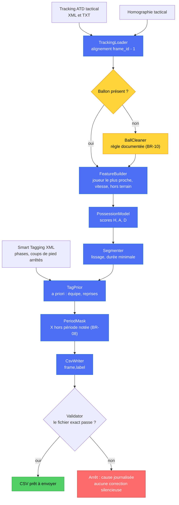
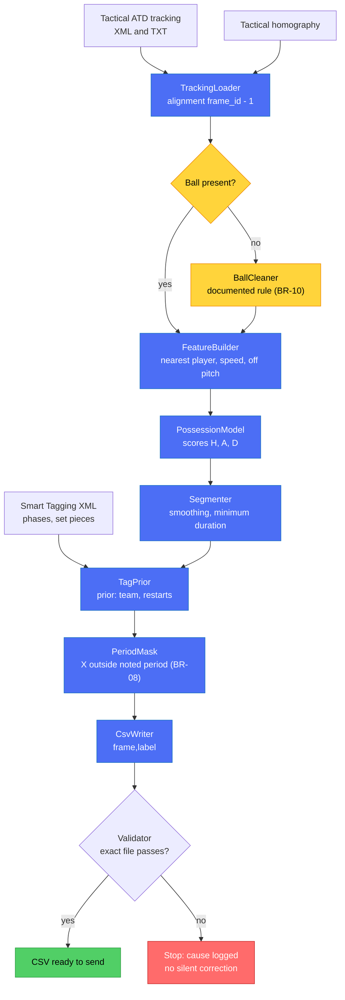

# Architecture : possession du ballon

[Français](#français) | [English](#english)

> **Langues :** FR puis EN (voir D-005) · **Languages:** FR then EN (see D-005).

---

## Français

> **Statut :** cible. Aucun composant n'est implémenté. Le dépôt ne contient aucun code applicatif. Les noms de composants sont indicatifs.
> **Source de vérité :** ce document pour l'architecture ; [BUSINESS_RULES.md](BUSINESS_RULES.md) pour les règles ; [REQUIREMENTS.md](REQUIREMENTS.md) pour les exigences.

**Légende**

| Symbole | Signification |
|---|---|
| 🎯 | Cible visée, **pas encore implémentée** |

Seul 🎯 s'applique aujourd'hui. Les statuts ✅ (réel, câblé) et 🟡 (code présent, non câblé) seront utilisés quand du code existera.

---

### 1. Vue d'ensemble

Le système est un **programme en lot** : une commande lit les données locales, produit une étiquette (`H`, `A`, `D` ou `X`) pour chacune des 199 319 frames, écrit le CSV de soumission et le valide. Il n'a ni interface, ni service, ni base de données à ce stade : les fichiers intermédiaires suffisent (FR-14). Aucun appel réseau n'est prévu, et aucune donnée ne part vers un service cloud (BR-17).

Principes :

- **Déterminisme** : même données et même configuration donnent le même CSV, octet pour octet (NFR-01).
- **Aucune correction silencieuse** : une donnée invalide ou absente est comptée, journalisée et traitée par une règle explicite (NFR-06).
- **Séparation des rôles** : chaque composant a une seule responsabilité (§3). Les paramètres viennent de la configuration, jamais de constantes dispersées.
- **Aucun réglage sur le match** : les paramètres se règlent sur données externes uniquement (BR-28, D-003).

---

### 2. Pipeline cible

Le flux de la donnée, de la lecture au CSV validé.



Le diagramme est une cible : aucun de ces nœuds n'existe encore. Les entrées IN1 à IN3 sont des fichiers de `data/` (hors dépôt).

---

### 3. Composants et responsabilités

| Composant | Responsabilité | Entrée | Sortie | Ne fait pas |
|---|---|---|---|---|
| Config | Charger et valider les paramètres versionnés, la graine (seed) et les chemins | Fichier de configuration | Objet de configuration, empreinte | Calculer un label |
| TrackingLoader | Lire l'ATD tactical (XML, TXT) et l'homographie ; aligner les frames (BR-11) ; convertir le smart tagging en frames | Fichiers de `data/` | Table par frame : ballon, emplacements ; phases en frames | Décider d'un label |
| BallCleaner | Traiter les frames sans ballon (BR-10) | Positions du ballon, avec `NaN` | Positions complétées, marquage et compteurs | Inventer une valeur sans trace |
| FeatureBuilder | Calculer le joueur le plus proche du ballon et son équipe, la vitesse, la sortie du terrain (coordonnées hors de 0 à 1) | Tracking nettoyé | Features par frame | Décider de `H`, `A` ou `D` |
| TagPrior | Appliquer le smart tagging comme a priori sur les segments : équipe des phases, reprises après coup de pied arrêté (BR-05, FR-10) | Labels segmentés ; phases du smart tagging (converties en frames) | Labels ajustés aux phases | Recopier les intervalles comme des possessions |
| PossessionModel | Donner un score à `H`, `A` et `D` pour chaque frame, selon les règles (BR-02 à BR-06) et, si D-002 l'accepte, un modèle | Features | Scores par frame | Lisser, mettre `X` hors période |
| Segmenter | Lisser et segmenter : durée minimale, changement de label pénalisé (FR-09) | Scores | Labels `H`, `A`, `D` | Régler ses paramètres sur le match |
| PeriodMask | Mettre `X` hors des périodes notées (BR-08) | Labels, bornes des périodes | Labels finaux | Détecter le coup d'envoi (voir PossessionModel, BR-09) |
| CsvWriter | Écrire `frame,label` en UTF-8, sans index, dans l'ordre (FR-02) | Labels finaux | Fichier CSV | Corriger un label |
| Validator | Appliquer le validateur officiel au fichier exact (FR-12) | Fichier CSV | Accepté, ou liste d'erreurs | Réécrire le fichier |
| Evaluator | Lancer le scoreur officiel sur la vérité terrain publique, comme test de plomberie (FR-13, D-006) | CSV, vérité terrain publique | Scores | Choisir des paramètres d'après le score |
| Logger | Émettre les marqueurs `[START]`, `[ENTITY]`, `[CALL]`, `[RESULT]`, `[STATE]` (NFR-05) | Événements de chaque étape | Sortie standard ou fichier | Journaliser les données du match en volume |

Le **Validator** et l'**Evaluator** sont des outils officiels des organisateurs. Ils ne sont pas réécrits : leur copie dans le dépôt public demande une vérification de licence (§8).

---

### 4. Qui décide chaque étiquette

| Étiquette | Décidée par | Règle |
|---|---|---|
| `X` hors période notée | PeriodMask | BR-08 |
| `D` ballon mort | PossessionModel, puis Segmenter | BR-02 |
| `H` ou `A` à ballon vivant | PossessionModel, puis Segmenter, puis TagPrior (a priori) | BR-03 à BR-06 ; BR-05 |
| `X` en plein milieu d'une possession (ballon absent) | BallCleaner, Segmenter | BR-10, BR-12 (proposition) |
| Aucune étiquette n'est modifiée à la main | — | BR-13 |

Un label ne peut être modifié qu'à une seule étape, celle qui le décide. Les étapes suivantes ne le réécrivent pas.

---

### 5. Données utilisées et abandonnées

Ce tableau alimente la section « données » du document technique (ARENA §6.2).

| Donnée | Statut | Usage ou raison | Règle |
|---|---|---|---|
| ATD tactical (XML et TXT) | Utilisée | Entrée principale : référence des frames, 199 319 enregistrements | BR-11 |
| Homographie tactical | Candidate | Valide sur 100 % des frames. Son utilité pour les coordonnées reste à évaluer | FR-04 |
| Smart Tagging | Utilisé comme a priori | Annotation automatique (non une vérité terrain), 638 instances | BR-05, H-05 |
| ATD broadcast (XML, TXT) et homographie broadcast | Candidate, à évaluer | Non synchronisée avec le tactical ; homographie valide sur 65,8 % des frames | Q-06 |
| Vidéo tactical et broadcast | Consultée pour comprendre seulement | Pas de contrôle des résultats contre la vidéo | BR-16, BR-22 |
| Vérité terrain publique (5 minutes) | Test de plomberie uniquement | Jamais de réglage ni de choix de règle | BR-15, BR-31 |
| Tracking corrigé, vérité terrain privée, données Opta, StatsBomb, Wyscout, LaLiga | Abandonnées (interdites) | Données humaines sur ce match | BR-14 |
| Annotation manuelle de ce match | Abandonnée (interdite) | Quelle que soit la finalité | BR-13 |
| Données externes d'autres matchs | Candidates pour le réglage | Licence à vérifier une par une ; source, annotateur et quantité documentés | BR-25, D-007 |
| LLM hébergé dans le cloud | Abandonné (interdit) | Données du match hors de la machine | BR-17 |
| LLM local | Permis, non retenu à ce stade | Aucune décision d'usage | BR-17 |
| Données d'entraînement | Aucune à ce stade | Si D-002 retient un apprentissage : documenter source, annotateur et quantité (ARENA §6.2) | D-002 |

---

### 6. Transversal

**6.1 Configuration**

- Un fichier versionné porte les paramètres de [BUSINESS_RULES.md](BUSINESS_RULES.md) §5, la graine et les chemins des données.
- Une valeur absente ou hors bornes arrête le programme avec un message qui nomme le champ.
- L'empreinte de la configuration figure dans le journal de chaque run (proposition).

**6.2 Journalisation**

| Balise | Contenu |
|---|---|
| `[START]` | Début d'un run ou d'une étape : identifiant du run, graine, empreinte de configuration |
| `[ENTITY]` | Identifiants concernés : source, plage de frames, nombre de frames notées, équipe. Jamais de ligne brute du tracking |
| `[CALL]` | Lecture d'un fichier ou appel d'un outil officiel : nom, chemin relatif, durée, code de retour |
| `[RESULT]` | Succès ou échec actionnable : compteurs (ballons absents, valeurs hors bornes), cause et étape en cas d'échec |
| `[STATE]` | Passage d'une étape à l'autre, et état final du fichier : écrit, validé, rejeté, empreinte SHA-256 |

Modèle de format (pas une sortie réelle) :

```text
[START] op=possession_run seed=<graine> config=<empreinte>
[ENTITY] source=tactical frames=<n> noted=<n>
[CALL] op=read_atd file=<nom du fichier>
[RESULT] op=fill_ball_gaps gaps=<k> longest_frames=<n>
[STATE] stage=export status=written sha256=<empreinte>
```

Interdit dans les journaux : données brutes du match en volume, secrets, chemins absolus personnels.

**6.3 Déterminisme et idempotence**

- La graine est fixée au démarrage, même si aucune étape n'est aléatoire (proposition).
- Ordre fixe : frames par index croissant ; emplacements triés par identifiant.
- Un run ne lit aucun état laissé par un run précédent : la sortie ne dépend que des données et de la configuration.
- Relancer le run réécrit le même fichier, au même contenu : l'opération est idempotente.
- L'empreinte SHA-256 du CSV est journalisée à l'étape `[STATE]`, pour comparer deux runs (NFR-01).

**6.4 Erreurs et données manquantes**

| Situation | Comportement |
|---|---|
| Fichier de données absent | Arrêt avec le chemin attendu. Aucun CSV partiel n'est écrit |
| Index de frame non consécutif, ou nombre de lignes inattendu | Arrêt : contrôle d'intégrité (FR-02) |
| Ballon absent (`NaN`) | Compté, traité par BR-10, journalisé. Jamais rempli sans trace |
| Coordonnée hors de 0 à 1 | Compté, traité par une règle documentée. Jamais corrigé en silence |
| Validator refuse le fichier | Aucun fichier à envoyer. La cause est affichée. Le CSV n'est pas retouché à la main |
| Bibliothèque de lecture en erreur | Échec actionnable. Pas de repli silencieux |

**6.5 Confidentialité**

- Les données du match restent dans `data/` local, hors Git (NFR-02).
- Aucun envoi vers un service cloud (BR-17, NFR-07).
- Les fichiers intermédiaires sont écrits hors du dépôt public (FR-14).

---

### 7. Structure du dépôt cible

- `ARENA.md`, `README.md`, `CLAUDE.md` : cadre du défi et consignes.
- `docs/` : documentation canonique (REQUIREMENTS, BUSINESS_RULES, DOMAIN_NOTES, ARCHITECTURE, DECISIONS et les autres).
- `possession/` : code du pipeline. Nom indicatif, avec un point d'entrée `run` (FR-11).
- `tests/` : tests sur cas synthétiques et propriétés, jamais sur les frames du match.
- `requirements.txt` : versions figées (NFR-03).
- `.gitignore` : `data/`, `*.mp4`, `evaluation/results/`, caches Python, environnements virtuels.
- `data/` : données locales, hors Git. Chemin réglable par la variable `MTAH_DATA_DIR` (ARENA §4.2).
- `evaluation/`, `starter/` : outils officiels des organisateurs. Absents aujourd'hui (§8).

---

### 8. État réel et écarts

État constaté lors de l'audit du 2026-11-07 (dossier local).

| Sujet | État constaté | Conséquence | Action |
|---|---|---|---|
| Code applicatif | Aucun | Tout est 🎯 | Écrire le pipeline |
| Dépôt Git | Le dossier n'est pas un dépôt Git | Le contrôle NFR-02 est impossible | Initialiser le dépôt |
| `.gitignore` | Ne contient que `/.claude` | `data/` et les CSV ne seraient pas ignorés (R-07) | Ajouter `data/`, `*.mp4`, `evaluation/results/`, caches Python |
| ATD tactical TXT | Absent. Le XML est présent | Le loader ne peut pas lire le tracking (R-09) | Re-télécharger le fichier |
| Vidéos MP4 (tactical, broadcast) | Absentes | Non nécessaires au CSV ; bloquantes pour les visualisations de debug (FR-15) | Re-télécharger si le debug vidéo est nécessaire |
| ATD tactical XML, homographie, smart tagging | Présents | Entrées disponibles | Vérifier le nombre de lignes (199 319) |
| ATD broadcast TXT et XML, homographie broadcast | Présents | Candidats (Q-06) | Décider après un test |
| Dépôt officiel (`games.py`, `evaluation/`, `starter/`) | Absent du dossier | Pas de scoreur ni de validateur locaux | Cloner le dépôt officiel ; vérifier la licence avant toute copie publique |
| Environnement Python | Python 3.13 présent mais hors PATH ; bibliothèque de lecture du tracking non installée (audit du plan) | Pas d'environnement figé | Créer un environnement virtuel et un fichier de dépendances figé (NFR-03) |

---

### 9. Décisions et questions ouvertes

| Référence | Sujet | Statut |
|---|---|---|
| D-001 | Python 3.9 minimum, bibliothèques de calcul et de lecture du tracking | ACCEPTED |
| D-002 | Règles et segmentation probabiliste avant tout apprentissage supervisé | OPEN |
| D-003 | Tout réglage sur données externes uniquement | ACCEPTED |
| D-004 | Un seul point d'entrée qui régénère le CSV, graine fixe | ACCEPTED |
| D-005 | Documentation bilingue FR puis EN, diagrammes Mermaid, sans ASCII art | ACCEPTED |
| D-006 | Les 5 minutes publiques servent de test de plomberie | ACCEPTED |
| D-007 | Jeux de données externes candidats pour le réglage | OPEN |

Questions : [REQUIREMENTS.md](REQUIREMENTS.md) §13 (Q-01 à Q-10). Règles ouvertes : [BUSINESS_RULES.md](BUSINESS_RULES.md) §4.

---

### 10. Comment garder le doc juste

- Dans le même changement : ajout ou renommage d'un composant (§2, §3) ; nouvelle étape ou nouveau contrat de données ; nouveau paramètre (§6.1 et BUSINESS_RULES §5) ; nouvelle source de données (§5).
- Un composant passe de 🎯 à ✅ seulement quand le code **et** un test existent. Indiquer alors le fichier et le test.
- Chaque nom de composant de ce document doit exister dans le code une fois implémenté : le vérifier par recherche.
- Une décision ou une question résolue est notée dans [DECISIONS.md](DECISIONS.md) avec sa date, puis reportée ici.

---

## English

> **Status:** target. No component is implemented. The repository contains no application code. Component names are indicative.
> **Source of truth:** this document for the architecture; [BUSINESS_RULES.md](BUSINESS_RULES.md) for the rules; [REQUIREMENTS.md](REQUIREMENTS.md) for the requirements.

**Legend**

| Symbol | Meaning |
|---|---|
| 🎯 | Target, **not implemented yet** |

Only 🎯 applies today. The statuses ✅ (real, wired) and 🟡 (code present, not wired) will be used once code exists.

---

### 1. Overview

The system is a **batch program**: one command reads the local data, produces a label (`H`, `A`, `D` or `X`) for each of the 199,319 frames, writes the submission CSV and validates it. At this stage it has no interface, no service and no database: intermediate files are enough (FR-14). No network call is planned, and no data goes to a cloud service (BR-17).

Principles:

- **Determinism**: same data and same configuration give the same CSV, byte for byte (NFR-01).
- **No silent correction**: an invalid or missing datum is counted, logged and handled by an explicit rule (NFR-06).
- **Separation of roles**: each component has a single responsibility (§3). Parameters come from the configuration, never from scattered constants.
- **No tuning on the match**: parameters are tuned on external data only (BR-28, D-003).

---

### 2. Target pipeline

The flow of the data, from reading to the validated CSV.



The diagram is a target: none of these nodes exists yet. Inputs IN1 to IN3 are files in `data/` (outside the repository).

---

### 3. Components and responsibilities

| Component | Responsibility | Input | Output | Does not |
|---|---|---|---|---|
| Config | Load and validate the versioned parameters, the seed and the paths | Configuration file | Configuration object, digest | Compute a label |
| TrackingLoader | Read the tactical ATD (XML, TXT) and the homography; align frames (BR-11); convert the smart tagging to frames | Files in `data/` | Per-frame table: ball, slots; phases in frames | Decide a label |
| BallCleaner | Handle frames without a ball (BR-10) | Ball positions, with `NaN` | Completed positions, markers and counters | Invent a value without a trace |
| FeatureBuilder | Compute the player nearest to the ball and his team, the speed, the exit from the pitch (coordinates outside 0 to 1) | Cleaned tracking | Per-frame features | Decide `H`, `A` or `D` |
| TagPrior | Apply the smart tagging as a prior on the segments: team of the phases, restarts after a set piece (BR-05, FR-10) | Segmented labels; smart tagging phases (converted to frames) | Labels adjusted to the phases | Copy the intervals as possessions |
| PossessionModel | Score `H`, `A` and `D` for each frame, following the rules (BR-02 to BR-06) and, if D-002 accepts it, a model | Features | Per-frame scores | Smooth, put `X` outside a period |
| Segmenter | Smooth and segment: minimum duration, penalised label change (FR-09) | Scores | Labels `H`, `A`, `D` | Tune its parameters on the match |
| PeriodMask | Put `X` outside the noted periods (BR-08) | Labels, period bounds | Final labels | Detect kick-off (see PossessionModel, BR-09) |
| CsvWriter | Write `frame,label` in UTF-8, no index, in order (FR-02) | Final labels | CSV file | Correct a label |
| Validator | Apply the official validator to the exact file (FR-12) | CSV file | Accepted, or list of errors | Rewrite the file |
| Evaluator | Run the official scorer on the public ground truth, as a plumbing test (FR-13, D-006) | CSV, public ground truth | Scores | Choose parameters from the score |
| Logger | Emit the markers `[START]`, `[ENTITY]`, `[CALL]`, `[RESULT]`, `[STATE]` (NFR-05) | Events of each step | Standard output or file | Log match data in bulk |

The **Validator** and the **Evaluator** are official tools of the organisers. They are not rewritten: copying them into the public repository requires a licence check (§8).

---

### 4. Who decides each label

| Label | Decided by | Rule |
|---|---|---|
| `X` outside a noted period | PeriodMask | BR-08 |
| `D` dead ball | PossessionModel, then Segmenter | BR-02 |
| `H` or `A` on a live ball | PossessionModel, then Segmenter, then TagPrior (prior) | BR-03 to BR-06; BR-05 |
| `X` in the middle of a possession (ball missing) | BallCleaner, Segmenter | BR-10, BR-12 (proposal) |
| No label is edited by hand | — | BR-13 |

A label may be changed at one step only: the one that decides it. Later steps do not rewrite it.

---

### 5. Data used and abandoned

This table feeds the data section of the technical document (ARENA §6.2).

| Data | Status | Use or reason | Rule |
|---|---|---|---|
| Tactical ATD (XML and TXT) | Used | Main input: frame reference, 199,319 records | BR-11 |
| Tactical homography | Candidate | Valid on 100 % of frames. Its usefulness for the coordinates is still to be assessed | FR-04 |
| Smart Tagging | Used as a prior | Automatic annotation (not a ground truth), 638 instances | BR-05, H-05 |
| Broadcast ATD (XML, TXT) and broadcast homography | Candidate, to assess | Not synchronised with the tactical; homography valid on 65.8 % of frames | Q-06 |
| Tactical and broadcast video | Consulted to understand only | No checking of results against the video | BR-16, BR-22 |
| Public ground truth (5 minutes) | Plumbing test only | Never used for tuning or for choosing a rule | BR-15, BR-31 |
| Corrected tracking, private ground truth, Opta, StatsBomb, Wyscout, LaLiga data | Abandoned (forbidden) | Human data on this match | BR-14 |
| Manual annotation of this match | Abandoned (forbidden) | Whatever the purpose | BR-13 |
| External data from other matches | Candidates for tuning | Licence to check one by one; source, annotator and quantity documented | BR-25, D-007 |
| Cloud-hosted LLM | Abandoned (forbidden) | Match data leaving the machine | BR-17 |
| Local LLM | Allowed, not retained at this stage | No decision on use | BR-17 |
| Training data | None at this stage | If D-002 retains learning: document source, annotator and quantity (ARENA §6.2) | D-002 |

---

### 6. Cross-cutting concerns

**6.1 Configuration**

- A versioned file holds the parameters of [BUSINESS_RULES.md](BUSINESS_RULES.md) §5, the seed and the data paths.
- A missing or out-of-range value stops the program with a message that names the field.
- The configuration digest appears in the log of each run (proposal).

**6.2 Logging**

| Tag | Content |
|---|---|
| `[START]` | Start of a run or of a step: run identifier, seed, configuration digest |
| `[ENTITY]` | Identifiers involved: source, frame range, number of noted frames, team. Never a raw tracking row |
| `[CALL]` | Reading a file or calling an official tool: name, relative path, duration, return code |
| `[RESULT]` | Success or actionable failure: counters (missing balls, out-of-range values), cause and step on failure |
| `[STATE]` | Transition from one step to the next, and final state of the file: written, validated, rejected, SHA-256 digest |

Format template (not a real output):

```text
[START] op=possession_run seed=<seed> config=<digest>
[ENTITY] source=tactical frames=<n> noted=<n>
[CALL] op=read_atd file=<file name>
[RESULT] op=fill_ball_gaps gaps=<k> longest_frames=<n>
[STATE] stage=export status=written sha256=<digest>
```

Forbidden in logs: raw match data in bulk, secrets, personal absolute paths.

**6.3 Determinism and idempotence**

- The seed is fixed at start-up, even if no step is random (proposal).
- Fixed order: frames by increasing index; slots sorted by identifier.
- A run reads no state left by a previous run: the output depends only on the data and the configuration.
- Re-running rewrites the same file with the same content: the operation is idempotent.
- The SHA-256 digest of the CSV is logged at the `[STATE]` step, to compare two runs (NFR-01).

**6.4 Errors and missing data**

| Situation | Behaviour |
|---|---|
| Data file missing | Stop with the expected path. No partial CSV is written |
| Non-consecutive frame index, or unexpected row count | Stop: integrity check (FR-02) |
| Ball missing (`NaN`) | Counted, handled by BR-10, logged. Never filled without a trace |
| Coordinate outside 0 to 1 | Counted, handled by a documented rule. Never corrected silently |
| Validator rejects the file | No file to send. The cause is shown. The CSV is not edited by hand |
| Reading library error | Actionable failure. No silent fallback |

**6.5 Confidentiality**

- Match data stay in the local `data/` folder, outside Git (NFR-02).
- No transfer to a cloud service (BR-17, NFR-07).
- Intermediate files are written outside the public repository (FR-14).

---

### 7. Target repository structure

- `ARENA.md`, `README.md`, `CLAUDE.md`: challenge frame and working rules.
- `docs/`: canonical documentation (REQUIREMENTS, BUSINESS_RULES, DOMAIN_NOTES, ARCHITECTURE, DECISIONS and the others).
- `possession/`: pipeline code. Indicative name, with a `run` entry point (FR-11).
- `tests/`: tests on synthetic cases and properties, never on the match frames.
- `requirements.txt`: frozen versions (NFR-03).
- `.gitignore`: `data/`, `*.mp4`, `evaluation/results/`, Python caches, virtual environments.
- `data/`: local data, outside Git. Path adjustable with the variable `MTAH_DATA_DIR` (ARENA §4.2).
- `evaluation/`, `starter/`: official tools of the organisers. Absent today (§8).

---

### 8. Actual state and gaps

State observed during the audit of 2026-11-07 (local folder).

| Topic | Observed state | Consequence | Action |
|---|---|---|---|
| Application code | None | Everything is 🎯 | Write the pipeline |
| Git repository | The folder is not a Git repository | The NFR-02 check is impossible | Initialise the repository |
| `.gitignore` | Contains only `/.claude` | `data/` and the CSV files would not be ignored (R-07) | Add `data/`, `*.mp4`, `evaluation/results/`, Python caches |
| Tactical ATD TXT | Missing. The XML is present | The loader cannot read the tracking (R-09) | Re-download the file |
| MP4 videos (tactical, broadcast) | Missing | Not needed for the CSV; blocking for debug visualisations (FR-15) | Re-download if video debugging is needed |
| Tactical ATD XML, homography, smart tagging | Present | Inputs available | Check the row count (199,319) |
| Broadcast ATD TXT and XML, broadcast homography | Present | Candidates (Q-06) | Decide after a test |
| Official repository (`games.py`, `evaluation/`, `starter/`) | Absent from the folder | No local scorer or validator | Clone the official repository; check the licence before any public copy |
| Python environment | Python 3.13 present but not on PATH; tracking reading library not installed (plan audit) | No frozen environment | Create a virtual environment and a frozen dependency file (NFR-03) |

---

### 9. Decisions and open questions

| Reference | Topic | Status |
|---|---|---|
| D-001 | Python 3.9 minimum, calculation and tracking-reading libraries | ACCEPTED |
| D-002 | Rules and probabilistic segmentation before any supervised learning | OPEN |
| D-003 | All tuning on external data only | ACCEPTED |
| D-004 | A single entry point that regenerates the CSV, fixed seed | ACCEPTED |
| D-005 | Bilingual FR then EN documentation, Mermaid diagrams, no ASCII art | ACCEPTED |
| D-006 | The public 5 minutes serve as a plumbing test | ACCEPTED |
| D-007 | External candidate datasets for tuning | OPEN |

Questions: [REQUIREMENTS.md](REQUIREMENTS.md) §13 (Q-01 to Q-10). Open rules: [BUSINESS_RULES.md](BUSINESS_RULES.md) §4.

---

### 10. How to keep this document accurate

- In the same change: adding or renaming a component (§2, §3); a new step or a new data contract; a new parameter (§6.1 and BUSINESS_RULES §5); a new data source (§5).
- A component moves from 🎯 to ✅ only when code **and** a test exist. Then record the file and the test.
- Each component name in this document must exist in the code once implemented: verify by search.
- A resolved decision or question is recorded in [DECISIONS.md](DECISIONS.md) with its date, then reflected here.
