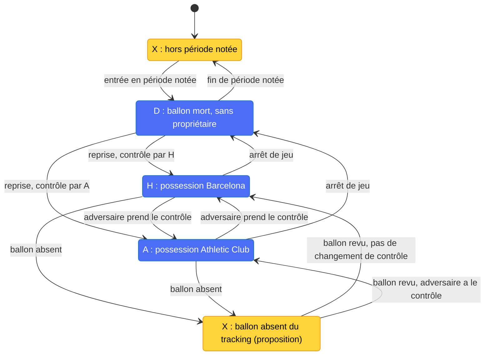
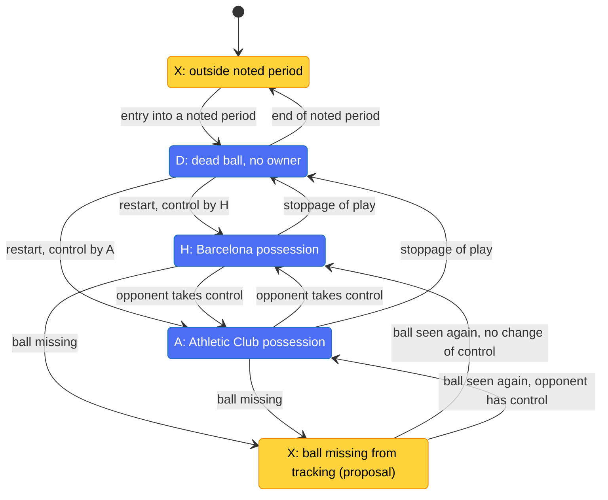

# Règles métier : possession du ballon

[Français](#français) | [English](#english)

---

## Français

> 🎯 Toutes les règles sont cibles. Aucun fichier source ne les applique encore.
> Concepts et chiffres : [DOMAIN_NOTES.md](DOMAIN_NOTES.md). Exigences : [REQUIREMENTS.md](REQUIREMENTS.md). Architecture : [ARCHITECTURE.md](ARCHITECTURE.md).

Conventions :

- **Statut** : `imposée` = fixée par [ARENA.md](../ARENA.md) ou par le mail de clarification des organisateurs ; `décidée` = décision de ce projet dans [DECISIONS.md](DECISIONS.md) ; `proposition` = choix de l'équipe, à valider ; `open` = à trancher.
- **Source « mail »** : clarification des organisateurs, qui prime sur ARENA.md en cas de conflit (REQUIREMENTS CON-07). Son texte n'est pas encore dans le dépôt : il doit être reporté dans ARENA.md (action du plan).
- **Identifiants** : stables, jamais renumérotés.

### 1. Catalogue

#### Partie 1 : règles de possession

| ID | Règle | Statut | Source | Exigence |
|---|---|---|---|---|
| BR-01 | Quatre étiquettes (`H`, `A`, `D`, `X`), trois états dans la vérité terrain (`H`, `A`, `D`). Pas de « contesté », « transition » ni « inconnu ». | imposée | ARENA §2 | FR-01 |
| BR-02 | Ballon mort = `D`, sans propriétaire. Un ballon mort n'est jamais une possession. | imposée | ARENA §2, §3 | FR-07 |
| BR-03 | Ballon vivant : une équipe a toujours la possession. Ballon libre ou disputé : la possession reste à la dernière équipe qui l'avait. | imposée | ARENA §3 | FR-06 |
| BR-04 | Changement de possession seulement si un joueur adverse prend le contrôle. Une simple touche, une déviation qui n'intercepte pas la passe, ou un duel aérien gagné sans contrôle ne sont pas des changements. | imposée | ARENA §3 | FR-06 |
| BR-05 | Après chaque arrêt, le possesseur à la reprise doit être clair. Chaque coup de pied arrêté marque une reprise (fin d'un ballon mort). Le smart tagging sert d'a priori, sans recopier ses intervalles. | imposée (principe) ; usage : proposition | ARENA §3, §4.4 | FR-10 |
| BR-06 | Une possession est une suite maximale d'une même équipe, ballon vivant. `H H H A A` = 2 possessions. `H H D D H H` = 2 possessions. | imposée | ARENA §3 | FR-06 |
| BR-07 | Référence de méthode : la vérité terrain est construite à partir du tracking corrigé (une frame vaut `D` où le tracking corrigé marque un ballon mort, sinon l'équipe désignée), sans lissage ni retouche. Notre sortie n'est jamais calée sur elle (BR-14). | imposée (information) | ARENA §3 | FR-13 |
| BR-08 | Une frame hors des deux mi-temps notées vaut `X` : avant 11 185, mi-temps 90 652 à 110 807, après 190 197 (soit à partir de la frame 190 198). | imposée | ARENA §4.7 | FR-08 |
| BR-09 | Aucune constante de frame liée à un événement du match n'est codée en dur (ni le coup d'envoi 113 742, ni les 2 934 frames). La détection vient des données. Les bornes de période viennent des métadonnées fournies (Q-05). | imposée (ARENA §7.1) ; bornes : open | ARENA §4.7, §7 | FR-08 |
| BR-10 | Un ballon absent (`NaN`) n'est jamais remplacé par une valeur inventée. Il est traité par une règle automatique documentée, comptée et journalisée. | proposition | ARENA §4.3 | FR-05, NFR-06 |
| BR-11 | Alignement : ligne de soumission = `frame_id - 1` pour l'ATD ; frame = `round(secondes × 25)` pour le smart tagging. | imposée | ARENA §4.6 | FR-03 |
| BR-12 | `X` est une abstention. Préférer `X` à une supposition qui couperait une possession en deux. | imposée (principe de notation) | ARENA §5 | FR-09 |

#### Partie 2 : règles de compétition

| ID | Règle | Statut | Source | Exigence |
|---|---|---|---|---|
| BR-13 | **Interdit** : annoter à la main ce match, en toute quantité et pour tout usage (soumission, entraînement, validation). Corriger à la main le tracking ou la sortie de l'algorithme est aussi interdit, tout comme les règles ou constantes liées à des frames précises du match. | imposée | ARENA §7.1 ; mail | NFR-07 |
| BR-14 | **Interdit** : utiliser la vérité terrain privée ou toute donnée humaine sur ce match (Opta, StatsBomb, Wyscout, LaLiga, tracking corrigé, etc.). | imposée | ARENA §7.2 | CON-01 |
| BR-15 | **Interdit** : entraîner ou régler un modèle sur les 5 minutes publiques, ou l'ajuster ou le calibrer sur la vérité terrain ou sur la vidéo fournie. | imposée | ARENA §7.3 ; mail | FR-13 |
| BR-16 | **Interdit** : vérifier sa sortie contre la vidéo. Le mail est plus strict qu'ARENA §7 (« pour déboguer ») : regarder pour comprendre reste permis (BR-22), contrôler ses résultats ne l'est pas. | imposée | Mail (prime) | FR-15 |
| BR-17 | **Interdit** : envoyer vidéos ou données du match à un LLM ou à un service d'IA hébergé dans le cloud, y compris l'assistant de code (ne pas lui faire lire ni afficher `data/`). Un LLM local est autorisé ; utiliser une IA pour écrire, relire ou déboguer le **code** est permis. | imposée | ARENA §7.6 ; mail | NFR-07 |
| BR-18 | **Interdit** : soumettre un fichier que le dépôt ne peut pas régénérer à l'identique. | imposée | ARENA §7.4 | FR-11 |
| BR-19 | **Interdit** : redistribuer les données (les commiter, publier des exports frame par frame ou des extraits vidéo). Le CSV soumis n'est donc jamais commité (Q-08). | imposée | ARENA §7.5 | NFR-02 |
| BR-20 | **Interdit** : utiliser un modèle privé ou interne non partageable, sans en faire la demande avant. | imposée | ARENA §7.7 | FR-17 |
| BR-21 | **Permis** : checks automatiques avec les seules données fournies (format, cohérence, plomberie). | imposée | Mail | FR-12 |
| BR-22 | **Permis** : inspecter données et vidéo pour comprendre ce qu'est la possession et déboguer le pipeline, sans contrôler les résultats. | imposée | Mail ; ARENA §7 | FR-15 |
| BR-23 | **Permis** : utiliser vidéo, tracking ou smart tagging comme entrée, si l'algorithme n'a pas été entraîné sur la vérité terrain ou sur la vidéo. | imposée | Mail | FR-06 |
| BR-24 | **Permis** : fournir des fichiers intermédiaires des étapes. | imposée | Mail | FR-14 |
| BR-25 | **Permis** : tout jeu de données dont on a le droit d'usage. Licence vérifiée une par une, source, annotateur et quantité documentés. | imposée ; licence : open | ARENA §6.2, §7 | D-007 |
| BR-26 | **Permis** : méthodes non supervisées ou auto-supervisées, et pseudo-labels produits par un algorithme. | imposée | ARENA §7 | D-002 |
| BR-27 | **Permis** : améliorer ou remplacer le tracking avec ses propres algorithmes (détecteur, suivi, reconnaissance d'événements). | imposée | ARENA §7 | FR-04 |
| BR-28 | **Réglage** (paramètres, seuils, fenêtres, pénalités) : uniquement sur données externes au match. | imposée (mail) ; décidée (D-003) | Mail ; D-003 | FR-09 |
| BR-29 | Une méthode est acceptée si les organisateurs peuvent l'inspecter et si le document technique l'explique. | imposée | ARENA §7 | NFR-08 |
| BR-30 | En cas de doute sur une règle, ouvrir une issue avant de construire. | imposée | ARENA §7 | — |
| BR-31 | Les 5 minutes publiques servent de test de plomberie uniquement : le pipeline tourne, le score est plausible. Aucun choix de paramètre ni de règle n'en découle. | décidée (D-006) | D-006 | FR-13 |

### 2. Détail des règles délicates

#### 2.1 Changement de possession (BR-03, BR-04, BR-06)

| Situation | Effet sur le label |
|---|---|
| Passe interceptée, un adversaire contrôle le ballon | Changement de possession |
| Simple touche, sans contrôle | Pas de changement |
| Déviation de passe qui n'intercepte pas | Pas de changement |
| Duel aérien gagné sans contrôle derrière | Pas de changement |
| Ballon libre après une passe ratée, personne ne contrôle | La dernière équipe garde la possession (`H` ou `A`) |
| Ballon sorti, arrêt de jeu | `D` |

Indices proposés par ARENA pour reconnaître un contrôle : un joueur garde le ballon quelques secondes, ou une équipe enchaîne plus de 2 passes. Ce sont des indices, pas des seuils : toute valeur chiffrée est un paramètre à régler sur des données externes (BR-28).

#### 2.2 Périodes et coup d'envoi (BR-08, BR-09)

- Hors des deux mi-temps notées : `X` (BR-08).
- Dans la 2e mi-temps, les frames avant le coup d'envoi (110 808 à 113 741) sont `D` selon ARENA §4.7. Pour les obtenir sans constante codée en dur, il faut détecter le coup d'envoi à partir des données (BR-09). La méthode de détection est **open**.
- Interdit : écrire `113742` ou `2934` dans le code, ou tout autre numéro de frame lié à un événement du match.

#### 2.3 Ballon manquant (BR-10, BR-12)

Options examinées (proposition, non décidée) :

- trous courts : interpolation entre les positions connues ;
- trous longs, en plein milieu d'une possession : `X` (gratuit en spellF1) ;
- à une transition probable : un label, pour éviter que l'ancien continue après le changement de possession.

Dans tous les cas, le traitement est une règle automatique, comptée et journalisée (NFR-06). Interdit : remplir un trou par l'équipe choisie à la main.

#### 2.4 Vérifier ou comprendre (BR-16, BR-22)

| Action | Statut |
|---|---|
| Lire les coordonnées, tracer une frame pour comprendre une passe ou un duel | Permis (BR-22) |
| Tests automatiques sur la sortie : couverture, format, absence de trou | Permis (BR-21) |
| Comparer la sortie du pipeline, frame par frame, avec ce que montre la vidéo, pour la valider | Interdit (BR-16) |
| Corriger un label en regardant la vidéo | Interdit (BR-13) |
| Regarder la vidéo pour comprendre pourquoi un décalage d'alignement existe | Cas limite : à faire trancher (Q-04) |

#### 2.5 Procédure de réglage (BR-25, BR-28)

Proposition de procédure, à valider :

1. Choisir un jeu de données externe, après vérification de sa licence (BR-25).
2. Régler les paramètres uniquement sur ce jeu externe.
3. Figer les paramètres et la version du code.
4. Lancer une seule fois le pipeline sur le match.
5. Ne plus modifier de paramètre en réaction au score du match.

### 3. Cycle de vie : étiquette d'une frame

Le diagramme décrit les états d'une frame du point de vue de sa possession. Les états `Ballon_perdu` sont une proposition (BR-10).

Lecture : une frame `H` ou `A` est toujours à ballon vivant ; `D` ne peut jamais être une possession ; `X` vient soit de la période, soit d'un ballon absent traité comme proposition.

### 4. Décisions ouvertes

| Sujet | Règle | Statut | Remarque |
|---|---|---|---|
| Les 5 minutes publiques servent-elles seulement de test de plomberie ? | BR-31 | décidée (D-006), à confirmer par écrit | Position retenue : oui, jamais pour choisir un paramètre ni une règle. Q-04 |
| Traitement du ballon manquant (trous courts, trous longs) | BR-10 | proposition | Options en §2.3 |
| Détection du coup d'envoi depuis les données | BR-09 | open | Ne pas coder la frame en dur |
| Bornes des périodes : constantes du pipeline ou détection | BR-09 | open | Q-05 |
| Consulter les 5 minutes publiques pour trancher une règle | BR-31 vs ARENA §3 | open | Conflit : ARENA §3 dit « en cas de doute, les 5 minutes font foi » ; position retenue (D-006) : non. Q-04 |
| Usage du tracking broadcast | BR-23 | open | Q-06 |
| Valeurs de durée minimale, fenêtre de lissage, pénalité de changement | BR-28 | open | Données externes uniquement. Q-09 |
| Licences des données externes | BR-25 | open | D-007 |

### 5. Paramètres et correspondances de noms

Noms proposés ; aucune valeur n'est fixée. Toute valeur se règle sur données externes (BR-28).

| Paramètre | Rôle | Référence | Valeur |
|---|---|---|---|
| `smooth_window` | Fenêtre de vote majoritaire ou de lissage | Baselines smooth25, smooth50, smooth125 (ARENA §5) | 25, 50, 125 dans les baselines. Unité supposée : frames, d'après le nom ; à confirmer dans `starter/baseline.py` (absent localement) |
| `min_possession_frames` | Durée minimale d'un contrôle | Proposition ; l'ordre de grandeur de 1 à 2 s est une idée du plan, non validée | À fixer |
| `transition_penalty` | Pénalité d'un changement de label dans la segmentation | D-002 (proposition) | À fixer |
| `max_gap_interpolated` | Longueur maximale d'un trou de ballon comblé | BR-10 (proposition) | À fixer |
| `period_bounds` | Bornes des mi-temps notées | ARENA §4.7 (`games.half_video_blocks`) | Fournies par les métadonnées |
| Cadence des frames | 25 fps : conversion secondes vers frames | ARENA §4.4 | Constante de format, pas un paramètre |

---

## English

> 🎯 All rules are targets. No source file applies them yet.
> Concepts and figures: [DOMAIN_NOTES.md](DOMAIN_NOTES.md). Requirements: [REQUIREMENTS.md](REQUIREMENTS.md). Architecture: [ARCHITECTURE.md](ARCHITECTURE.md).

Conventions:

- **Status**: `imposed` = fixed by [ARENA.md](../ARENA.md) or by the organisers' clarification email; `decided` = project decision in [DECISIONS.md](DECISIONS.md); `proposal` = team's choice, to be validated; `open` = to be settled.
- **"Email" source**: the organisers' clarification, which prevails over ARENA.md in case of conflict (REQUIREMENTS CON-07). Its text is not yet in the repository: it must be copied into ARENA.md (plan action).
- **Identifiers**: stable, never renumbered.

### 1. Catalogue

#### Part 1: possession rules

| ID | Rule | Status | Source | Requirement |
|---|---|---|---|---|
| BR-01 | Four labels (`H`, `A`, `D`, `X`), three states in the ground truth (`H`, `A`, `D`). No "contested", "transition" or "unknown". | imposed | ARENA §2 | FR-01 |
| BR-02 | Dead ball = `D`, no owner. A dead ball is never a possession. | imposed | ARENA §2, §3 | FR-07 |
| BR-03 | Live ball: one team always has possession. Loose or contested ball: possession stays with the last team that had it. | imposed | ARENA §3 | FR-06 |
| BR-04 | Change of possession only if an opponent player takes control. A simple touch, a deflection that does not intercept the pass, or an aerial duel won without control are not changes. | imposed | ARENA §3 | FR-06 |
| BR-05 | After each stoppage, the team in possession at the restart must be clear. Each set piece marks a restart (end of a dead ball). Smart tagging serves as a prior, without copying its intervals. | imposed (principle); use: proposal | ARENA §3, §4.4 | FR-10 |
| BR-06 | A possession is a maximal run of the same team, live ball. `H H H A A` = 2 possessions. `H H D D H H` = 2 possessions. | imposed | ARENA §3 | FR-06 |
| BR-07 | Method reference: the ground truth is built from corrected tracking (a frame is `D` where the corrected tracking marks a dead ball, otherwise the team it designates), with no smoothing and no manual edit. Our output is never calibrated on it (BR-14). | imposed (information) | ARENA §3 | FR-13 |
| BR-08 | A frame outside the two noted halves is `X`: before 11,185, half-time 90,652 to 110,807, after 190,197 (that is, from frame 190,198). | imposed | ARENA §4.7 | FR-08 |
| BR-09 | No frame constant tied to a match event is hard-coded (neither the kick-off 113,742 nor the 2,934 frames). Detection comes from the data. Period bounds come from the supplied metadata (Q-05). | imposed (ARENA §7.1); bounds: open | ARENA §4.7, §7 | FR-08 |
| BR-10 | A missing ball (`NaN`) is never replaced by an invented value. It is handled by a documented automatic rule, counted and logged. | proposal | ARENA §4.3 | FR-05, NFR-06 |
| BR-11 | Alignment: submission row = `frame_id - 1` for the ATD; frame = `round(seconds × 25)` for smart tagging. | imposed | ARENA §4.6 | FR-03 |
| BR-12 | `X` is an abstention. Prefer `X` to a guess that would cut a possession in two. | imposed (scoring principle) | ARENA §5 | FR-09 |

#### Part 2: competition rules

| ID | Rule | Status | Source | Requirement |
|---|---|---|---|---|
| BR-13 | **Forbidden**: annotating this match by hand, in any quantity and for any use (submission, training, validation). Correcting the tracking or the algorithm's output by hand is also forbidden, as are rules or constants tied to specific frames of the match. | imposed | ARENA §7.1; email | NFR-07 |
| BR-14 | **Forbidden**: using the private ground truth or any human data on this match (Opta, StatsBomb, Wyscout, LaLiga, corrected tracking, etc.). | imposed | ARENA §7.2 | CON-01 |
| BR-15 | **Forbidden**: training or tuning a model on the public 5 minutes, or adjusting or calibrating it on the ground truth or on the supplied video. | imposed | ARENA §7.3; email | FR-13 |
| BR-16 | **Forbidden**: checking one's output against the video. The email is stricter than ARENA §7 ("to debug"): watching to understand remains allowed (BR-22); checking one's results does not. | imposed | Email (prevails) | FR-15 |
| BR-17 | **Forbidden**: sending videos or match data to an LLM or AI service hosted in the cloud, including the coding assistant itself (do not let it read or print `data/`). A local LLM is allowed; using an AI to write, review or debug **code** is permitted. | imposed | ARENA §7.6; email | NFR-07 |
| BR-18 | **Forbidden**: submitting a file that the repository cannot regenerate identically. | imposed | ARENA §7.4 | FR-11 |
| BR-19 | **Forbidden**: redistributing the data (committing it, publishing frame-by-frame exports or video clips). The submitted CSV is therefore never committed (Q-08). | imposed | ARENA §7.5 | NFR-02 |
| BR-20 | **Forbidden**: using a private or internal model that cannot be shared, without asking first. | imposed | ARENA §7.7 | FR-17 |
| BR-21 | **Allowed**: automatic checks using only the supplied data (format, consistency, plumbing). | imposed | Email | FR-12 |
| BR-22 | **Allowed**: inspecting data and video to understand what possession is and to debug the pipeline, without checking the results. | imposed | Email; ARENA §7 | FR-15 |
| BR-23 | **Allowed**: using video, tracking or smart tagging as input, provided the algorithm was not trained on the ground truth or on the video. | imposed | Email | FR-06 |
| BR-24 | **Allowed**: supplying intermediate files of the steps. | imposed | Email | FR-14 |
| BR-25 | **Allowed**: any dataset one has the right to use. Licence checked one dataset at a time; source, annotator and quantity documented. | imposed; licence: open | ARENA §6.2, §7 | D-007 |
| BR-26 | **Allowed**: unsupervised or self-supervised methods, and pseudo-labels produced by an algorithm. | imposed | ARENA §7 | D-002 |
| BR-27 | **Allowed**: improving or replacing the tracking with one's own algorithms (detector, tracker, event recognition). | imposed | ARENA §7 | FR-04 |
| BR-28 | **Tuning** (parameters, thresholds, windows, penalties): only on data external to the match. | imposed (email); decided (D-003) | Email; D-003 | FR-09 |
| BR-29 | A method is accepted if the organisers can inspect it and if the technical document explains it. | imposed | ARENA §7 | NFR-08 |
| BR-30 | In case of doubt about a rule, open an issue before building. | imposed | ARENA §7 | — |
| BR-31 | The public 5 minutes serve only as a plumbing test: the pipeline runs and the score is plausible. No parameter or rule choice follows from them. | decided (D-006) | D-006 | FR-13 |

### 2. Detail of the delicate rules

#### 2.1 Change of possession (BR-03, BR-04, BR-06)

| Situation | Effect on the label |
|---|---|
| Pass intercepted, an opponent controls the ball | Change of possession |
| Simple touch, no control | No change |
| Pass deflection that does not intercept | No change |
| Aerial duel won without control behind it | No change |
| Loose ball after a failed pass, nobody controls it | The last team keeps possession (`H` or `A`) |
| Ball out of play, stoppage | `D` |

Hints proposed by ARENA to recognise a control: a player keeps the ball for a few seconds, or a team strings together more than 2 passes. These are hints, not thresholds: any numeric value is a parameter to tune on external data (BR-28).

#### 2.2 Periods and kick-off (BR-08, BR-09)

- Outside the two noted halves: `X` (BR-08).
- In the 2nd half, the frames before kick-off (110,808 to 113,741) are `D` according to ARENA §4.7. To obtain them without a hard-coded constant, kick-off must be detected from the data (BR-09). The detection method is **open**.
- Forbidden: writing `113742` or `2934` in the code, or any other frame number tied to a match event.

#### 2.3 Missing ball (BR-10, BR-12)

Options examined (proposal, not decided):

- short gaps: interpolation between known positions;
- long gaps, in the middle of a possession: `X` (free in spellF1);
- at a probable transition: one label, so that the old label does not carry on after the change of possession.

In every case the handling is an automatic rule, counted and logged (NFR-06). Forbidden: filling a gap with the team chosen by hand.

#### 2.4 Checking or understanding (BR-16, BR-22)

| Action | Status |
|---|---|
| Reading coordinates, plotting a frame to understand a pass or a duel | Allowed (BR-22) |
| Automatic tests on the output: coverage, format, no gap | Allowed (BR-21) |
| Comparing the pipeline output, frame by frame, with what the video shows, in order to validate it | Forbidden (BR-16) |
| Correcting a label by looking at the video | Forbidden (BR-13) |
| Watching the video to understand why an alignment offset exists | Borderline case: to be settled (Q-04) |

#### 2.5 Tuning procedure (BR-25, BR-28)

Proposed procedure, to be validated:

1. Choose an external dataset, after checking its licence (BR-25).
2. Tune the parameters only on that external dataset.
3. Freeze the parameters and the code version.
4. Run the pipeline on the match once.
5. Do not change any parameter in reaction to the match score.

### 3. Lifecycle: label of a frame

The diagram describes the states of a frame from the point of view of its possession. The `Ballon_perdu` states are a proposal (BR-10).

Reading: an `H` or `A` frame is always a live ball; `D` can never be a possession; `X` comes either from the period or from a missing ball handled as a proposal.

### 4. Open decisions

| Topic | Rule | Status | Note |
|---|---|---|---|
| Are the public 5 minutes only a plumbing test? | BR-31 | decided (D-006), to be confirmed in writing | Position taken: yes, never to choose a parameter or a rule. Q-04 |
| Handling of the missing ball (short gaps, long gaps) | BR-10 | proposal | Options in §2.3 |
| Detection of kick-off from the data | BR-09 | open | Do not hard-code the frame |
| Period bounds: pipeline constants or detection | BR-09 | open | Q-05 |
| Consulting the public 5 minutes to settle a rule | BR-31 vs ARENA §3 | open | Conflict: ARENA §3 says "in case of doubt, the 5 minutes prevail"; position taken (D-006): no. Q-04 |
| Use of the broadcast tracking | BR-23 | open | Q-06 |
| Minimum duration, smoothing window, change penalty values | BR-28 | open | External data only. Q-09 |
| Licences of external data | BR-25 | open | D-007 |

### 5. Parameters and name correspondences

Proposed names; no value is set. Any value is tuned on external data (BR-28).

| Parameter | Role | Reference | Value |
|---|---|---|---|
| `smooth_window` | Majority-vote or smoothing window | Baselines smooth25, smooth50, smooth125 (ARENA §5) | 25, 50, 125 in the baselines. Assumed unit: frames, from the name; to confirm in `starter/baseline.py` (absent locally) |
| `min_possession_frames` | Minimum duration of a control | Proposal; the order of magnitude of 1 to 2 s is an idea from the plan, not validated | To set |
| `transition_penalty` | Penalty for a label change in segmentation | D-002 (proposal) | To set |
| `max_gap_interpolated` | Maximum length of a ball gap that is filled | BR-10 (proposal) | To set |
| `period_bounds` | Bounds of the noted halves | ARENA §4.7 (`games.half_video_blocks`) | Supplied by the metadata |
| Frame rate | 25 fps: conversion from seconds to frames | ARENA §4.4 | Format constant, not a parameter |
