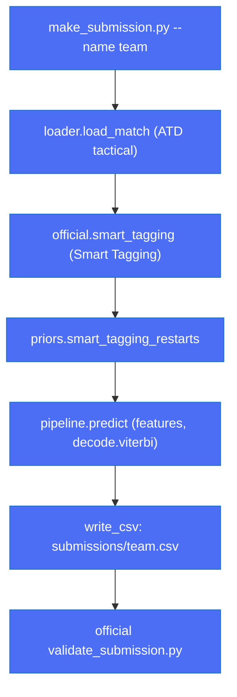

# Workflow de développement / Development workflow

[Français](#français) | [English](#english)



## Français

> **État au 2026-11-16.** Les commandes ci-dessous existent dans le dépôt (`scripts/`, `tests/`,
> `requirements.txt`). Elles n'ont pas été rejouées par cette mise à jour : à valider sur une machine propre.
> Ce qui n'existe pas encore est marqué 🎯. Date limite de soumission : 17 novembre 2026, soit
> un jour après cette mise à jour.
>
> Convention : `python` désigne l'interpréteur de l'environnement virtuel, soit `.venv\Scripts\python.exe`
> sous Windows (ou `.venv/bin/python` sous bash). Les commandes `python ...` supposent cet environnement activé.

Nouveau contributeur ? Suivre le **Quick start** de haut en bas.

---

### Quick start

1. Cloner le dépôt de l'équipe (public, sans `data/`).
2. Créer l'environnement virtuel avec Python 3.11 et installer les dépendances figées (`requirements.txt` :
   numpy 2.4.6, pandas 3.1.1, pytest 9.2.0).

   PowerShell (Windows) :

   ```powershell
   py -3.11 -m venv .venv
   .\.venv\Scripts\python.exe -m pip install -r requirements.txt
   ```

   bash :

   ```bash
   python3.11 -m venv .venv
   .venv/bin/python -m pip install -r requirements.txt
   ```

   Si le lanceur `py` ne trouve pas Python 3.11, utiliser le chemin complet de `python.exe` 3.11.
3. Dépôt officiel à côté du dépôt : `..\more-than-a-hack-2027` (Windows) ou `../more-than-a-hack-2027` (bash).
   Son code est importé depuis le disque (`arena/official.py`), jamais copié. Autre emplacement : variable
   `MTAH_OFFICIAL_DIR` (voir le tableau ci-dessous).
4. Placer les données du match hors du dépôt : dans le dossier `data/` attendu par `games.require` du dépôt
   officiel, ou dans le dossier désigné par `MTAH_DATA_DIR`. Ne jamais les commiter.
5. Régénérer le CSV de soumission et le valider (le validateur officiel est lancé par le script) :

   ```
   python scripts/make_submission.py --name <nom_equipe>
   ```

6. Réglage sur données externes (git requis, données Metrica) :

   ```
   python scripts/get_external.py
   python scripts/tune_external.py
   ```

7. Lancer les tests (synthétiques uniquement) :

   ```
   python -m pytest -q tests
   ```

Commandes par shell : PowerShell, activer l'environnement avec `.\.venv\Scripts\Activate.ps1`, puis `python ...`
comme ci-dessus. Sous bash, `source .venv/bin/activate`. Les commandes elles-mêmes sont identiques.

---

### Variables d'environnement

| Variable | Rôle | Défaut |
|---|---|---|
| `MTAH_OFFICIAL_DIR` | Dépôt officiel (`games.py`, `evaluation/`, `starter/`) | dossier frère `more-than-a-hack-2027` |
| `MTAH_DATA_DIR` | Dossier des données du match, lu par le code du dépôt officiel (ARENA.md §4.2) | résolu par `games.require` |
| `ARENA_EXTERNAL_DIR` | Dossier des données externes (`get_external.py`, `external_metrica.py`) | `external/sample-data` dans ce dépôt |

PowerShell : `$env:MTAH_OFFICIAL_DIR = "C:\chemin\vers\more-than-a-hack-2027"`.
bash : `export MTAH_OFFICIAL_DIR=/chemin/vers/more-than-a-hack-2027`.

---

### Environnements

| Environnement | Usage | Données du match | Envoi à un LLM hébergé dans le cloud |
|---|---|---|---|
| `dev` | développement local | `data/` en local, jamais commité | interdit |
| `test` | tests automatiques | jeux synthétiques versionnés (`tests/`) ; aucun test ne lit `data/` | interdit |
| `soumission` | régénération du CSV final depuis un clone propre | `data/` fourni, hors du dépôt | interdit |

Règles :

- **Aucune donnée du match dans le dépôt** : ni `data/`, ni vidéo, ni export frame par frame (ARENA.md §7).
  `.gitignore` couvre `data/`, `*.mp4`, `*.csv`, `submissions/`, `external/` et `.venv/`.
- **Aucune clé ni service distant** : le pipeline tourne en local.
- **Graine fixe** : pas de tirage aléatoire sur le chemin du match. Le seul tirage (occlusion et dégradation
  des remises, sur données externes) utilise une graine fixe (`SEED = 0`).
- **Interpréteur** : Python 3.11, version figée dans `requirements.txt`. `DECISIONS.md` D-001 mentionne encore
  « 3.9 minimum » : voir `KNOWN_ISSUES.md` (entrée 17).

---

### Commandes

| Action | Commande | Statut |
|---|---|---|
| Installer les dépendances | `python -m pip install -r requirements.txt` | ✅ |
| Régénérer et valider le CSV | `python scripts/make_submission.py --name <nom_equipe>` | ✅ sortie `submissions/<nom_equipe>.csv` (ignorée par Git) |
| Récupérer les données externes | `python scripts/get_external.py` | ✅ clone épinglé au commit `e706dd5`, dans `external/sample-data` |
| Régler sur données externes | `python scripts/tune_external.py` | ✅ écrit `tuning/results.json` ; ne modifie pas `arena/config.py` |
| Lancer les tests | `python -m pytest -q tests` | ✅ 8 tests synthétiques (`tests/test_pipeline.py`) |
| Scorer spellF1 / macroF1 | fonctions officielles chargées par `arena/official.py` | 🟡 utilisées par `tune_external.py` sur données externes ; pas de commande de scoring du match |
| Lint, type-check | — | 🎯 non installés ; ruff absent de `requirements.txt` ; non décidé |
| Vérifier les règles du défi | agent `rules-guard` (`TESTING.md` §6) | 🎯 |

Détails utiles :

- `make_submission.py` écrit `frame,label` (en-tête puis une ligne par frame), vérifie la plage des frames
  (`loader.py`), affiche des agrégats seulement, puis affiche l'empreinte SHA-256 (16 premiers caractères).
  Son code de sortie est celui du validateur officiel.
- `tune_external.py` fait deux grilles : 144 combinaisons (étape 1) puis 96 (étape 2, a priori des remises),
  chacune sur les deux matchs Metrica. La durée n'est pas mesurée ici.
- Les valeurs de `arena/config.py` sont recopiées à la main depuis `tuning/results.json` (voir `TUNING.md`).
  Relancer le réglage ne change pas la soumission tant que `config.py` n'est pas mis à jour.

Aucun service réseau ni port n'est prévu : tout tourne en processus local (sauf `get_external.py`, qui clone
un dépôt public).

---

### Comment soumettre

Source : ARENA.md §6. Date limite : **17 novembre 2026** ; résultats avant le **26 novembre 2026**.

1. Régénérer le CSV depuis le dépôt propre : `python scripts/make_submission.py --name <nom_equipe>`.
   Le script valide le fichier produit avec le validateur officiel. Noter l'empreinte SHA-256 affichée.
2. Relancer la commande une seconde fois : l'empreinte doit être identique (`TESTING.md` §6). ✅ Vérifié le 2026-11-17 sur un clone neuf de `main` avec un environnement neuf (SHA-256 `42e933af…`).
3. Le fichier s'appelle `<nom_equipe>.csv`, et il est dans `submissions/` (ignoré par Git, à envoyer hors dépôt).
4. Rédiger le document technique `<nom_equipe>.pdf` (PDF ou MD, quelques pages) avec les rubriques d'ARENA.md §6.2 :
   approche et son choix, données utilisées et abandonnées, données d'entraînement (source, annotateur,
   quantité ; rien sur ce match), règles de possession, tracking manquant ou bruité, limites, reproduction.
5. Vérifier que le dépôt public est accessible, sans `data/`, avec des dépendances figées, et que la commande de
   régénération est documentée.
6. Remplir le **Google Form** (lien envoyé par e-mail aux inscrits ; compte Google requis) : nom d'équipe, CSV,
   URL du dépôt, document technique.
7. Une seule réponse par équipe, modifiable : la dernière réponse avant la date limite compte.
8. Ne pas attendre le dernier jour. Il n'y a ni classement en direct ni retour pendant le concours (ARENA.md §6.3).

Contact : `hackathon.talentarena@mobileworldcapital.com` ; questions techniques : issues GitHub du dépôt officiel.

---

### Avant de commiter

- `git status` ne liste aucun fichier de `data/`, aucun `*.mp4`, aucun CSV, aucun export frame par frame
  (publication interdite, ARENA.md §7 ; le CSV soumis dans le dépôt public reste à confirmer, `ROADMAP_NEXT_STEPS.md` §5).
- Aucun secret ni donnée personnelle dans le diff.
- Tests verts : `python -m pytest -q tests`. Lint : 🎯.
- `rules-guard` vert (`TESTING.md` §6) : 🎯 agent à utiliser avant tout commit sensible.
- Logs conformes aux marqueurs `[START]` `[ENTITY]` `[CALL]` `[RESULT]` `[STATE]` (`TESTING.md` §7). Les scripts
  utilisent déjà `[START]` `[CALL]` `[RESULT]` `[STATE]`.
- Documentation à jour : `DECISIONS.md` pour une décision, `KNOWN_ISSUES.md` pour une limite, `LESSONS_LEARNED.md`
  après un bug. Français et anglais dans le même changement (D-005).

---

## English

> **Status as of 2026-11-16.** The commands below exist in the repository (`scripts/`, `tests/`,
> `requirements.txt`). This update did not re-run them: to be validated on a clean machine.
> What does not exist yet is marked 🎯. Submission deadline: 17 November 2026, one day after this update.
>
> Convention: `python` means the interpreter of the virtual environment, i.e. `.venv\Scripts\python.exe`
> on Windows (or `.venv/bin/python` in bash). The `python ...` commands assume this environment is active.

New contributor? Follow the **Quick start** from top to bottom.

---

### Quick start

1. Clone the team repository (public, without `data/`).
2. Create the virtual environment with Python 3.11 and install the frozen dependencies (`requirements.txt`:
   numpy 2.4.6, pandas 3.1.1, pytest 9.2.0).

   PowerShell (Windows):

   ```powershell
   py -3.11 -m venv .venv
   .\.venv\Scripts\python.exe -m pip install -r requirements.txt
   ```

   bash:

   ```bash
   python3.11 -m venv .venv
   .venv/bin/python -m pip install -r requirements.txt
   ```

   If the `py` launcher does not find Python 3.11, use the full path of the 3.11 `python.exe`.
3. Official repository next to this repository: `..\more-than-a-hack-2027` (Windows) or `../more-than-a-hack-2027`
   (bash). Its code is imported from disk (`arena/official.py`), never copied. Other location: variable
   `MTAH_OFFICIAL_DIR` (see the table below).
4. Place the match data outside the repository: in the `data/` folder expected by `games.require` of the official
   repository, or in the folder named by `MTAH_DATA_DIR`. Never commit them.
5. Regenerate the submission CSV and validate it (the official validator is run by the script):

   ```
   python scripts/make_submission.py --name <team_name>
   ```

6. Tuning on external data (git required, Metrica data):

   ```
   python scripts/get_external.py
   python scripts/tune_external.py
   ```

7. Run the tests (synthetic only):

   ```
   python -m pytest -q tests
   ```

Shell notes: in PowerShell, activate the environment with `.\.venv\Scripts\Activate.ps1`, then use `python ...`
as above. In bash, `source .venv/bin/activate`. The commands themselves are identical.

---

### Environment variables

| Variable | Role | Default |
|---|---|---|
| `MTAH_OFFICIAL_DIR` | Official repository (`games.py`, `evaluation/`, `starter/`) | sibling folder `more-than-a-hack-2027` |
| `MTAH_DATA_DIR` | Folder of the match data, read by the code of the official repository (ARENA.md §4.2) | resolved by `games.require` |
| `ARENA_EXTERNAL_DIR` | Folder of the external data (`get_external.py`, `external_metrica.py`) | `external/sample-data` in this repository |

PowerShell: `$env:MTAH_OFFICIAL_DIR = "C:\path\to\more-than-a-hack-2027"`.
bash: `export MTAH_OFFICIAL_DIR=/path/to/more-than-a-hack-2027`.

---

### Environments

| Environment | Use | Match data | Sending to a cloud-hosted LLM |
|---|---|---|---|
| `dev` | local development | `data/` locally, never committed | forbidden |
| `test` | automated tests | small synthetic datasets, versioned (`tests/`); no test reads `data/` | forbidden |
| `submission` | regeneration of the final CSV from a clean clone | `data/` provided, outside the repository | forbidden |

Rules:

- **No match data in the repository**: no `data/`, no video, no frame-by-frame export (ARENA.md §7).
  `.gitignore` covers `data/`, `*.mp4`, `*.csv`, `submissions/`, `external/` and `.venv/`.
- **No key or remote service**: the pipeline runs locally.
- **Fixed seed**: no random draw on the match path. The only draws (occlusion and degradation of restarts, on
  external data) use a fixed seed (`SEED = 0`).
- **Interpreter**: Python 3.11, version pinned in `requirements.txt`. `DECISIONS.md` D-001 still says
  "3.9 minimum": see `KNOWN_ISSUES.md` (entry 17).

---

### Commands

| Action | Command | Status |
|---|---|---|
| Install dependencies | `python -m pip install -r requirements.txt` | ✅ |
| Regenerate and validate the CSV | `python scripts/make_submission.py --name <team_name>` | ✅ output `submissions/<team_name>.csv` (ignored by Git) |
| Fetch the external data | `python scripts/get_external.py` | ✅ clone pinned at commit `e706dd5`, in `external/sample-data` |
| Tune on external data | `python scripts/tune_external.py` | ✅ writes `tuning/results.json`; does not change `arena/config.py` |
| Run tests | `python -m pytest -q tests` | ✅ 8 synthetic tests (`tests/test_pipeline.py`) |
| Score spellF1 / macroF1 | official functions loaded by `arena/official.py` | 🟡 used by `tune_external.py` on external data; no scoring command for the match |
| Lint, type-check | — | 🎯 not installed; ruff absent from `requirements.txt`; not decided |
| Check challenge rules | `rules-guard` agent (`TESTING.md` §6) | 🎯 |

Useful details:

- `make_submission.py` writes `frame,label` (header, then one line per frame), checks the frame range
  (`loader.py`), prints aggregates only, then prints the SHA-256 fingerprint (first 16 characters).
  Its exit code is the exit code of the official validator.
- `tune_external.py` runs two grids: 144 combinations (stage 1), then 96 (stage 2, restart prior), each on the
  two Metrica games. Its run time is not measured here.
- The values in `arena/config.py` are copied by hand from `tuning/results.json` (see `TUNING.md`).
  Re-running the tuning does not change the submission until `config.py` is updated.

No network service or port is planned: everything runs as a local process (except `get_external.py`, which
clones a public repository).

---

### How to submit

Source: ARENA.md §6. Deadline: **17 November 2026**; results before **26 November 2026**.

1. Regenerate the CSV from the clean repository: `python scripts/make_submission.py --name <team_name>`.
   The script validates the produced file with the official validator. Note the SHA-256 fingerprint printed.
2. Run the command a second time: the fingerprint must be identical (`TESTING.md` §6). ✅ Verified on 2026-11-17 on a fresh clone of `main` with a fresh environment (SHA-256 `42e933af…`).
3. The file is named `<team_name>.csv` and sits in `submissions/` (ignored by Git; send it outside the repository).
4. Write the technical document `<team_name>.pdf` (PDF or MD, a few pages) with the sections of ARENA.md §6.2:
   approach and why it was chosen, data used and abandoned, training data (source, annotator, quantity; nothing
   on this match), possession rules, missing or noisy tracking, limits, reproduction.
5. Check that the public repository is reachable, without `data/`, with frozen dependencies, and that the
   regeneration command is documented.
6. Fill in the **Google Form** (link sent by e-mail to registered teams; a Google account is required): team name,
   CSV, repository URL, technical document.
7. One answer per team, editable: the last answer before the deadline counts.
8. Do not wait for the last day. There is no live leaderboard and no feedback during the challenge (ARENA.md §6.3).

Contact: `hackathon.talentarena@mobileworldcapital.com`; technical questions: GitHub issues of the official repository.

---

### Before committing

- `git status` lists no file from `data/`, no `*.mp4`, no CSV, no frame-by-frame export (publication forbidden,
  ARENA.md §7; whether the submitted CSV may appear in the public repository is still to confirm,
  `ROADMAP_NEXT_STEPS.md` §5).
- No secret and no personal data in the diff.
- Tests green: `python -m pytest -q tests`. Lint: 🎯.
- `rules-guard` green (`TESTING.md` §6): 🎯 agent to run before any sensitive commit.
- Logs follow the `[START]` `[ENTITY]` `[CALL]` `[RESULT]` `[STATE]` markers (`TESTING.md` §7). The scripts
  already use `[START]` `[CALL]` `[RESULT]` `[STATE]`.
- Documentation up to date: `DECISIONS.md` for a decision, `KNOWN_ISSUES.md` for a limit, `LESSONS_LEARNED.md`
  after a bug. French and English in the same change (D-005).
