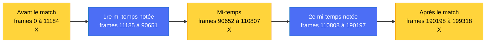
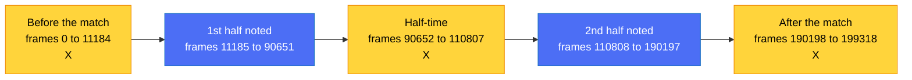

# Notes de domaine : possession du ballon

[Français](#français) | [English](#english)

---

## Français

> 🎯 Document cible : aucun code n'existe. Les chiffres viennent de [ARENA.md](../ARENA.md) (ils sont cités, jamais estimés). Règles : [BUSINESS_RULES.md](BUSINESS_RULES.md). Exigences : [REQUIREMENTS.md](REQUIREMENTS.md).

### 1. Objet du défi

Le match est Barcelona (`H`) contre Athletic Club (`A`), LaLiga EA Sports 2024-25, journée 2. Il dure 199 319 frames à 25 fps (environ 2 h 15 de vidéo), dont 158 857 frames notées (environ 106 minutes de jeu).

La soumission associe à chaque frame un label : `H`, `A`, `D` ou `X`. La notation compare ces labels à une vérité terrain privée, et ne sert qu'à produire un score.

### 2. Glossaire

| Terme | Définition | Remarque |
|---|---|---|
| `H` | Barcelona a le ballon, ballon vivant. | Home |
| `A` | Athletic Club a le ballon, ballon vivant. | Away |
| `D` | Ballon mort (hors jeu, arrêt). Pas de propriétaire. | Même quand le tracking désigne une équipe |
| `X` | Pas de réponse (abstention). | Erreur en macroF1 ; remplacé en spellF1 (§7) |
| Ballon vivant / mort | Ballon en jeu / arrêté (hors jeu, coup de pied arrêté, etc.). | Seul le ballon vivant peut appartenir à une équipe |
| Possession | Suite maximale d'une même équipe, ballon vivant. | BR-06 |
| Changement de possession | Un joueur adverse prend le contrôle du ballon. | BR-04 |
| Ballon disputé ou libre | La possession reste à la dernière équipe qui l'avait. | BR-03 |
| Spell | Suite maximale d'un même label hors `X`, comptée comme un objet par spellF1. | Définition de travail : le code du scoreur fait foi |
| IoU temporel | Intersection divisée par union des intervalles de temps d'une possession prédite et d'une possession réelle. Sert à les associer. | Voir §7 |
| ATD | Tracking automatique (format FIFA/EPTS) : un XML de métadonnées et un TXT brut. | Tracking tactical ou broadcast |
| Tactical | Caméra de référence. La ligne `i` de la soumission correspond à sa frame `i`. | H-01 |
| Broadcast | Caméra optionnelle, non synchronisée avec la tactical. | H-02 |
| Homographie | Matrice 3×3 par frame qui projette les coordonnées normalisées du terrain vers les pixels. | Colonne `valid` à vérifier |
| Smart Tagging | Annotation tactique automatique (XML SportsCode), 638 instances. | Pas une vérité terrain |
| Frame notée | Frame située dans l'une des deux mi-temps notées. | §4 |
| Emplacement | Une position suivie, nommée « Track 1 » à « Track 46 ». Pas d'identité de joueur. | §5 |
| Tracking corrigé | Tracking retouché à la main par des humains. | Donnée humaine : interdite sur ce match (BR-14) |
| Vérité terrain publique | Frames 11 185 à 18 684 (les 5 premières minutes notées). | Test de plomberie seulement (D-006) |
| Vérité terrain privée | Vérité terrain non publiée. | Interdite (BR-14) |
| Coup d'envoi | Début du jeu en 2e mi-temps (frame 113 742). | §4 et BR-09 |
| Baseline | Méthode de référence fournie par les organisateurs. | §7 |

### 3. Alignement des frames

Trois sources n'utilisent pas le même index. Il faut les ramener à la ligne de soumission, qui va de 0 à 199318.

| Source | Index | Vers la ligne de soumission |
|---|---|---|
| Soumission | `0` à `199318` | Aucune conversion |
| ATD | `frame_id` de `1` à `199319` | `frame = frame_id - 1` |
| Smart Tagging | Secondes depuis la première frame tactical | `frame = round(secondes × 25)` |
| Homographie | `0` à `199318` | Identique |

**Exemple.** Une phase du smart tagging à 447,4 s donne `round(447,4 × 25) = 11185`, soit la première frame notée de la 1re mi-temps. Une ligne ATD de `frame_id` 11186 donne aussi la frame 11185.

**Piège.** Un fichier ATD d'environ 164 000 lignes indique qu'on a indexé la broadcast par erreur : la tactical en compte 199 319.

### 4. Périodes notées

| Période | Frames | Notée ? | Label attendu hors possession |
|---|---|---|---|
| Avant le match | 0 à 11184 | Non | `X` |
| 1re mi-temps | 11185 à 90651 (79 467 frames) | Oui | Labels `H`, `A`, `D` |
| Mi-temps | 90652 à 110807 | Non | `X` |
| 2e mi-temps | 110808 à 190197 (79 390 frames) | Oui | Labels `H`, `A`, `D` |
| Après le match | 190198 à 199318 | Non | `X` |

**Piège des 2 934 frames.** La 2e mi-temps est notée dès la frame 110 808, mais le coup d'envoi n'a lieu qu'à la frame 113 742. Les 2 934 frames entre les deux (110 808 à 113 741) sont toutes `D` selon ARENA §4.7. Elles ne doivent pas être codées en dur : la règle doit venir d'une détection dans les données (BR-09, Q-05). Les frames de ce segment ne sont pas des possessions.

Les bornes des périodes sont fournies par les métadonnées des organisateurs (`games.half_video_blocks`) : `[(1, 11185, 90651), (2, 110808, 190197)]`.

### 5. Données de tracking

- **Coordonnées normalisées entre 0 et 1.** Pour obtenir des mètres : `x × 105,3` et `y × 68,0` (dimensions de `games.py`).
- **Sens d'attaque en 1re mi-temps** : Barcelona de gauche à droite, Athletic Club de droite à gauche. Il s'inverse en 2e mi-temps.
- **46 emplacements pour 22 joueurs.** Les emplacements apparaissent, disparaissent et échangent leurs identités. On ne connaît que l'équipe de chaque emplacement. En moyenne, 20,5 objets suivis par frame notée.
- **Ballon.** Visible sur 56,9 % des frames (tactical). Absent (`NaN`) sur 43 % des frames, et sur 41 % des frames notées. Il manque surtout en surface encombrée, lors des duels aériens et des tacles. **Ce cas est à prévoir dès le premier jour.**
- **Homographie.** Tactical : 199 319 lignes, 100 % utilisables. Broadcast : 164 488 lignes, 65,8 % utilisables, 122 trous dont le plus long dépasse 1 minute 30. Erreur de reprojection médiane (tactical, pendant le jeu) : 0,24. Broadcast : jusqu'à 304.
- **Format.** Le TXT contient, par frame, `x, y, vitesse` pour chacun des 46 emplacements, puis `x, y, vitesse` du ballon. Il ne contient ni le propriétaire du ballon ni l'état vivant ou mort : il faut les déduire.

### 6. Smart Tagging

638 instances au format SportsCode XML. Ce n'est pas une vérité terrain : c'est un a priori gratuit et fort (BR-05).

| Code | Nombre | Code | Nombre |
|---|---|---|---|
| PLAYERS IN THE BOX | 97 | DEFENDING IN ATTACKING THIRD | 22 |
| BALL IN FINAL THIRD | 93 | ATTACKING TRANSITION | 24 |
| BALL IN THE BOX | 72 | DEFENSIVE TRANSITION | 24 |
| PROGRESSION | 66 | BUILD UP | 22 |
| DEFENDING IN MIDDLE THIRD | 66 | LONG BALL | 29 |
| SET PIECES | 59 | CREATING CHANCES | 30 |
| DEFENDING IN DEFENSIVE THIRD | 30 | GOALS | 4 |

- Tag `Team` : Barcelona 314, Athletic Club 288, `N/A` 36 (dont toutes les touches).
- Tag `Type` des coups de pied arrêtés : Throw-in 26, Corner 12, Goal Kick 10, Free Kick 5, Kick Off (After Goal) 4, Kick Off (Start) 2.

**Pièges.**

- Les colonnes sont en Title Case (`Team`), les codes en MAJUSCULES : comparer sans tenir compte de la casse.
- `Max Players in the box` est une chaîne (`"7+"`), pas un nombre.
- **Les intervalles sont des phases, pas des possessions.** Les recopier tels quels reproduit leurs erreurs.
- Chaque coup de pied arrêté correspond à une reprise de jeu, donc à la fin d'un ballon mort (ARENA §4.4).

### 7. Notation

Le scoreur officiel fait foi (`evaluation/possession_metrics.py`, environ 720 lignes). En cas de désaccord avec ce document, c'est le code qui gagne.

**macroF1** (départage des ex æquo) : moyenne des F1 de `H`, `A` et `D` sur les frames notées, frame par frame. Plancher d'environ 0,16, pas 0. Un écart inférieur à 0,01 est du bruit.

**spellF1** (classement) :

- chaque possession compte comme un seul objet, quelle que soit sa durée ;
- les possessions prédites sont associées une à une aux vraies selon l'IoU temporel ;
- le F1 est moyenné sur les seuils d'IoU 0,3 / 0,4 / 0,5 / 0,6 / 0,7 ;
- une prédiction constante ou aléatoire donne 0 ;
- un écart inférieur à 0,04 est du bruit sur le match complet.

**Sensibilité au décalage** (spellF1) : un retard de 1 frame est gratuit (1,0000), 3 frames donnent 0,98, 8 frames 0,89, **1 seconde 0,65**.

**Traitement de `X`.**

- macroF1 : un `X` sur une frame notée compte comme une erreur.
- spellF1 : chaque `X` est remplacé par le dernier label non-`X` de la même mi-temps (en début de mi-temps, par le suivant).
- En plein milieu d'une possession (ballon perdu de vue), `X` est gratuit, et plus sûr qu'une supposition qui couperait la possession en deux.
- Au moment d'une transition, il faut proposer un label, sinon l'ancien continue après le changement de possession.

**Baselines** (même algorithme : joueur suivi le plus proche du ballon, puis vote majoritaire ; seule la fenêtre change) :

| Baseline | macroF1 (match) | spellF1 (match) | spellF1 (5 min publiques) |
|---|---|---|---|
| raw | 0,6532 | 0,0486 | 0,0378 |
| smooth25 | 0,6752 | 0,1996 | 0,2868 |
| smooth50 | 0,6724 | **0,2433** (seuil à battre) | 0,3256 |
| smooth125 | 0,6356 | 0,2242 | **0,4242** (trompeur) |

**Leçons.**

- Régler sur les 5 minutes publiques fait choisir la mauvaise option : smooth125 y paraît le meilleur et il est le pire sur le match (D-006).
- Une seule possession ratée dans les 5 minutes publiques coûte environ 6 points.
- `--bootstrap 1000` indique si un écart est réel.

**Vérité terrain publique** : frames 11 185 à 18 684 (7 500 frames). Elle contient `H` 3 454, `A` 2 577, `D` 1 469, et 17 possessions de 14,2 s en moyenne. Tout le reste vaut `X`.

### 8. Exemples travaillés

**Exemple 1 : compter les possessions.** La séquence `H H H A A` contient 2 possessions : `H` (3 frames), puis `A` (2 frames). Un changement de label à ballon vivant est un changement de possession.

**Exemple 2 : un arrêt coupe la possession.** La séquence `H H D D H H` contient 2 possessions et non une seule : les deux `H` sont séparés par un ballon mort. Le `D` n'est pas une possession ; il sépare deux possessions de Barcelona.

**Exemple 3 : le coût d'un décalage.** Une prédiction décalée d'une seconde (25 frames) fait tomber spellF1 à 0,65 (ARENA §5), alors qu'un décalage d'une frame est gratuit. D'où l'importance de l'alignement (§3).

**Exemple 4 : un `X` au milieu d'une possession.** Un ballon perdu de vue pendant quelques secondes au milieu d'une possession de `A` : `X` sur ces frames ne coûte rien en spellF1 (§7), alors qu'un label `H` supposé couperait la possession.

### 9. Documents liés

- [BUSINESS_RULES.md](BUSINESS_RULES.md) : règles BR-01 à BR-31, cycle de vie, paramètres.
- [REQUIREMENTS.md](REQUIREMENTS.md) : exigences FR et NFR.
- [ARCHITECTURE.md](ARCHITECTURE.md) : pipeline cible et données utilisées ou abandonnées.
- [DECISIONS.md](DECISIONS.md) : D-001 à D-007.
- [ARENA.md](../ARENA.md) : guide du défi, source des chiffres de ce document.

---

## English

> 🎯 Target document: no code exists. The figures come from [ARENA.md](../ARENA.md) (they are quoted, never estimated). Rules: [BUSINESS_RULES.md](BUSINESS_RULES.md). Requirements: [REQUIREMENTS.md](REQUIREMENTS.md).

### 1. Purpose of the challenge

The match is Barcelona (`H`) against Athletic Club (`A`), LaLiga EA Sports 2024-25, matchday 2. It lasts 199 319 frames at 25 fps (about 2 h 15 of video), of which 158 857 frames are noted (about 106 minutes of play).

The submission attaches one label to each frame: `H`, `A`, `D` or `X`. Scoring compares these labels with a private ground truth, and only produces a score.

### 2. Glossary

| Term | Definition | Note |
|---|---|---|
| `H` | Barcelona has the ball, live ball. | Home |
| `A` | Athletic Club has the ball, live ball. | Away |
| `D` | Dead ball (out of play, stoppage). No owner. | Even when the tracking points to a team |
| `X` | No answer (abstention). | An error in macroF1; replaced in spellF1 (§7) |
| Live / dead ball | Ball in play / stopped (out of play, set piece, etc.). | Only a live ball can belong to a team |
| Possession | Maximal run of the same team, live ball. | BR-06 |
| Change of possession | An opponent player takes control of the ball. | BR-04 |
| Loose or contested ball | Possession stays with the last team that had it. | BR-03 |
| Spell | Maximal run of the same label, excluding `X`, counted as one object by spellF1. | Working definition: the scorer's code decides |
| Temporal IoU | Intersection over union of the time intervals of a predicted possession and a true one. Used to match them. | See §7 |
| ATD | Automatic tracking data (FIFA/EPTS format): one XML metadata file and one raw TXT file. | Tactical or broadcast tracking |
| Tactical | Reference camera. Row `i` of the submission corresponds to its frame `i`. | H-01 |
| Broadcast | Optional camera, not synchronised with the tactical one. | H-02 |
| Homography | 3×3 matrix per frame that projects normalised pitch coordinates onto pixels. | Check the `valid` column |
| Smart Tagging | Automatic tactical annotation (SportsCode XML), 638 instances. | Not a ground truth |
| Noted frame | Frame inside one of the two noted halves. | §4 |
| Slot | A tracked position, named "Track 1" to "Track 46". No player identity. | §5 |
| Corrected tracking | Tracking manually corrected by humans. | Human data: forbidden on this match (BR-14) |
| Public ground truth | Frames 11,185 to 18,684 (the first 5 noted minutes). | Plumbing test only (D-006) |
| Private ground truth | Ground truth that is not published. | Forbidden (BR-14) |
| Kick-off | Start of play in the 2nd half (frame 113,742). | §4 and BR-09 |
| Baseline | Reference method supplied by the organisers. | §7 |

### 3. Frame alignment

Three sources do not use the same index. They must be mapped to the submission row, which runs from 0 to 199318.

| Source | Index | To the submission row |
|---|---|---|
| Submission | `0` to `199318` | No conversion |
| ATD | `frame_id` from `1` to `199319` | `frame = frame_id - 1` |
| Smart Tagging | Seconds since the first tactical frame | `frame = round(seconds × 25)` |
| Homography | `0` to `199318` | Identical |

**Example.** A smart tagging phase at 447.4 s gives `round(447.4 × 25) = 11185`, the first noted frame of the 1st half. An ATD row with `frame_id` 11186 also gives frame 11185.

**Pitfall.** An ATD file of about 164,000 rows means the broadcast was indexed by mistake: the tactical one has 199,319.

### 4. Noted periods

| Period | Frames | Noted? | Expected label outside possession |
|---|---|---|---|
| Before the match | 0 to 11184 | No | `X` |
| 1st half | 11185 to 90651 (79,467 frames) | Yes | Labels `H`, `A`, `D` |
| Half-time | 90652 to 110807 | No | `X` |
| 2nd half | 110808 to 190197 (79,390 frames) | Yes | Labels `H`, `A`, `D` |
| After the match | 190198 to 199318 | No | `X` |

**The 2,934-frame trap.** The 2nd half is noted from frame 110,808, but kick-off only happens at frame 113,742. The 2,934 frames between them (110,808 to 113,741) are all `D` according to ARENA §4.7. They must not be hard-coded: the rule has to come from a detection in the data (BR-09, Q-05). The frames of this segment are not possessions.

The period bounds are supplied by the organisers' metadata (`games.half_video_blocks`): `[(1, 11185, 90651), (2, 110808, 190197)]`.

### 5. Tracking data

- **Normalised coordinates between 0 and 1.** To get metres: `x × 105.3` and `y × 68.0` (dimensions from `games.py`).
- **Direction of attack in the 1st half**: Barcelona from left to right, Athletic Club from right to left. It reverses in the 2nd half.
- **46 slots for 22 players.** Slots appear, disappear and swap identities. Only the team of each slot is known. On average, 20.5 tracked objects per noted frame.
- **Ball.** Visible on 56.9 % of tactical frames. Missing (`NaN`) on 43 % of frames, and on 41 % of noted frames. It is missing mostly in crowded penalty areas, during aerial duels and tackles. **Plan for this case from day one.**
- **Homography.** Tactical: 199,319 rows, 100 % usable. Broadcast: 164,488 rows, 65.8 % usable, 122 gaps, the longest one over 1 minute 30. Median reprojection error (tactical, during play): 0.24. Broadcast: up to 304.
- **Format.** The TXT contains, per frame, `x, y, speed` for each of the 46 slots, then `x, y, speed` of the ball. It contains neither the ball owner nor the live or dead state: these must be deduced.

### 6. Smart Tagging

638 instances in SportsCode XML format. It is not a ground truth: it is a free and strong prior (BR-05).

| Code | Count | Code | Count |
|---|---|---|---|
| PLAYERS IN THE BOX | 97 | DEFENDING IN ATTACKING THIRD | 22 |
| BALL IN FINAL THIRD | 93 | ATTACKING TRANSITION | 24 |
| BALL IN THE BOX | 72 | DEFENSIVE TRANSITION | 24 |
| PROGRESSION | 66 | BUILD UP | 22 |
| DEFENDING IN MIDDLE THIRD | 66 | LONG BALL | 29 |
| SET PIECES | 59 | CREATING CHANCES | 30 |
| DEFENDING IN DEFENSIVE THIRD | 30 | GOALS | 4 |

- `Team` tag: Barcelona 314, Athletic Club 288, `N/A` 36 (including all throw-ins).
- `Type` tag of set pieces: Throw-in 26, Corner 12, Goal Kick 10, Free Kick 5, Kick Off (After Goal) 4, Kick Off (Start) 2.

**Pitfalls.**

- Columns use Title Case (`Team`), codes use UPPER CASE: compare ignoring case.
- `Max Players in the box` is a string (`"7+"`), not a number.
- **The intervals are phases, not possessions.** Copying them as they are reproduces their errors.
- Each set piece corresponds to a restart of play, so to the end of a dead ball (ARENA §4.4).

### 7. Scoring

The official scorer is the reference (`evaluation/possession_metrics.py`, about 720 lines). If this document disagrees with it, the code wins.

**macroF1** (breaks ties): mean of the F1 scores of `H`, `A` and `D` over noted frames, frame by frame. Floor of about 0.16, not 0. A gap below 0.01 is noise.

**spellF1** (ranking):

- each possession counts as one object, whatever its duration;
- predicted possessions are matched one by one to true ones by temporal IoU;
- the F1 is averaged over IoU thresholds 0.3 / 0.4 / 0.5 / 0.6 / 0.7;
- a constant or random prediction scores 0;
- a gap below 0.04 is noise on the full match.

**Sensitivity to offset** (spellF1): a delay of 1 frame is free (1.0000), 3 frames give 0.98, 8 frames 0.89, **1 second 0.65**.

**Handling of `X`.**

- macroF1: an `X` on a noted frame counts as an error.
- spellF1: each `X` is replaced by the last non-`X` label of the same half (at the start of a half, by the next one).
- In the middle of a possession (ball out of sight), `X` is free, and safer than a guess that would cut the possession in two.
- At a transition, a label must be proposed; otherwise the old label carries on after the change of possession.

**Baselines** (same algorithm: nearest tracked player to the ball, then majority vote; only the window changes):

| Baseline | macroF1 (match) | spellF1 (match) | spellF1 (public 5 min) |
|---|---|---|---|
| raw | 0.6532 | 0.0486 | 0.0378 |
| smooth25 | 0.6752 | 0.1996 | 0.2868 |
| smooth50 | 0.6724 | **0.2433** (threshold to beat) | 0.3256 |
| smooth125 | 0.6356 | 0.2242 | **0.4242** (misleading) |

**Lessons.**

- Tuning on the public 5 minutes leads to the wrong choice: smooth125 looks best there and is the worst on the match (D-006).
- A single lost possession within the public 5 minutes costs about 6 points.
- `--bootstrap 1000` shows whether a gap is real.

**Public ground truth**: frames 11,185 to 18,684 (7,500 frames). It contains `H` 3,454, `A` 2,577, `D` 1,469, and 17 possessions of 14.2 s on average. Everything else is `X`.

### 8. Worked examples

**Example 1: counting possessions.** The sequence `H H H A A` contains 2 possessions: `H` (3 frames), then `A` (2 frames). A label change on a live ball is a change of possession.

**Example 2: a stoppage cuts a possession.** The sequence `H H D D H H` contains 2 possessions, not one: the two `H` runs are separated by a dead ball. The `D` is not a possession; it separates two possessions of Barcelona.

**Example 3: the cost of an offset.** A prediction shifted by one second (25 frames) drops spellF1 to 0.65 (ARENA §5), whereas a one-frame shift is free. Hence the importance of alignment (§3).

**Example 4: an `X` in the middle of a possession.** The ball is out of sight for a few seconds in the middle of an `A` possession: an `X` on those frames costs nothing in spellF1 (§7), whereas an assumed `H` label would cut the possession.

### 9. Related documents

- [BUSINESS_RULES.md](BUSINESS_RULES.md): rules BR-01 to BR-31, lifecycle, parameters.
- [REQUIREMENTS.md](REQUIREMENTS.md): functional and non-functional requirements.
- [ARCHITECTURE.md](ARCHITECTURE.md): target pipeline and data used or abandoned.
- [DECISIONS.md](DECISIONS.md): D-001 to D-007.
- [ARENA.md](../ARENA.md): challenge guide, source of the figures in this document.
