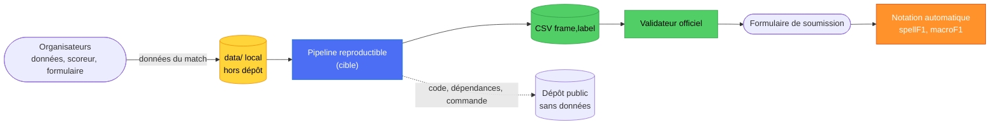
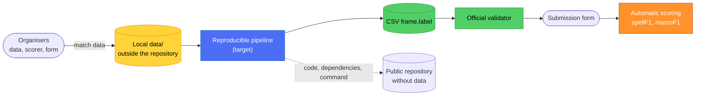

# Exigences : possession du ballon

[Français](#français) | [English](#english)

---

## Français

> Statut : 🎯 cible. Aucun code n'existe encore dans ce dépôt. Les valeurs marquées « proposition » ne sont pas validées.
> Identifiants stables : jamais renumérotés. Un identifiant retiré est marqué `withdrawn`.
> Source des faits : [ARENA.md](../ARENA.md) (guide du défi), sauf mention contraire.

### 1. Vision et problème

**Défi.** Pour chaque frame du match Barcelona (`H`) contre Athletic Club (`A`), LaLiga EA Sports 2024-25, journée 2, dire quelle équipe a le ballon, ou si le ballon est mort (`D`). Le fichier rendu compte 199 319 frames, de 0 à 199318.

**Vision.** Un pipeline reproductible qui lit les données de tracking fournies, produit une étiquette pour chaque frame, écrit le CSV de soumission et le valide avant envoi. Le dépôt public contient le code, jamais les données du match.

**Enjeu.** La notation est 100 % automatique : seul le score compte (ARENA §1). L'édition 2026 était libre et jugée par un jury ; l'édition 2027 pose une seule question. Le classement repose sur spellF1 ; le départage se fait par macroF1 (voir [DOMAIN_NOTES.md](DOMAIN_NOTES.md) §7).

### 2. Périmètre

| Inclus | Hors périmètre |
|---|---|
| Production du CSV de soumission pour le match, frames 0 à 199318 | Annotation manuelle de ce match, sous quelque forme que ce soit (BR-13) |
| Lecture et alignement du tracking tactical (référence) ; lecture optionnelle du broadcast | Correction manuelle du tracking ou de la sortie (BR-13) |
| Smart Tagging comme a priori | Données humaines sur ce match : Opta, StatsBomb, Wyscout, LaLiga, tracking corrigé (BR-14) |
| Données externes d'autres matchs pour le réglage, si la licence le permet (BR-25, D-007) | Réglage sur la vérité terrain publique ou sur la vidéo fournie (BR-15, D-003) |
| Dépôt public : code, dépendances figées, commande de régénération | Envoi de vidéos ou de données à un service d'IA hébergé dans le cloud (BR-17) |
| Document technique (FR-16) | Publication de données du match : exports frame par frame, extraits vidéo (BR-19) |
| Visualisations de debug, hors soumission (FR-15) | Modèle privé ou interne non partageable, sans demande préalable (BR-20) |

### 3. Acteurs

| Acteur | Type | Rôle | Interagit avec |
|---|---|---|---|
| Équipe participante (3 à 5 membres) | Humain | Construit le pipeline, rédige le document technique, soumet | Dépôt public, formulaire |
| Organisateurs (Metrica Sports, FC Barcelona Barça Innovation Hub, Mobile World Capital Barcelona) | Externe | Fournissent les données, le scoreur officiel, reçoivent les soumissions | Données, formulaire |
| Scoreur officiel (`run_evaluation.py`) | Outil externe | Calcule macroF1 et spellF1, le même que celui des organisateurs | CSV |
| Validateur (`validate_submission.py`) | Outil externe | Contrôle le format du fichier exact qui sera envoyé | CSV |
| Pipeline (cible) | Logiciel de l'équipe | Produit le CSV à partir des données locales | `data/` local, dépôt public |

### 4. Contexte

- Les données du match restent sur la machine de l'équipe : aucun service tiers n'en reçoit (BR-17, NFR-07).
- Le formulaire reçoit le nom d'équipe, le CSV, l'URL du dépôt et le document technique (ARENA §6.3).

### 5. Besoins fonctionnels

| ID | Besoin | Composant cible | Statut |
|---|---|---|---|
| FR-01 | **Étiquetage complet.** Produire une étiquette `H`, `A`, `D` ou `X` pour chacune des 199 319 frames (0 à 199318) du tracking tactical. | Pipeline | 🎯 |
| FR-02 | **Format de soumission.** Fichier UTF-8, en-tête `frame,label`, sans colonne d'index, lignes dans l'ordre, aucune cellule vide, labels `H`/`A`/`D`/`X` (casse tolérée). | CsvWriter | 🎯 |
| FR-03 | **Alignement des frames.** Pour l'ATD, la ligne de soumission vaut `frame_id - 1`. Pour le smart tagging, la frame vaut `round(secondes × 25)`. L'homographie est alignée sur la soumission telle quelle. | TrackingLoader | 🎯 |
| FR-04 | **Lecture du tracking.** Lire les métadonnées XML et le TXT brut de l'ATD, en coordonnées normalisées 0 à 1. Une valeur absente n'est jamais lue comme une position. | TrackingLoader | 🎯 |
| FR-05 | **Ballon manquant.** Traiter explicitement les frames sans ballon (valeurs `NaN`, 41 % des frames notées), par une règle documentée et automatique. Aucune correction manuelle. | BallCleaner | 🎯 |
| FR-06 | **Possession.** Attribuer `H` ou `A` aux frames à ballon vivant, selon BR-03 à BR-06. | PossessionModel | 🎯 |
| FR-07 | **Ballon mort.** Attribuer `D` aux frames à ballon mort. Un ballon mort n'a pas de propriétaire (BR-02). | PossessionModel | 🎯 |
| FR-08 | **Hors période notée.** Attribuer `X` aux frames hors des deux mi-temps notées (BR-08). Les bornes viennent des métadonnées fournies, jamais de constantes codées en dur (BR-09). | PeriodMask | 🎯 |
| FR-09 | **Segmentation.** Lisser la sortie frame par frame pour éviter les possessions fragmentées (durée minimale, changement de label pénalisé). Méthode cible : segmentation probabiliste de type HMM-Viterbi, sous réserve de D-002. | Segmenter | 🎯 |
| FR-10 | **A priori smart tagging.** Utiliser les phases du smart tagging (équipe, coups de pied arrêtés) comme indices, sans recopier les intervalles comme des possessions (BR-05). | TagPrior | 🎯 |
| FR-11 | **Régénération.** Une commande unique régénère le CSV à l'identique à partir des données locales et d'une configuration versionnée. Nom indicatif : `python -m possession.run`. | Point d'entrée | 🎯 |
| FR-12 | **Validation.** Le fichier exact qui sera envoyé passe `validate_submission.py` avant envoi. | Validator | 🎯 |
| FR-13 | **Évaluation locale.** Lancer le scoreur officiel sur la vérité terrain publique, uniquement comme test de plomberie (D-006). | Evaluator | 🎯 |
| FR-14 | **Fichiers intermédiaires.** Écrire les étapes intermédiaires (tracking nettoyé, features, labels avant lissage) pour inspection, hors dépôt. | Pipeline | 🎯 |
| FR-15 | **Visualisations de debug.** Tracés pour comprendre la possession. Hors soumission. Jamais utilisés pour régler un paramètre sur ce match (BR-16, BR-22). | Debug | 🎯 |
| FR-16 | **Document technique.** Rédiger un document court (PDF) couvrant les sujets de ARENA §6.2 (voir §10), nommé `<nom_equipe>.pdf`. | Documentation | 🎯 |
| FR-17 | **Dépôt public.** Code, dépendances figées, instructions, commande de régénération, sans aucune donnée du match. | Dépôt | 🎯 |

### 6. Besoins non fonctionnels

| ID | Besoin | Mesure | Statut |
|---|---|---|---|
| NFR-01 | **Déterminisme.** Deux exécutions avec les mêmes données et la même configuration produisent un CSV identique octet pour octet. Graine (seed) fixe. | Empreinte SHA-256 identique sur deux exécutions (méthode proposée) | 🎯 |
| NFR-02 | **Aucune donnée du match dans le dépôt.** `data/`, les exports frame par frame et les extraits vidéo ne sont jamais suivis par Git. | `git ls-files` ne liste aucune donnée | 🎯 |
| NFR-03 | **Dépendances figées.** Versions de Python et des bibliothèques fixées dans un fichier de dépendances ; environnement recréable. | Installation dans un environnement vierge, puis exécution | 🎯 |
| NFR-04 | **Temps d'exécution raisonnable.** La régénération complète se termine dans un délai acceptable pour l'équipe. | À définir (ARENA.md ne fixe pas de délai) | 🎯 |
| NFR-05 | **Logs.** Chaque étape produit `[START]`, `[ENTITY]`, `[CALL]`, `[RESULT]`, `[STATE]` (CLAUDE.md §2.4). | Test sur la sortie de logs | 🎯 |
| NFR-06 | **Aucune correction silencieuse.** Toute donnée invalide ou manquante est comptée, journalisée et traitée par une règle explicite. | Test sur les compteurs | 🎯 |
| NFR-07 | **Aucun envoi vers le cloud.** Aucune vidéo ni donnée du match n'est envoyée à un LLM ou service d'IA hébergé dans le cloud. Un LLM local est permis. | Revue de code et de configuration | 🎯 |
| NFR-08 | **Explicabilité.** Chaque règle implémentée porte un identifiant BR-xx et est expliquée dans le document technique (ARENA §7 : méthode inspectable). | Revue de la matrice (§11) | 🎯 |

### 7. Contraintes et hypothèses

| ID | Type | Énoncé |
|---|---|---|
| CON-01 | Contrainte | Données du match : jamais commitées, jamais redistribuées (ARENA §7.5). |
| CON-02 | Contrainte | Équipe de 3 à 5 membres. Avec moins de 3, l'équipe n'est pas éligible à l'Innovation Challenge ni au Final Pitch (ARENA §7). |
| CON-03 | Contrainte | Date limite de soumission : 17 novembre 2026. Résultats avant le 26 novembre 2026 (ARENA §6.3, §9). |
| CON-04 | Contrainte | Une seule réponse au formulaire par équipe, modifiable ; la dernière avant la date limite compte (ARENA §6.3). |
| CON-05 | Contrainte | Pas de classement en direct ni de retour pendant la compétition (ARENA §6.3). |
| CON-06 | Contrainte | Python 3.8 au minimum pour l'évaluation seule, 3.9 recommandé pour les notebooks (ARENA §8). Choix du projet : 3.9 minimum (D-001). |
| CON-07 | Contrainte | En cas de conflit, le mail de clarification des organisateurs prime sur ARENA.md (règles reprises dans BUSINESS_RULES.md, partie 2). |
| H-01 | Hypothèse | Le tracking tactical est la référence : la ligne `i` de la soumission correspond à la frame `i` de cette vidéo (ARENA §4.1). |
| H-02 | Hypothèse | Le tracking broadcast n'est pas synchronisé avec le tactical et n'est pas requis (ARENA §4.1). |
| H-03 | Hypothèse | Le ballon est absent sur 43 % des frames (41 % des frames notées), avec la valeur `NaN` (ARENA §4.3). |
| H-04 | Hypothèse | Les coordonnées sont normalisées entre 0 et 1. Les dimensions 105,3 × 68,0 de `games.py` servent à passer en mètres (ARENA §4.3). |
| H-05 | Hypothèse | Le smart tagging est une annotation automatique, pas une vérité terrain (ARENA §4.4). |

### 8. Critères d'acceptation

| ID | Critère mesurable | Méthode de vérification |
|---|---|---|
| FR-01 | Chaque frame de 0 à 199318 reçoit exactement une étiquette parmi `H`, `A`, `D`, `X`. | Test de couverture sur la sortie |
| FR-02 | Le fichier exact envoyé passe `validate_submission.py` sans erreur : en-tête `frame,label`, 199 319 lignes de données (voir Q-01), frames 0 à 199318 dans l'ordre, aucune cellule vide. | Validateur officiel |
| FR-03 | La première ligne ATD (`frame_id` = 1) est écrite à la ligne de soumission 0. Une phase à 447,4 s du smart tagging donne la frame 11185. | Test unitaire d'alignement |
| FR-05 | Une frame sans ballon n'a jamais de position inventée : elle est comptée, puis traitée par la règle documentée (BR-10). | Test du compteur |
| FR-06, FR-07 | Une frame à ballon mort reçoit `D`, quelle que soit l'équipe désignée par le tracking. | Test unitaire sur cas synthétiques (jamais sur les frames du match) |
| FR-08 | Aux bornes 11184/11185, 90651/90652, 110807/110808 et 190197/190198 : une frame hors période notée reçoit `X` ; une frame de période notée ne reçoit `X` que par abstention (BR-12), jamais à cause de la période. | Test aux bornes |
| FR-11 | Deux exécutions successives avec les mêmes entrées produisent un CSV identique (empreinte SHA-256). | Test de déterminisme (NFR-01) |
| FR-13 | Le scoreur officiel s'exécute sur la sortie et le score est plausible. Aucun paramètre n'a été modifié en réaction à ce score (D-006). | Journal de run et revue |
| FR-16 | Le document contient les 7 sujets de ARENA §6.2. | Liste de contrôle |
| FR-17 | Aucun fichier de données n'est suivi par Git. La commande documentée régénère le CSV sur une machine qui possède les données. | Scan des fichiers suivis (NFR-02) et exécution |

### 9. Risques

| ID | Risque | Impact | Probabilité | Mitigation |
|---|---|---|---|---|
| R-01 | Ballon absent sur 41 % des frames notées, surtout en surface, lors des duels aériens et des tacles : labels faux aux moments clés. | H | H | FR-05, BR-10, `X` en plein milieu de possession (BR-12). |
| R-02 | Décalage d'une ligne ou d'une seconde. Un retard de 1 s fait tomber spellF1 à 0,65 (ARENA §5). | H | M | FR-03, FR-02, test d'alignement. |
| R-03 | Sur-ajustement sur les 5 minutes publiques. Sur ces 5 minutes, smooth125 paraît meilleur (spellF1 0,4242), alors qu'il est pire sur le match (0,2242). | H | H | D-006, D-003, BR-15, BR-28. |
| R-04 | Fragmentation des possessions : spellF1 compte chaque possession comme un objet, donc chaque coupure se paie. | H | H | FR-09, BR-06, BR-12. |
| R-05 | Violation d'une règle de compétition : annotation, comparaison avec la vidéo, service cloud, redistribution. La sanction n'est pas précisée dans ARENA.md (Q-02). | H | M | BR-13 à BR-20, revue avant chaque envoi. |
| R-06 | Soumission impossible à régénérer : CSV retouché à la main, pipeline non déterministe. | H | M | FR-11, NFR-01, D-004. |
| R-07 | Fuite de données via Git : `data/` ou un CSV commité. | H | M | NFR-02, CON-01, BR-19. |
| R-08 | Délai court : au 2026-11-07, il reste 10 jours avant la date limite du 17 novembre 2026. | H | H | Priorité au CSV valide et régénérable (Must, §12). |
| R-09 | Données locales incomplètes : au 2026-11-07, le fichier TXT du tracking tactical et les vidéos sont absents du dossier `data/` (voir [ARCHITECTURE.md](ARCHITECTURE.md) §8). | H | H | Re-téléchargement avant tout développement de loader. |
| R-10 | Licence inconnue des données externes de réglage. | M | M | D-007, BR-25 : licence vérifiée une par une. |
| R-11 | Interprétation divergente des règles de possession (contrôle, duel, reprise) par rapport à la vérité terrain. | H | M | BR-03, BR-04, BR-05 ; question Q-04. |
| R-12 | Bibliothèque de lecture du tracking non installée localement. | L | M | NFR-03, environnement figé. |

### 10. Livrables et calendrier

| Livrable | Contenu | Exigences | Échéance |
|---|---|---|---|
| CSV | `<nom_equipe>.csv`, validé sur le fichier exact | FR-01, FR-02, FR-12 | 17 novembre 2026 |
| Dépôt public | Code, dépendances figées, instructions, commande de régénération, sans données | FR-11, FR-17, NFR-02 | 17 novembre 2026 |
| Document technique | `<nom_equipe>.pdf`, sujets de ARENA §6.2 (liste ci-dessous) | FR-16, NFR-08 | 17 novembre 2026 |
| Formulaire | Nom d'équipe, CSV, URL du dépôt, document ; une réponse modifiable | CON-04 | 17 novembre 2026 |

Sujets du document technique (ARENA §6.2) :

1. L'approche et pourquoi elle a été choisie.
2. Les données utilisées et celles qui ont été abandonnées.
3. Les données d'entraînement : source, annotateur, quantité (rien sur ce match ; aucune donnée si l'approche n'apprend rien).
4. Les règles de possession implémentées : ballons libres, duels, reprises de jeu.
5. La gestion du tracking manquant ou bruité.
6. Les limites et ce qu'il faudrait améliorer.
7. Comment reproduire le résultat.

| Date | Événement |
|---|---|
| 1er octobre 2026 | Ouverture des inscriptions |
| 20 octobre 2026 | Publication des données |
| 17 novembre 2026 | Date limite de soumission |
| Avant le 26 novembre 2026 | Résultats |

### 11. Matrice de traçabilité

Tous les tests sont écrits sur des cas synthétiques ou sur des propriétés, jamais calés sur les frames du match.

| ID | Composant cible | Vérification |
|---|---|---|
| FR-01 | Pipeline | Test de couverture : 199 319 labels |
| FR-02 | CsvWriter, Validator | `validate_submission.py` sur le fichier exact |
| FR-03 | TrackingLoader | Test unitaire d'alignement |
| FR-04 | TrackingLoader | Test de lecture et de valeurs `NaN` |
| FR-05 | BallCleaner | Test de règle et compteur |
| FR-06 | PossessionModel | Tests sur cas synthétiques |
| FR-07 | PossessionModel | Test sur cas synthétiques |
| FR-08 | PeriodMask | Test aux bornes des périodes |
| FR-09 | Segmenter | Test : aucune possession sous la durée minimale (cas synthétiques) |
| FR-10 | TagPrior | Test sur intervalles synthétiques |
| FR-11 | Point d'entrée | Test de déterminisme (NFR-01) |
| FR-12 | Validator | Validation du fichier exact |
| FR-13 | Evaluator | Scoreur officiel, plomberie seulement |
| FR-14 | Pipeline | Inspection des fichiers intermédiaires |
| FR-15 | Debug | Revue |
| FR-16 | Documentation | Liste de contrôle ARENA §6.2 |
| FR-17 | Dépôt | Scan des fichiers suivis (NFR-02) |
| NFR-01 | Point d'entrée | Deux exécutions, empreinte SHA-256 |
| NFR-02 | Dépôt | Scan Git |
| NFR-03 | Environnement | Installation dans un environnement vierge |
| NFR-05 | Logs | Test de sortie |
| NFR-06 | Pipeline | Test des compteurs |
| NFR-07 | Configuration | Revue |
| NFR-08 | Documentation | Revue : chaque BR-xx implémenté est expliqué |

### 12. Priorités MoSCoW

| Priorité | Éléments |
|---|---|
| Must | FR-01, FR-02, FR-03, FR-04, FR-05, FR-06, FR-07, FR-08, FR-11, FR-12, FR-16, FR-17 ; NFR-01, NFR-02, NFR-03, NFR-05, NFR-06, NFR-07 |
| Should | FR-09, FR-10, FR-13, FR-14 ; NFR-04, NFR-08 |
| Could | FR-15 |
| Won't (cette édition) | Annotation manuelle de ce match, apprentissage sur la vérité terrain ou la vidéo, envoi de données à un service cloud : interdits (BR-13 à BR-17), pas seulement reportés |

Précision : sans CSV valide, reproductible et documenté, la soumission ne vaut rien. Les Must passent donc avant les Should.

### 13. Questions ouvertes

- **Q-01** Le fichier doit-il compter 199 319 lignes de données plus l'en-tête, ou 199 319 lignes au total ? ARENA §6.1 dit « exactement 199 319 lignes » sans trancher. Le validateur officiel fait foi.
- **Q-02** Quelle est la sanction d'une violation des règles (exclusion, pénalité) ? ARENA.md ne la précise pas.
- **Q-03** Quel est le rôle de l'Innovation Challenge et du Final Pitch (éligibilité à partir de 3 membres, ARENA §7) face à une notation 100 % automatique (ARENA §1) ?
- **Q-04** Peut-on consulter les 5 minutes publiques pour trancher une règle de possession ? ARENA §3 le prévoit (« en cas de doute, elles font foi ») ; le mail l'interdit pour l'ajustement. Position retenue (D-006) : non, plomberie seulement. À confirmer par écrit auprès des organisateurs.
- **Q-05** Les bornes des périodes notées (`games.py`) peuvent-elles servir de constantes du pipeline, ou faut-il détecter le coup d'envoi depuis les données (BR-09) ?
- **Q-06** Le tracking broadcast (non synchronisé, homographie valide sur 65,8 % des frames) apporte-t-il assez pour justifier son usage ?
- **Q-07** Quelles données externes, sous quelle licence (D-007) ? Quelle quantité, et qui les a annotées ?
- **Q-08** Le CSV de soumission peut-il être placé dans `evaluation/results/`, dossier suggéré par ARENA §8, sans être publié ? Position retenue : il n'est jamais commité, le dépôt le régénère (BR-19). Ce dossier doit être ignoré par Git.
- **Q-09** Quelles valeurs pour la durée minimale d'un contrôle, la fenêtre de lissage et la pénalité de changement ? Elles ne se règlent que sur des données externes (BR-28).
- **Q-10** Le document technique est-il attendu en français, en anglais, ou dans les deux langues ? ARENA.md ne le précise pas.

---

## English

> Status: 🎯 target. No code exists in this repository yet. Values marked "proposal" are not validated.
> Stable identifiers: never renumbered. A withdrawn identifier is marked `withdrawn`.
> Source of facts: [ARENA.md](../ARENA.md) (challenge guide), unless stated otherwise.

### 1. Vision and problem

**Challenge.** For each frame of the match Barcelona (`H`) against Athletic Club (`A`), LaLiga EA Sports 2024-25, matchday 2, say which team has the ball, or whether the ball is dead (`D`). The file covers 199 319 frames, from 0 to 199318.

**Vision.** A reproducible pipeline that reads the supplied tracking data, produces one label per frame, writes the submission CSV and validates it before sending. The public repository contains the code, never the match data.

**Stakes.** Scoring is 100 % automatic: only the score counts (ARENA §1). The 2026 edition was free and judged by a jury; the 2027 edition asks a single question. Ranking relies on spellF1; ties are broken with macroF1 (see [DOMAIN_NOTES.md](DOMAIN_NOTES.md) §7).

### 2. Scope

| In scope | Out of scope |
|---|---|
| Production of the submission CSV for the match, frames 0 to 199318 | Manual annotation of this match, in any form (BR-13) |
| Reading and alignment of the tactical tracking (reference); optional reading of the broadcast tracking | Manual correction of the tracking or of the output (BR-13) |
| Smart Tagging as a prior | Human data on this match: Opta, StatsBomb, Wyscout, LaLiga, corrected tracking (BR-14) |
| External data from other matches for tuning, if the licence allows it (BR-25, D-007) | Tuning on the public ground truth or on the supplied video (BR-15, D-003) |
| Public repository: code, frozen dependencies, regeneration command | Sending video or match data to a cloud-hosted AI service (BR-17) |
| Technical document (FR-16) | Publishing match data: frame-by-frame exports, video clips (BR-19) |
| Debug visualisations, not part of the submission (FR-15) | Private or internal model that cannot be shared, without prior request (BR-20) |

### 3. Actors

| Actor | Type | Role | Interacts with |
|---|---|---|---|
| Participating team (3 to 5 members) | Human | Builds the pipeline, writes the technical document, submits | Public repository, form |
| Organisers (Metrica Sports, FC Barcelona Barça Innovation Hub, Mobile World Capital Barcelona) | External | Provide the data and the official scorer, receive the submissions | Data, form |
| Official scorer (`run_evaluation.py`) | External tool | Computes macroF1 and spellF1, the same one as the organisers' | CSV |
| Validator (`validate_submission.py`) | External tool | Checks the format of the exact file to be sent | CSV |
| Pipeline (target) | Team software | Produces the CSV from local data | Local `data/`, public repository |

### 4. Context

- Match data stay on the team's machine: no third-party service receives it (BR-17, NFR-07).
- The form receives the team name, the CSV, the repository URL and the technical document (ARENA §6.3).

### 5. Functional requirements

| ID | Requirement | Target component | Status |
|---|---|---|---|
| FR-01 | **Complete labelling.** Produce a label `H`, `A`, `D` or `X` for each of the 199 319 frames (0 to 199318) of the tactical tracking. | Pipeline | 🎯 |
| FR-02 | **Submission format.** UTF-8 file, header `frame,label`, no index column, rows in order, no empty cell, labels `H`/`A`/`D`/`X` (case tolerated). | CsvWriter | 🎯 |
| FR-03 | **Frame alignment.** For the ATD, the submission row is `frame_id - 1`. For the smart tagging, the frame is `round(seconds × 25)`. The homography is aligned on the submission as is. | TrackingLoader | 🎯 |
| FR-04 | **Tracking reading.** Read the ATD XML metadata and raw TXT, in normalised coordinates 0 to 1. A missing value is never read as a position. | TrackingLoader | 🎯 |
| FR-05 | **Missing ball.** Handle frames without a ball (`NaN` values, 41 % of the noted frames) explicitly, through a documented and automatic rule. No manual correction. | BallCleaner | 🎯 |
| FR-06 | **Possession.** Assign `H` or `A` to frames with a live ball, according to BR-03 to BR-06. | PossessionModel | 🎯 |
| FR-07 | **Dead ball.** Assign `D` to frames with a dead ball. A dead ball has no owner (BR-02). | PossessionModel | 🎯 |
| FR-08 | **Outside noted periods.** Assign `X` to frames outside the two noted halves (BR-08). The bounds come from the supplied metadata, never from constants hard-coded in the code (BR-09). | PeriodMask | 🎯 |
| FR-09 | **Segmentation.** Smooth the frame-by-frame output to avoid fragmented possessions (minimum duration, penalised label change). Target method: probabilistic segmentation of HMM-Viterbi type, subject to D-002. | Segmenter | 🎯 |
| FR-10 | **Smart tagging prior.** Use the smart tagging phases (team, set pieces) as hints, without copying their intervals as possessions (BR-05). | TagPrior | 🎯 |
| FR-11 | **Regeneration.** A single command regenerates the CSV identically from local data and a versioned configuration. Indicative name: `python -m possession.run`. | Entry point | 🎯 |
| FR-12 | **Validation.** The exact file to be sent passes `validate_submission.py` before sending. | Validator | 🎯 |
| FR-13 | **Local evaluation.** Run the official scorer on the public ground truth, only as a plumbing test (D-006). | Evaluator | 🎯 |
| FR-14 | **Intermediate files.** Write the intermediate steps (cleaned tracking, features, labels before smoothing) for inspection, outside the repository. | Pipeline | 🎯 |
| FR-15 | **Debug visualisations.** Plots to understand possession. Not part of the submission. Never used to tune a parameter on this match (BR-16, BR-22). | Debug | 🎯 |
| FR-16 | **Technical document.** Write a short document (PDF) covering the topics of ARENA §6.2 (see §10), named `<team_name>.pdf`. | Documentation | 🎯 |
| FR-17 | **Public repository.** Code, frozen dependencies, instructions, regeneration command, with no match data at all. | Repository | 🎯 |

### 6. Non-functional requirements

| ID | Requirement | Measure | Status |
|---|---|---|---|
| NFR-01 | **Determinism.** Two runs with the same data and the same configuration produce a CSV identical byte for byte. Fixed seed. | Identical SHA-256 digest on two runs (proposed method) | 🎯 |
| NFR-02 | **No match data in the repository.** `data/`, frame-by-frame exports and video clips are never tracked by Git. | `git ls-files` lists no data | 🎯 |
| NFR-03 | **Frozen dependencies.** Python and library versions fixed in a dependency file; the environment can be recreated. | Installation in a clean environment, then a run | 🎯 |
| NFR-04 | **Reasonable run time.** The full regeneration finishes within a delay acceptable to the team. | To define (ARENA.md sets no delay) | 🎯 |
| NFR-05 | **Logs.** Each step produces `[START]`, `[ENTITY]`, `[CALL]`, `[RESULT]`, `[STATE]` (CLAUDE.md §2.4). | Test on the log output | 🎯 |
| NFR-06 | **No silent correction.** Any invalid or missing datum is counted, logged and handled by an explicit rule. | Test on the counters | 🎯 |
| NFR-07 | **No cloud transfer.** No video or match data is sent to a cloud-hosted LLM or AI service. A local LLM is allowed. | Code and configuration review | 🎯 |
| NFR-08 | **Explainability.** Each implemented rule carries a BR-xx identifier and is explained in the technical document (ARENA §7: inspectable method). | Review of the matrix (§11) | 🎯 |

### 7. Constraints and assumptions

| ID | Type | Statement |
|---|---|---|
| CON-01 | Constraint | Match data: never committed, never redistributed (ARENA §7.5). |
| CON-02 | Constraint | Team of 3 to 5 members. With fewer than 3, the team is not eligible for the Innovation Challenge or the Final Pitch (ARENA §7). |
| CON-03 | Constraint | Submission deadline: 17 November 2026. Results before 26 November 2026 (ARENA §6.3, §9). |
| CON-04 | Constraint | One form response per team, editable; the last one before the deadline counts (ARENA §6.3). |
| CON-05 | Constraint | No live ranking and no feedback during the competition (ARENA §6.3). |
| CON-06 | Constraint | Python 3.8 minimum for the evaluation alone, 3.9 recommended for notebooks (ARENA §8). Project choice: 3.9 minimum (D-001). |
| CON-07 | Constraint | In case of conflict, the organisers' clarification email takes precedence over ARENA.md (rules carried into BUSINESS_RULES.md, part 2). |
| H-01 | Assumption | The tactical tracking is the reference: row `i` of the submission corresponds to frame `i` of this video (ARENA §4.1). |
| H-02 | Assumption | The broadcast tracking is not synchronised with the tactical one and is not required (ARENA §4.1). |
| H-03 | Assumption | The ball is absent on 43 % of frames (41 % of noted frames), with the value `NaN` (ARENA §4.3). |
| H-04 | Assumption | Coordinates are normalised between 0 and 1. The dimensions 105.3 × 68.0 from `games.py` convert to metres (ARENA §4.3). |
| H-05 | Assumption | Smart tagging is automatic annotation, not ground truth (ARENA §4.4). |

### 8. Acceptance criteria

| ID | Measurable criterion | Verification method |
|---|---|---|
| FR-01 | Each frame from 0 to 199318 receives exactly one label among `H`, `A`, `D`, `X`. | Coverage test on the output |
| FR-02 | The exact file sent passes `validate_submission.py` without error: header `frame,label`, 199 319 data rows (see Q-01), frames 0 to 199318 in order, no empty cell. | Official validator |
| FR-03 | The first ATD row (`frame_id` = 1) is written at submission row 0. A smart tagging phase at 447.4 s gives frame 11185. | Alignment unit test |
| FR-05 | A frame without a ball never gets an invented position: it is counted, then handled by the documented rule (BR-10). | Counter test |
| FR-06, FR-07 | A dead-ball frame gets `D`, whatever team the tracking points to. | Unit test on synthetic cases (never on the match frames) |
| FR-08 | At the bounds 11184/11185, 90651/90652, 110807/110808 and 190197/190198: a frame outside a noted period gets `X`; a frame inside a noted period gets `X` only by abstention (BR-12), never because of the period. | Boundary test |
| FR-11 | Two successive runs with the same inputs produce an identical CSV (SHA-256 digest). | Determinism test (NFR-01) |
| FR-13 | The official scorer runs on the output and the score is plausible. No parameter was changed in reaction to this score (D-006). | Run log and review |
| FR-16 | The document covers the 7 topics of ARENA §6.2. | Checklist |
| FR-17 | No data file is tracked by Git. The documented command regenerates the CSV on a machine that holds the data. | Scan of tracked files (NFR-02) and run |

### 9. Risks

| ID | Risk | Impact | Likelihood | Mitigation |
|---|---|---|---|---|
| R-01 | Ball absent on 41 % of noted frames, especially in the box, during aerial duels and tackles: wrong labels at key moments. | H | H | FR-05, BR-10, `X` in the middle of a possession (BR-12). |
| R-02 | Shift of one row or one second. A 1 s delay drops spellF1 to 0.65 (ARENA §5). | H | M | FR-03, FR-02, alignment test. |
| R-03 | Overfitting on the public 5 minutes. On these 5 minutes smooth125 looks better (spellF1 0.4242), whereas it is worse on the match (0.2242). | H | H | D-006, D-003, BR-15, BR-28. |
| R-04 | Fragmented possessions: spellF1 counts each possession as one object, so every cut is paid for. | H | H | FR-09, BR-06, BR-12. |
| R-05 | Breach of a competition rule: annotation, comparison with the video, cloud service, redistribution. The penalty is not stated in ARENA.md (Q-02). | H | M | BR-13 to BR-20, review before each submission. |
| R-06 | Submission that cannot be regenerated: CSV edited by hand, non-deterministic pipeline. | H | M | FR-11, NFR-01, D-004. |
| R-07 | Data leak through Git: `data/` or a committed CSV. | H | M | NFR-02, CON-01, BR-19. |
| R-08 | Short deadline: on 2026-11-07, 10 days remain before the 17 November 2026 deadline. | H | H | Priority to a valid, regenerable CSV (Must, §12). |
| R-09 | Incomplete local data: on 2026-11-07, the tactical tracking TXT file and the videos are absent from the `data/` folder (see [ARCHITECTURE.md](ARCHITECTURE.md) §8). | H | H | Re-download before any loader work. |
| R-10 | Unknown licence of the external tuning data. | M | M | D-007, BR-25: licence checked one dataset at a time. |
| R-11 | Interpretation of the possession rules (control, duel, restart) that differs from the ground truth. | H | M | BR-03, BR-04, BR-05; question Q-04. |
| R-12 | Tracking reading library not installed locally. | L | M | NFR-03, frozen environment. |

### 10. Deliverables and schedule

| Deliverable | Content | Requirements | Due |
|---|---|---|---|
| CSV | `<team_name>.csv`, validated on the exact file | FR-01, FR-02, FR-12 | 17 November 2026 |
| Public repository | Code, frozen dependencies, instructions, regeneration command, no data | FR-11, FR-17, NFR-02 | 17 November 2026 |
| Technical document | `<team_name>.pdf`, topics of ARENA §6.2 (list below) | FR-16, NFR-08 | 17 November 2026 |
| Form | Team name, CSV, repository URL, document; one editable response | CON-04 | 17 November 2026 |

Topics of the technical document (ARENA §6.2):

1. The approach and why it was chosen.
2. The data used and the data abandoned.
3. The training data: source, annotator, quantity (nothing on this match; no data if the approach learns nothing).
4. The possession rules implemented: free balls, duels, restarts of play.
5. Handling of missing or noisy tracking.
6. Limits and what would be improved.
7. How to reproduce the result.

| Date | Event |
|---|---|
| 1 October 2026 | Registration opens |
| 20 October 2026 | Data published |
| 17 November 2026 | Submission deadline |
| Before 26 November 2026 | Results |

### 11. Traceability matrix

All tests are written on synthetic cases or on properties, never tuned on the match frames.

| ID | Target component | Verification |
|---|---|---|
| FR-01 | Pipeline | Coverage test: 199 319 labels |
| FR-02 | CsvWriter, Validator | `validate_submission.py` on the exact file |
| FR-03 | TrackingLoader | Alignment unit test |
| FR-04 | TrackingLoader | Reading and `NaN` value test |
| FR-05 | BallCleaner | Rule and counter test |
| FR-06 | PossessionModel | Tests on synthetic cases |
| FR-07 | PossessionModel | Test on synthetic cases |
| FR-08 | PeriodMask | Boundary test on periods |
| FR-09 | Segmenter | Test: no possession below the minimum duration (synthetic cases) |
| FR-10 | TagPrior | Test on synthetic intervals |
| FR-11 | Entry point | Determinism test (NFR-01) |
| FR-12 | Validator | Validation of the exact file |
| FR-13 | Evaluator | Official scorer, plumbing only |
| FR-14 | Pipeline | Inspection of intermediate files |
| FR-15 | Debug | Review |
| FR-16 | Documentation | ARENA §6.2 checklist |
| FR-17 | Repository | Scan of tracked files (NFR-02) |
| NFR-01 | Entry point | Two runs, SHA-256 digest |
| NFR-02 | Repository | Git scan |
| NFR-03 | Environment | Installation in a clean environment |
| NFR-05 | Logs | Output test |
| NFR-06 | Pipeline | Counter test |
| NFR-07 | Configuration | Review |
| NFR-08 | Documentation | Review: each BR-xx implemented is explained |

### 12. MoSCoW priorities

| Priority | Items |
|---|---|
| Must | FR-01, FR-02, FR-03, FR-04, FR-05, FR-06, FR-07, FR-08, FR-11, FR-12, FR-16, FR-17 ; NFR-01, NFR-02, NFR-03, NFR-05, NFR-06, NFR-07 |
| Should | FR-09, FR-10, FR-13, FR-14 ; NFR-04, NFR-08 |
| Could | FR-15 |
| Won't (this edition) | Manual annotation of this match, learning on the ground truth or the video, sending data to a cloud service: forbidden (BR-13 to BR-17), not merely postponed |

Note: without a valid, reproducible and documented CSV, the submission is worth nothing. Musts therefore come before Shoulds.

### 13. Open questions

- **Q-01** Must the file count 199 319 data rows plus the header, or 199 319 rows in total? ARENA §6.1 says "exactly 199 319 lines" without settling it. The official validator decides.
- **Q-02** What is the penalty for a rule breach (exclusion, sanction)? ARENA.md does not say.
- **Q-03** What is the role of the Innovation Challenge and the Final Pitch (eligibility from 3 members, ARENA §7) given fully automatic scoring (ARENA §1)?
- **Q-04** May the public 5 minutes be consulted to settle a possession rule? ARENA §3 allows it ("in case of doubt, they prevail"); the email forbids it for tuning. Position taken (D-006): no, plumbing only. To be confirmed in writing with the organisers.
- **Q-05** May the bounds of the noted periods (`games.py`) be pipeline constants, or must the kick-off be detected from the data (BR-09)?
- **Q-06** Does the broadcast tracking (not synchronised, valid homography on 65.8 % of frames) bring enough to justify its use?
- **Q-07** Which external data, under which licence (D-007)? What quantity, and who annotated it?
- **Q-08** May the submission CSV be placed in `evaluation/results/`, the folder suggested by ARENA §8, without being published? Position taken: it is never committed, the repository regenerates it (BR-19). This folder must be ignored by Git.
- **Q-09** Which values for the minimum control duration, the smoothing window and the change penalty? They may only be tuned on external data (BR-28).
- **Q-10** Is the technical document expected in French, in English, or in both languages? ARENA.md does not say.
