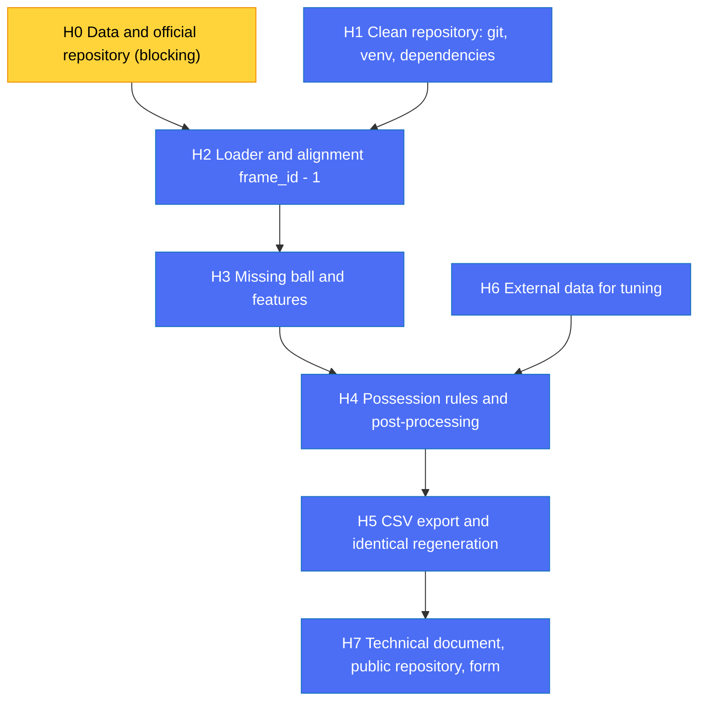

# Feuille de route / Roadmap

[Français](#français) | [English](#english)

## Français

> **Légende :** ✅ fait · 🟡 partiel · 🔴 bloquant ou absent · 🎯 à construire.
> Au 2026-11-07, aucun code applicatif n'existe. Il reste **10 jours** avant la date limite du 17 novembre 2026.
> Les dates de jalons ci-dessous sont des **propositions** 🎯, pas des faits.

---

### 1. État actuel

| Brique | État | Détail |
|---|---|---|
| Données : caméra tactical (XML, homographie, smart tagging) | 🟡 | présentes dans `data/tactical/` |
| Données : tracking ATD tactical (`BAR-ATH_tactical_atd.txt`) | 🔴 | absent ; à re-télécharger (`KNOWN_ISSUES.md` §1) |
| Vidéos MP4 | 🔴 | absentes ; non nécessaires au calcul (`KNOWN_ISSUES.md` §2) |
| Dépôt officiel (`games.py`, `evaluation/`, `starter/`) | 🔴 | non cloné (`KNOWN_ISSUES.md` §3) |
| Dépôt git, `.gitignore`, venv, dépendances figées | 🔴 | à créer ; `data/` à exclure |
| Chargement du tracking et alignement | 🎯 | non écrit |
| Nettoyage du ballon manquant, features | 🎯 | non écrits |
| Modèle, règles et post-traitement | 🎯 | non écrits |
| Export CSV et régénération identique | 🎯 | non écrits |
| Évaluation locale (5 minutes, plomberie) | 🟡 | scoreur officiel disponible après clonage |
| Documentation et règles | 🟡 | nettoyage fait ; section « Clarification du mail » ajoutée à `ARENA.md` |
| Document technique et dépôt public | 🎯 | non commencés |
| Soumission | 🎯 | non faite |

---

### 2. Chantiers et dépendances

| ID | Chantier | Dépend de | Sortie attendue |
|---|---|---|---|
| H0 | Données complètes (tracking `_atd.txt`), dépôt officiel cloné, licence vérifiée | — | `data/` complet hors dépôt ; `games.py` et `evaluation/` disponibles |
| H1 | Dépôt git, `.gitignore` (`data/`, `*.mp4`), venv, `requirements.txt` figé | — | dépôt propre ; `git status` sans données |
| H2 | Loader du tracking, alignement, périodes notées, smart tagging | H0, H1 | tests du loader verts (`TESTING.md` §2) |
| H3 | Nettoyage du ballon manquant, features (joueur le plus proche, équipe) | H2 | features calculées sur tous les cas `NaN`, remplissage documenté |
| H4 | Règles de possession, segmentation, traitement de `X` et de `D` | H3, H6 | sortie H/A/D/X cohérente (`TESTING.md` §4) |
| H5 | Export CSV, validation, régénération identique | H4 | CSV validé ; même SHA-256 à la 2e exécution |
| H6 | Données externes pour le réglage (licence vérifiée) | H1 | jeu de réglage documenté (source, quantité) |
| H7 | Document technique, dépôt public, formulaire | H5 | dossier complet, prêt à envoyer |

---

### 3. Minimum viable

Le minimum viable est un CSV qui :

- passe `validate_submission.py` sur le fichier exact (en-tête `frame,label`, 199 319 lignes, aucune cellule vide) ;
- se régénère à l'identique depuis un clone propre (`python -m possession.run`, 🎯) ;
- est accompagné d'un dépôt public sans données, avec des dépendances figées, et d'un document technique couvrant les rubriques d'ARENA.md §6.2.

**Cible de qualité** : spellF1 supérieur à **0,2433** (smooth50, seuil à battre d'ARENA.md §5).

**Limite à connaître.** Le spellF1 du match complet n'est mesuré que par les organisateurs (vérité terrain privée). La fenêtre publique de 5 minutes ne sert qu'à la plomberie (D-006). L'équipe ne peut donc pas vérifier elle-même qu'elle bat le seuil : c'est la décision « Estimation de la qualité » de la section 5.

---

### 4. Jalons jusqu'au 17 novembre 2026

Dates proposées 🎯 (aujourd'hui : 2026-11-07).

| Date | Jalon | Critère de sortie |
|---|---|---|
| 2026-11-08 | H0 : fichier `_atd.txt` re-téléchargé ; dépôt officiel cloné ; licence vérifiée | `git status` propre ; `run_evaluation.py` s'exécute |
| 2026-11-09 | H1 : `git init`, `.gitignore`, venv, dépendances figées | `data/` absent de `git status` |
| 2026-11-10 | H2 : loader et alignement, avec leurs tests | tests du loader verts |
| 2026-11-12 | H3 et H4, première version ; H6 : jeu de réglage documenté | sortie H/A/D/X complète, toutes les frames |
| 2026-11-13 | H5 : CSV valide et régénération identique | `validate_submission.py` vert ; SHA-256 identique |
| 2026-11-14 | `rules-guard` vert ; plomberie sur les 5 minutes contrôlée | `TESTING.md` §6 vert |
| 2026-11-15 | H7 : document technique, dépôt public, PDF | rubriques d'ARENA.md §6.2 couvertes |
| 2026-11-16 | Gel de la version soumise ; formulaire rempli (un jour d'avance) | même SHA-256 que le fichier validé |
| 2026-11-17 | Date limite de soumission (dernier délai, pas un objectif) | — |
| avant le 2026-11-26 | Résultats, annoncés par les organisateurs | — |

---

### 5. Décisions à prendre

Les décisions déjà prises (D-001 Python, D-002 règles avant ML, D-003 réglage sur données externes, D-004 point d'entrée unique et graine fixe, D-005 documents bilingues, D-006 5 minutes = plomberie, D-007 jeux externes candidats) sont dans `DECISIONS.md`. Restent ouvertes :

| Réf. | Question | Bloque | Statut |
|---|---|---|---|
| à ouvrir | Licence et copie du code officiel : copier `evaluation/` et `games.py` dans le dépôt public, ou le référencer comme dépôt séparé | H0, H7 | OPEN |
| à ouvrir | Estimation de la qualité sans vérité terrain privée : quels jeux externes (D-007), quelle licence, quelle quantité | H4, H6 | OPEN |
| à ouvrir | Le CSV soumis peut-il figurer dans le dépôt public ? C'est un export frame par frame : à confirmer auprès des organisateurs (`hackathon.talentarena@mobileworldcapital.com`) | H5, H7 | OPEN |
| à ouvrir | `kloppy` installé, ou lecture directe du format FIFA/EPTS par le loader | H2 | OPEN |
| à ouvrir | Version exacte de Python, et outils (pytest, ruff) | H1 | OPEN |
| à ouvrir | Forme du lissage et de la segmentation : réglés uniquement sur données externes (D-003) | H4 | OPEN |

---

### 6. À ne pas faire

- Annoter à la main ce match, en quelque quantité que ce soit, pour la soumission, l'entraînement ou la validation (ARENA.md §7, interdit 1).
- Corriger à la main le tracking ou la sortie de l'algorithme ; ajouter des règles ou constantes liées à des frames précises du match.
- Régler un paramètre, entraîner ou calibrer sur la vérité terrain publique ou sur la vidéo fournie (mail des organisateurs ; ARENA.md §7, interdit 3).
- Vérifier sa sortie contre la vidéo (mail des organisateurs). Regarder la vidéo pour **comprendre** une situation reste permis.
- Utiliser la vérité terrain privée ou toute donnée humaine sur ce match : Opta, StatsBomb, Wyscout, LaLiga, tracking corrigé… (ARENA.md §7, interdit 2).
- Envoyer des vidéos ou des données du match à un LLM hébergé dans le cloud. Un LLM local est permis (ARENA.md §7, interdit 6).
- Commiter `data/`, des vidéos, ou publier des exports frame par frame (ARENA.md §7, interdit 5).
- Soumettre un fichier que le dépôt ne peut pas régénérer à l'identique (ARENA.md §7, interdit 4).
- Utiliser un modèle privé ou non partageable sans demande préalable (ARENA.md §7, interdit 7).
- Poser une question de règle après avoir construit : ouvrir une issue **avant** de construire (ARENA.md §7).

---

### 7. Idées pour la suite

Pistes à évaluer, **non planifiées** et **non implémentées** (🎯). Le score de classement est spellF1 : chaque possession compte comme un objet. L'enjeu n'est donc pas la précision frame par frame, mais de **ne pas fragmenter les possessions** et de placer les changements au bon moment (un retard de 1 seconde vaut 0,65 ; ARENA.md §5). Le seuil à battre est 0,2433.

1. **Joueur le plus proche + HMM/Viterbi** (D-002, règles et HMM avant ML). Au lieu d'un vote glissant : états H, A, D ; observations = distance et équipe du joueur le plus proche ; pénalité forte de changement, pour éviter les possessions de 0,3 s. Les paramètres se justifient par des principes (durée minimale d'un contrôle, de l'ordre de 1 à 2 s : hypothèse à justifier) ou par des données externes (D-003), **jamais** par la vérité terrain publique.
2. **Ballon manquant (41 %)**. Interpoler les trous courts, extrapoler vers le dernier joueur proche. Sur les trous longs, mettre `X` au milieu d'une possession (gratuit en spellF1) et ne poser un label qu'aux transitions probables.
3. **Smart Tagging comme a priori**. L'équipe de chaque phase (sauf `N/A`) et les coups de pied arrêtés (Throw-in, Corner, Goal Kick, Free Kick, Kick Off) marquent la fin d'un ballon mort et la reprise. Attention : les intervalles sont des phases, pas des possessions ; ne pas les recopier tels quels (ARENA.md §4.4).
4. **Détection de `D`**. À partir du signal : ballon hors du terrain (coordonnées hors de 0–1), ballon immobile, joueurs regroupés. Le bloc de 2 934 frames de la 2e mi-temps doit être trouvé par la détection, pas codé en dur (`KNOWN_ISSUES.md` §7). Hors des périodes notées, la sortie reste `X`.
5. **Orientation du jeu**. Barcelona attaque de gauche à droite en 1re mi-temps (ARENA.md §4.3) et change de sens en 2e. Utile pour vérifier la cohérence des équipes sans toucher à la vérité terrain.
6. **Données externes pour le réglage** (D-003, D-007 ; licence à vérifier une par une). Jeux ouverts avec tracking et événements, par exemple les données ouvertes de Metrica Sports, de DFL (Bundesliga), de SkillCorner ou de PFF. Le document technique doit citer la source et la quantité utilisée.
7. **Garde-fous reproductibles** (D-004). Graine fixe ; un seul point d'entrée (`python -m possession.run`) qui régénère le CSV octet pour octet ; test de déterminisme ; validation avec `validate_submission.py` sur le fichier exact envoyé.
8. **Usage des 5 minutes publiques** (D-006). Test de plomberie seulement : le pipeline tourne, le score est plausible. Pas de choix de paramètres : une fenêtre de 5 minutes ne départage pas les options (`smooth125` y paraît meilleur, et il est moins bon sur le match complet).

---

### 8. Documents liés

| Document | Rôle |
|---|---|
| `ARENA.md` (racine) | résumé complet du défi, règles, données, notation, soumission |
| `CLAUDE.md` (racine) | règles de travail du dépôt et des agents |
| `REQUIREMENTS.md` | exigences fonctionnelles et non fonctionnelles |
| `DOMAIN_NOTES.md` | vocabulaire : possession, ballon mort, alignement des frames |
| `BUSINESS_RULES.md` | règles de possession et règles de compétition |
| `ARCHITECTURE.md` | pipeline et état des frames |
| `DECISIONS.md` | décisions D-xxx |
| `KNOWN_ISSUES.md` | limites et constats sur les fichiers, les règles et l'environnement |
| `LESSONS_LEARNED.md` | causes racines et règles à retenir après un incident |
| `TESTING.md` | stratégie de test et critères d'achèvement |
| `DEV_WORKFLOW.md` | commandes, environnements, comment soumettre |

---

## English

> **Legend:** ✅ done · 🟡 partial · 🔴 blocking or missing · 🎯 to build.
> As of 2026-11-07, no application code exists. There are **10 days** left before the 17 November 2026 deadline.
> The milestone dates below are **proposals** 🎯, not facts.

---

### 1. Current state

| Component | State | Detail |
|---|---|---|
| Data: tactical camera (XML, homography, smart tagging) | 🟡 | present in `data/tactical/` |
| Data: tactical ATD tracking (`BAR-ATH_tactical_atd.txt`) | 🔴 | missing; to re-download (`KNOWN_ISSUES.md` §1) |
| MP4 videos | 🔴 | missing; not needed for the computation (`KNOWN_ISSUES.md` §2) |
| Official repository (`games.py`, `evaluation/`, `starter/`) | 🔴 | not cloned (`KNOWN_ISSUES.md` §3) |
| Git repository, `.gitignore`, venv, frozen dependencies | 🔴 | to create; `data/` to exclude |
| Tracking loading and alignment | 🎯 | not written |
| Missing ball cleaning, features | 🎯 | not written |
| Model, rules and post-processing | 🎯 | not written |
| CSV export and identical regeneration | 🎯 | not written |
| Local evaluation (5 minutes, plumbing) | 🟡 | official scorer available after cloning |
| Documentation and rules | 🟡 | cleanup done; "Clarification du mail" section added to `ARENA.md` |
| Technical document and public repository | 🎯 | not started |
| Submission | 🎯 | not done |

---

### 2. Milestones and dependencies

| ID | Milestone | Depends on | Expected output |
|---|---|---|---|
| H0 | Complete data (tracking `_atd.txt`), official repository cloned, licence checked | — | complete `data/` outside the repository; `games.py` and `evaluation/` available |
| H1 | Git repository, `.gitignore` (`data/`, `*.mp4`), venv, frozen `requirements.txt` | — | clean repository; `git status` without data |
| H2 | Tracking loader, alignment, scored periods, smart tagging | H0, H1 | loader tests green (`TESTING.md` §2) |
| H3 | Missing ball cleaning, features (closest player, team) | H2 | features computed for all `NaN` cases, documented fill |
| H4 | Possession rules, segmentation, handling of `X` and `D` | H3, H6 | consistent H/A/D/X output (`TESTING.md` §4) |
| H5 | CSV export, validation, identical regeneration | H4 | validated CSV; same SHA-256 on the second run |
| H6 | External data for tuning (licence checked) | H1 | tuning dataset documented (source, quantity) |
| H7 | Technical document, public repository, form | H5 | complete file, ready to send |

---

### 3. Minimum viable

The minimum viable product is a CSV that:

- passes `validate_submission.py` on the exact file (header `frame,label`, 199,319 lines, no empty cell);
- regenerates identically from a clean clone (`python -m possession.run`, 🎯);
- comes with a public repository without data, frozen dependencies, and a technical document covering the sections of ARENA.md §6.2.

**Quality target**: spellF1 above **0.2433** (smooth50, the threshold to beat in ARENA.md §5).

**Limit to know.** The full-match spellF1 is measured only by the organisers (private ground truth). The 5-minute public window serves only for plumbing (D-006). The team therefore cannot check by itself that it beats the threshold: this is the "Quality estimation" decision in section 5.

---

### 4. Milestones up to 17 November 2026

Proposed dates 🎯 (today: 2026-11-07).

| Date | Milestone | Exit criterion |
|---|---|---|
| 2026-11-08 | H0: `_atd.txt` file re-downloaded; official repository cloned; licence checked | `git status` clean; `run_evaluation.py` runs |
| 2026-11-09 | H1: `git init`, `.gitignore`, venv, frozen dependencies | `data/` absent from `git status` |
| 2026-11-10 | H2: loader and alignment, with their tests | loader tests green |
| 2026-11-12 | H3 and H4, first version; H6: tuning dataset documented | complete H/A/D/X output, all frames |
| 2026-11-13 | H5: valid CSV and identical regeneration | `validate_submission.py` green; SHA-256 identical |
| 2026-11-14 | `rules-guard` green; 5-minute plumbing checked | `TESTING.md` §6 green |
| 2026-11-15 | H7: technical document, public repository, PDF | sections of ARENA.md §6.2 covered |
| 2026-11-16 | Submitted version frozen; form filled in (one day ahead) | same SHA-256 as the validated file |
| 2026-11-17 | Submission deadline (last limit, not a target) | — |
| before 2026-11-26 | Results, announced by the organisers | — |

---

### 5. Decisions to make

Decisions already taken (D-001 Python, D-002 rules before ML, D-003 tuning on external data, D-004 single entry point and fixed seed, D-005 bilingual documents, D-006 5 minutes = plumbing, D-007 candidate external datasets) are in `DECISIONS.md`. Still open:

| Ref. | Question | Blocks | Status |
|---|---|---|---|
| to open | Licence and copy of the official code: copy `evaluation/` and `games.py` into the public repository, or reference them as a separate repository | H0, H7 | OPEN |
| to open | Quality estimation without the private ground truth: which external datasets (D-007), which licence, which quantity | H4, H6 | OPEN |
| to open | May the submitted CSV appear in the public repository? It is a frame-by-frame export: to confirm with the organisers (`hackathon.talentarena@mobileworldcapital.com`) | H5, H7 | OPEN |
| to open | `kloppy` installed, or the loader reads the FIFA/EPTS format directly | H2 | OPEN |
| to open | Exact Python version, and tools (pytest, ruff) | H1 | OPEN |
| to open | Shape of smoothing and segmentation: tuned only on external data (D-003) | H4 | OPEN |

---

### 6. Do not do

- Hand-annotate this match, in any quantity, for submission, training or validation (ARENA.md §7, forbidden 1).
- Correct the tracking or the algorithm's output by hand; add rules or constants tied to specific frames of the match.
- Tune a parameter, train or calibrate on the public ground truth or on the provided video (organisers' email; ARENA.md §7, forbidden 3).
- Check one's output against the video (organisers' email). Watching the video to **understand** a situation stays allowed.
- Use the private ground truth or any human data on this match: Opta, StatsBomb, Wyscout, LaLiga, corrected tracking… (ARENA.md §7, forbidden 2).
- Send videos or match data to a cloud-hosted LLM. A local LLM is allowed (ARENA.md §7, forbidden 6).
- Commit `data/`, videos, or publish frame-by-frame exports (ARENA.md §7, forbidden 5).
- Submit a file that the repository cannot regenerate identically (ARENA.md §7, forbidden 4).
- Use a private or non-shareable model without prior request (ARENA.md §7, forbidden 7).
- Ask a rule question after building: open an issue **before** building (ARENA.md §7).

---

### 7. Ideas for later

Avenues to evaluate, **not planned** and **not implemented** (🎯). The ranking score is spellF1: each possession counts as one object. The stake is therefore not frame-by-frame precision, but **not fragmenting possessions** and placing changes at the right moment (a 1-second delay is worth 0.65; ARENA.md §5). The threshold to beat is 0.2433.

1. **Closest player + HMM/Viterbi** (D-002, rules and HMM before ML). Instead of a sliding vote: states H, A, D; observations = distance and team of the closest player; strong change penalty, to avoid possessions of 0.3 s. Parameters are justified by principles (minimum duration of a control, of the order of 1 to 2 s: assumption to justify) or by external data (D-003), **never** by the public ground truth.
2. **Missing ball (41%)**. Interpolate short gaps, extrapolate toward the last nearby player. On long gaps, put `X` in the middle of a possession (free in spellF1) and only place a label at probable transitions.
3. **Smart Tagging as a prior**. The team of each phase (except `N/A`) and set pieces (Throw-in, Corner, Goal Kick, Free Kick, Kick Off) mark the end of a dead ball and the restart. Caution: intervals are phases, not possessions; do not copy them as they are (ARENA.md §4.4).
4. **Detection of `D`**. From the signal: ball out of the pitch (coordinates outside 0–1), ball motionless, players grouped. The 2,934-frame block of the 2nd half must be found by detection, not hard-coded (`KNOWN_ISSUES.md` §7). Outside scored periods, the output stays `X`.
5. **Game orientation**. Barcelona attacks from left to right in the 1st half (ARENA.md §4.3) and switches ends in the 2nd. Useful to check team consistency without touching the ground truth.
6. **External data for tuning** (D-003, D-007; licence checked one by one). Open datasets with tracking and events, for example open data from Metrica Sports, DFL (Bundesliga), SkillCorner or PFF. The technical document must cite the source and the quantity used.
7. **Reproducible guard-rails** (D-004). Fixed seed; a single entry point (`python -m possession.run`) that regenerates the CSV byte for byte; determinism test; validation with `validate_submission.py` on the exact file sent.
8. **Use of the 5 public minutes** (D-006). Plumbing test only: the pipeline runs, the score is plausible. No parameter choice: a 5-minute window does not separate options (`smooth125` looks better there, and is worse on the full match).

---

### 8. Related documents

| Document | Role |
|---|---|
| `ARENA.md` (root) | full summary of the challenge, rules, data, scoring, submission |
| `CLAUDE.md` (root) | working rules of the repository and of the agents |
| `REQUIREMENTS.md` | functional and non-functional requirements |
| `DOMAIN_NOTES.md` | vocabulary: possession, dead ball, frame alignment |
| `BUSINESS_RULES.md` | possession rules and competition rules |
| `ARCHITECTURE.md` | pipeline and frame state |
| `DECISIONS.md` | decisions D-xxx |
| `KNOWN_ISSUES.md` | limits and findings on files, rules and environment |
| `LESSONS_LEARNED.md` | root causes and rules to remember after an incident |
| `TESTING.md` | testing strategy and completion criteria |
| `DEV_WORKFLOW.md` | commands, environments, how to submit |
