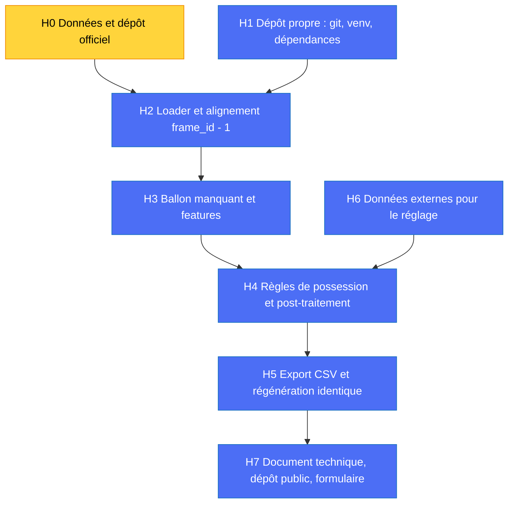

# Feuille de route / Roadmap

[Français](#français) | [English](#english)

## Français

> **Légende :** ✅ fait · 🟡 partiel · 🔴 bloquant ou absent · 🎯 à construire.
> Au 2026-11-16, le pipeline existe (loader, features, décodage Viterbi, a priori des remises, réglage externe,
> script de soumission, tests synthétiques). Il reste **1 jour** avant la date limite du 17 novembre 2026.
> Les dates de jalons de la section 4 sont des **propositions** 🎯, pas des faits.

---

### 1. État actuel

| Brique | État | Détail |
|---|---|---|
| Données : ATD tactical (`BAR-ATH_tactical_atd.txt`) | ✅ | lu par `arena/loader.py` ; présence à vérifier au premier lancement (`KNOWN_ISSUES.md` §1) |
| Données : Smart Tagging | ✅ | lu via le lecteur officiel ; a priori des remises dans `arena/priors.py` |
| Données : homographie, vidéos MP4 | 🟡 | non lues par le code ; non nécessaires (`KNOWN_ISSUES.md` §2, §15) |
| Dépôt officiel (`games.py`, `evaluation/`, `starter/`) | ✅ | importé depuis le disque (`arena/official.py`), non copié |
| Dépôt git, `.gitignore`, venv, dépendances figées | ✅ | `requirements.txt` fige Python 3.11 et trois paquets (`KNOWN_ISSUES.md` §10) |
| Chargement du tracking et alignement (`loader.py`) | ✅ | `frame = frame_id - 1` ; test d'alignement à écrire 🎯 (`KNOWN_ISSUES.md` §8) |
| Features : joueur le plus proche par équipe (`features.py`) | ✅ | ballon manquant = `NaN`, sans remplissage |
| Décodage H / A / D par Viterbi (`decode.py`) | ✅ | pénalités de changement en secondes ; `D` par ballon hors du terrain |
| A priori des remises en jeu (`priors.py`) | ✅ | `D` avant la remise, équipe après ; robustesse limitée (`KNOWN_ISSUES.md` §13) |
| Réglage sur données externes (Metrica) | ✅ | `scripts/get_external.py`, `scripts/tune_external.py`, `docs/TUNING.md` |
| Export CSV déterministe et validé (`make_submission.py`) | ✅ | validé par le validateur officiel ; deux runs donnent un SHA-256 identique (vérifié le 2026-11-16) |
| Tests synthétiques | ✅ | 8 tests dans `tests/test_pipeline.py` ; aucun test d'alignement ATD 🎯 |
| Ballon manquant : interpolation des courts trous | 🎯 | non écrit ; le ballon manquant garde l'état courant (`KNOWN_ISSUES.md` §4) |
| Détection de `D` par le mouvement | 🎯 | non écrit ; `D` seulement par ballon hors du terrain et remises |
| Évaluation locale sur le match | 🔴 | absente de ce dépôt (D-006) ; le score officiel reste chez les organisateurs |
| Documentation et règles | 🟡 | « Clarification du mail » ajoutée à `ARENA.md` ; `DECISIONS.md` à aligner (`KNOWN_ISSUES.md` §17) |
| Document technique et dépôt public | 🎯 | non commencés |
| Soumission | 🎯 | non faite |

---

### 2. Chantiers et dépendances

| ID | Chantier | Statut | Dépend de | Sortie attendue |
|---|---|---|---|---|
| H0 | Données complètes, dépôt officiel importé, licence à confirmer | 🟡 | — | `data/` complet hors dépôt ; `games.py` et `evaluation/` disponibles |
| H1 | Dépôt git, `.gitignore`, venv, `requirements.txt` figé | ✅ | — | dépôt propre ; `git status` sans données |
| H2 | Loader du tracking, alignement, périodes notées, Smart Tagging | 🟡 | H0, H1 | code en place ; tests du loader à écrire (`TESTING.md` §2) |
| H3 | Ballon manquant, features (joueur le plus proche, équipe) | 🟡 | H2 | features en place ; interpolation des trous à écrire |
| H4 | Règles de possession, segmentation, traitement de `X` et de `D` | 🟡 | H3, H6 | Viterbi et a priori en place ; `X` seulement hors des périodes notées |
| H5 | Export CSV, validation, régénération identique | 🟡 | H4 | script en place ; second run à SHA-256 identique à vérifier |
| H6 | Données externes pour le réglage (licence à vérifier) | 🟡 | H1 | Metrica Sample Game 1 et 2, `docs/TUNING.md` ; conditions d'usage à acter dans le document technique |
| H7 | Document technique, dépôt public, formulaire | 🎯 | H5 | dossier complet, prêt à envoyer |

---

### 3. Minimum viable

Le minimum viable est un CSV qui :

- passe le validateur officiel sur le fichier exact (en-tête `frame,label`, 199 319 lignes, aucune cellule vide) ;
- se régénère à l'identique depuis un clone propre (`python scripts/make_submission.py --name <nom_equipe>`) ;
- est accompagné d'un dépôt public sans données, avec des dépendances figées, et d'un document technique couvrant les
  rubriques d'ARENA.md §6.2.

**Cible de qualité** : spellF1 supérieur à **0,2433** (smooth50, seuil à battre d'ARENA.md §5).

**Limite à connaître.** Le spellF1 du match complet n'est mesuré que par les organisateurs (vérité terrain privée). La
fenêtre publique de 5 minutes ne sert qu'à la plomberie (D-006). Le réglage se fait sur données externes seulement, et
ses gains ne sont pas mesurés sur le match (`KNOWN_ISSUES.md` §11). L'équipe ne peut donc pas vérifier elle-même qu'elle
bat le seuil.

---

### 4. Jalons jusqu'au 17 novembre 2026

Dates proposées 🎯 (état au 2026-11-16 : les jalons antérieurs sont à considérer comme passés ou repris).

| Date | Jalon | Critère de sortie |
|---|---|---|
| 2026-11-08 | H0 : fichier `_atd.txt` re-téléchargé ; dépôt officiel cloné ; licence vérifiée | `git status` propre ; `run_evaluation.py` s'exécute |
| 2026-11-09 | H1 : `git init`, `.gitignore`, venv, dépendances figées | `data/` absent de `git status` |
| 2026-11-10 | H2 : loader et alignement, avec leurs tests | tests du loader verts |
| 2026-11-12 | H3 et H4, première version ; H6 : jeu de réglage documenté | sortie H/A/D/X complète, toutes les frames |
| 2026-11-13 | H5 : CSV valide et régénération identique | `validate_submission.py` vert ; SHA-256 identique |
| 2026-11-14 | `rules-guard` vert ; plomberie sur les 5 minutes contrôlée | `TESTING.md` §6 vert |
| 2026-11-15 | H7 : document technique, dépôt public, PDF | rubriques d'ARENA.md §6.2 couvertes |
| 2026-11-16 | Gel de la version soumise ; formulaire rempli (un jour d'avance) | même SHA-256 que le fichier validé |
| 2026-11-17 | Date limite de soumission (dernier délai, pas un objectif) | — |
| avant le 2026-11-26 | Résultats, annoncés par les organisateurs | — |

---

### 5. Décisions à prendre

Les décisions déjà prises (D-001 Python, D-002 règles avant ML, D-003 réglage sur données externes, D-004 point d'entrée
unique et graine fixe, D-005 documents bilingues, D-006 5 minutes = plomberie, D-007 jeux externes candidats) sont dans
`DECISIONS.md`. Restent ouvertes :

| Réf. | Question | Bloque | Statut |
|---|---|---|---|
| à ouvrir | Licence et copie du code officiel : le code importe depuis le disque (référence) ; licence MIT indiquée dans `arena/official.py` à confirmer, puis à acter | H0, H7 | OPEN (code : référence) |
| à ouvrir | Estimation de la qualité sans vérité terrain privée : quels jeux externes (D-007), quelle licence, quelle quantité. Metrica Sample Games 1 et 2 utilisés | H4, H6 | OPEN (données Metrica en place) |
| à ouvrir | Le CSV soumis peut-il figurer dans le dépôt public ? C'est un export frame par frame : à confirmer auprès des organisateurs (`hackathon.talentarena@mobileworldcapital.com`) | H5, H7 | OPEN |
| à ouvrir | `kloppy` installé, ou lecture directe du format ATD par le loader | H2 | Code : lecture directe ; D-001 à mettre à jour (`KNOWN_ISSUES.md` §17) |
| à ouvrir | Version exacte de Python, et outils (pytest, ruff) | H1 | Code : Python 3.11 et pytest figés ; ruff absent ; D-001 à mettre à jour |
| à ouvrir | Forme du lissage et de la segmentation : réglés uniquement sur données externes (D-003) | H4 | Code : Viterbi réglé sur Metrica ; à acter dans `DECISIONS.md` |

---

### 6. À ne pas faire

- Annoter à la main ce match, en quelque quantité que ce soit, pour la soumission, l'entraînement ou la validation (ARENA.md §7, interdit 1).
- Corriger à la main le tracking ou la sortie de l'algorithme ; ajouter des règles ou constantes liées à des frames précises du match.
- Régler un paramètre, entraîner ou calibrer sur la vérité terrain publique ou sur la vidéo fournie (mail des organisateurs ; ARENA.md §7, interdit 3).
- Vérifier sa sortie contre la vidéo (mail des organisateurs). Regarder la vidéo pour **comprendre** une situation reste permis.
- Utiliser la vérité terrain privée ou toute donnée humaine sur ce match : Opta, StatsBomb, Wyscout, LaLiga, tracking corrigé… (ARENA.md §7, interdit 2).
- Envoyer des vidéos ou des données du match à un LLM hébergé dans le cloud. Un LLM local est permis (ARENA.md §7, interdit 6).
- Commiter `data/`, des vidéos, ou publier des exports frame par frame (ARENA.md §7, interdit 5).
- Soumettre un fichier que le dépôt ne peut pas régénérer à l'identique (ARENA.md §7, interdit 4).
- Utiliser un modèle privé ou non partageable sans demande préalable (ARENA.md §7, interdit 7).
- Poser une question de règle après avoir construit : ouvrir une issue **avant** de construire (ARENA.md §7).

---

### 7. Idées pour la suite

Pistes **non planifiées** et **non implémentées** (🎯). Le score de classement est spellF1 : chaque possession compte
comme un objet. L'enjeu est donc de **ne pas fragmenter les possessions** et de placer les changements au bon moment
(un retard de 1 seconde vaut 0,65 ; ARENA.md §5). Le seuil à battre est 0,2433.

1. **Features de vitesse du ballon et de contrôle de possession** (détection de passes). Ajouter une vitesse du ballon et
   une mesure de contrôle par équipe pour mieux placer les changements. À valider sur données externes uniquement (D-003).
2. **Interpolation des courts trous de ballon.** Combler les trous courts par interpolation, et ne pas toucher aux
   trous longs (ils restent sans preuve, `KNOWN_ISSUES.md` §4). Ajouter un test de remplissage.
3. **A priori d'équipe depuis les phases du Smart Tagging.** L'équipe de chaque phase (sauf `N/A`) comme a priori
   supplémentaire. Attention : les intervalles sont des phases, pas des possessions ; ne pas les recopier tels quels
   (ARENA.md §4.4).
4. **Plus de données externes pour le réglage.** Metrica Sample Game 3 (format EPTS) et d'autres tracking ouverts, chacun
   avec sa licence vérifiée (D-007). Le document technique cite la source et la quantité utilisée.
5. **Émissions apprises.** Remplacer les émissions manuelles par une régression logistique entraînée sur données externes
   uniquement. Ne pas commencer avant que D-002 soit tranché dans `DECISIONS.md`.

---

### 8. Documents liés

| Document | Rôle |
|---|---|
| `ARENA.md` (racine) | résumé complet du défi, règles, données, notation, soumission |
| `CLAUDE.md` (racine) | règles de travail du dépôt et des agents |
| `REQUIREMENTS.md` | exigences fonctionnelles et non fonctionnelles |
| `DOMAIN_NOTES.md` | vocabulaire : possession, ballon mort, alignement des frames |
| `BUSINESS_RULES.md` | règles de possession et règles de compétition |
| `ARCHITECTURE.md` | pipeline et état des frames |
| `DECISIONS.md` | décisions D-xxx |
| `KNOWN_ISSUES.md` | limites et constats sur les fichiers, les règles, les simulations et l'environnement |
| `TUNING.md` | réglage sur données externes, résultats et robustesse |
| `LESSONS_LEARNED.md` | causes racines et règles à retenir après un incident |
| `TESTING.md` | stratégie de test et critères d'achèvement |
| `DEV_WORKFLOW.md` | commandes, environnements, comment soumettre |

---

## English

> **Legend:** ✅ done · 🟡 partial · 🔴 blocking or missing · 🎯 to build.
> As of 2026-11-16, the pipeline exists (loader, features, Viterbi decoding, restart prior, external tuning, submission
> script, synthetic tests). There is **1 day** left before the 17 November 2026 deadline.
> The milestone dates in section 4 are **proposals** 🎯, not facts.

---

### 1. Current state

| Component | State | Detail |
|---|---|---|
| Data: ATD tactical (`BAR-ATH_tactical_atd.txt`) | ✅ | read by `arena/loader.py`; presence to check at the first run (`KNOWN_ISSUES.md` §1) |
| Data: Smart Tagging | ✅ | read via the official reader; restart prior in `arena/priors.py` |
| Data: homography, MP4 videos | 🟡 | not read by the code; not needed (`KNOWN_ISSUES.md` §2, §15) |
| Official repository (`games.py`, `evaluation/`, `starter/`) | ✅ | imported from disk (`arena/official.py`), not copied |
| Git repository, `.gitignore`, venv, frozen dependencies | ✅ | `requirements.txt` pins Python 3.11 and three packages (`KNOWN_ISSUES.md` §10) |
| Tracking loading and alignment (`loader.py`) | ✅ | `frame = frame_id - 1`; alignment test to write 🎯 (`KNOWN_ISSUES.md` §8) |
| Features: closest player per team (`features.py`) | ✅ | missing ball = `NaN`, no fill |
| Viterbi H / A / D decoding (`decode.py`) | ✅ | switch penalties in seconds; `D` for a ball out of the pitch |
| Restart prior (`priors.py`) | ✅ | `D` before the restart, restarting team after; limited robustness (`KNOWN_ISSUES.md` §13) |
| Tuning on external data (Metrica) | ✅ | `scripts/get_external.py`, `scripts/tune_external.py`, `docs/TUNING.md` |
| Deterministic and validated CSV export (`make_submission.py`) | ✅ | validated by the official validator; two runs give an identical SHA-256 (checked 2026-11-16) |
| Synthetic tests | ✅ | 8 tests in `tests/test_pipeline.py`; no ATD alignment test 🎯 |
| Missing ball: interpolation of short gaps | 🎯 | not written; a missing ball keeps the current state (`KNOWN_ISSUES.md` §4) |
| Detection of `D` from movement | 🎯 | not written; `D` only from ball out of the pitch and restarts |
| Local evaluation on the match | 🔴 | absent from this repository (D-006); the official score stays with the organisers |
| Documentation and rules | 🟡 | "Clarification du mail" section added to `ARENA.md`; `DECISIONS.md` to align (`KNOWN_ISSUES.md` §17) |
| Technical document and public repository | 🎯 | not started |
| Submission | 🎯 | not done |

---

### 2. Milestones and dependencies

| ID | Milestone | Status | Depends on | Expected output |
|---|---|---|---|---|
| H0 | Complete data, official repository imported, licence to confirm | 🟡 | — | complete `data/` outside the repository; `games.py` and `evaluation/` available |
| H1 | Git repository, `.gitignore`, venv, frozen `requirements.txt` | ✅ | — | clean repository; `git status` without data |
| H2 | Tracking loader, alignment, scored periods, Smart Tagging | 🟡 | H0, H1 | code in place; loader tests to write (`TESTING.md` §2) |
| H3 | Missing ball, features (closest player, team) | 🟡 | H2 | features in place; gap interpolation to write |
| H4 | Possession rules, segmentation, handling of `X` and `D` | 🟡 | H3, H6 | Viterbi and restart prior in place; `X` only outside scored periods |
| H5 | CSV export, validation, identical regeneration | 🟡 | H4 | script in place; second run with identical SHA-256 to verify |
| H6 | External data for tuning (licence to check) | 🟡 | H1 | Metrica Sample Games 1 and 2, `docs/TUNING.md`; terms of use to record in the technical document |
| H7 | Technical document, public repository, form | 🎯 | H5 | complete file, ready to send |

---

### 3. Minimum viable

The minimum viable product is a CSV that:

- passes the official validator on the exact file (header `frame,label`, 199,319 lines, no empty cell);
- regenerates identically from a clean clone (`python scripts/make_submission.py --name <team_name>`);
- comes with a public repository without data, frozen dependencies, and a technical document covering the sections of
  ARENA.md §6.2.

**Quality target**: spellF1 above **0.2433** (smooth50, the threshold to beat in ARENA.md §5).

**Limit to know.** The full-match spellF1 is measured only by the organisers (private ground truth). The 5-minute public
window serves only for plumbing (D-006). Tuning uses external data only, and its gains are not measured on the match
(`KNOWN_ISSUES.md` §11). The team therefore cannot check by itself that it beats the threshold.

---

### 4. Milestones up to 17 November 2026

Proposed dates 🎯 (status as of 2026-11-16: earlier milestones are to be read as past or taken over).

| Date | Milestone | Exit criterion |
|---|---|---|
| 2026-11-08 | H0: `_atd.txt` file re-downloaded; official repository cloned; licence checked | `git status` clean; `run_evaluation.py` runs |
| 2026-11-09 | H1: `git init`, `.gitignore`, venv, frozen dependencies | `data/` absent from `git status` |
| 2026-11-10 | H2: loader and alignment, with their tests | loader tests green |
| 2026-11-12 | H3 and H4, first version; H6: tuning dataset documented | complete H/A/D/X output, all frames |
| 2026-11-13 | H5: valid CSV and identical regeneration | `validate_submission.py` green; SHA-256 identical |
| 2026-11-14 | `rules-guard` green; 5-minute plumbing checked | `TESTING.md` §6 green |
| 2026-11-15 | H7: technical document, public repository, PDF | sections of ARENA.md §6.2 covered |
| 2026-11-16 | Submitted version frozen; form filled in (one day ahead) | same SHA-256 as the validated file |
| 2026-11-17 | Submission deadline (last limit, not a target) | — |
| before 2026-11-26 | Results, announced by the organisers | — |

---

### 5. Decisions to make

Decisions already taken (D-001 Python, D-002 rules before ML, D-003 tuning on external data, D-004 single entry point and
fixed seed, D-005 bilingual documents, D-006 5 minutes = plumbing, D-007 candidate external datasets) are in
`DECISIONS.md`. Still open:

| Ref. | Question | Blocks | Status |
|---|---|---|---|
| to open | Licence and copy of the official code: the code imports from disk (reference); MIT licence stated in `arena/official.py` to confirm, then to record | H0, H7 | OPEN (code: reference) |
| to open | Quality estimation without the private ground truth: which external datasets (D-007), which licence, which quantity. Metrica Sample Games 1 and 2 used | H4, H6 | OPEN (Metrica data in place) |
| to open | May the submitted CSV appear in the public repository? It is a frame-by-frame export: to confirm with the organisers (`hackathon.talentarena@mobileworldcapital.com`) | H5, H7 | OPEN |
| to open | `kloppy` installed, or the loader reads the ATD format directly | H2 | Code: direct reading; D-001 to update (`KNOWN_ISSUES.md` §17) |
| to open | Exact Python version, and tools (pytest, ruff) | H1 | Code: Python 3.11 and pytest pinned; ruff absent; D-001 to update |
| to open | Shape of smoothing and segmentation: tuned only on external data (D-003) | H4 | Code: Viterbi tuned on Metrica; to record in `DECISIONS.md` |

---

### 6. Do not do

- Hand-annotate this match, in any quantity, for submission, training or validation (ARENA.md §7, forbidden 1).
- Correct the tracking or the algorithm's output by hand; add rules or constants tied to specific frames of the match.
- Tune a parameter, train or calibrate on the public ground truth or on the provided video (organisers' email; ARENA.md §7, forbidden 3).
- Check one's output against the video (organisers' email). Watching the video to **understand** a situation stays allowed.
- Use the private ground truth or any human data on this match: Opta, StatsBomb, Wyscout, LaLiga, corrected tracking… (ARENA.md §7, forbidden 2).
- Send videos or match data to a cloud-hosted LLM. A local LLM is allowed (ARENA.md §7, forbidden 6).
- Commit `data/`, videos, or publish frame-by-frame exports (ARENA.md §7, forbidden 5).
- Submit a file that the repository cannot regenerate identically (ARENA.md §7, forbidden 4).
- Use a private or non-shareable model without prior request (ARENA.md §7, forbidden 7).
- Ask a rule question after building: open an issue **before** building (ARENA.md §7).

---

### 7. Ideas for later

Avenues **not planned** and **not implemented** (🎯). The ranking score is spellF1: each possession counts as one object. The
stake is therefore **not fragmenting possessions** and placing changes at the right moment (a 1-second delay is worth 0.65;
ARENA.md §5). The threshold to beat is 0.2433.

1. **Ball speed and possession-control features** (pass detection). Add a ball speed and a per-team control measure to place
   changes better. To validate on external data only (D-003).
2. **Interpolation of short ball gaps.** Fill short gaps by interpolation, and leave long gaps alone (they stay without
   evidence, `KNOWN_ISSUES.md` §4). Add a test for the fill.
3. **Team prior from the Smart Tagging phases.** The team of each phase (except `N/A`) as an extra prior. Caution: intervals
   are phases, not possessions; do not copy them as they are (ARENA.md §4.4).
4. **More external data for tuning.** Metrica Sample Game 3 (EPTS format) and other open tracking data, each with its licence
   checked (D-007). The technical document cites the source and the quantity used.
5. **Learned emissions.** Replace the hand-set emissions with a logistic regression trained on external data only. Do not
   start before D-002 is settled in `DECISIONS.md`.

---

### 8. Related documents

| Document | Role |
|---|---|
| `ARENA.md` (root) | full summary of the challenge, rules, data, scoring, submission |
| `CLAUDE.md` (root) | working rules of the repository and of the agents |
| `REQUIREMENTS.md` | functional and non-functional requirements |
| `DOMAIN_NOTES.md` | vocabulary: possession, dead ball, frame alignment |
| `BUSINESS_RULES.md` | possession rules and competition rules |
| `ARCHITECTURE.md` | pipeline and frame state |
| `DECISIONS.md` | decisions D-xxx |
| `KNOWN_ISSUES.md` | limits and findings on files, rules, simulations and environment |
| `TUNING.md` | tuning on external data, results and robustness |
| `LESSONS_LEARNED.md` | root causes and rules to remember after an incident |
| `TESTING.md` | testing strategy and completion criteria |
| `DEV_WORKFLOW.md` | commands, environments, how to submit |
