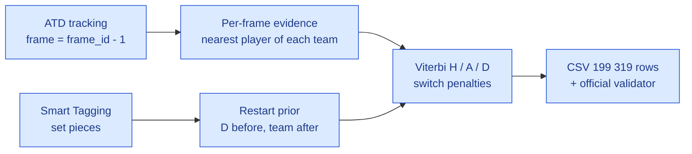

# Ball possession labelling with a switch-penalised Viterbi decoder — technical document

More than a Hack 2027, Phase 1 · team Arena · repository: https://github.com/ArenaHackhaton/Arena

## 1. Approach

For every tactical-video frame we output `H`, `A` or `D` inside the two graded halves and `X`
outside them. The method takes three steps and needs no training.



**Why this and not a smoother.** The ranking metric (spellF1) matches whole possessions by
temporal IoU. A single flicker splits one possession into two and can lose both matches. The
official baseline is a majority vote: it still flickers and reports 669 possessions of 7.6 s on
the match. A Viterbi decoder with an explicit cost for every change of state removes a change
unless sustained evidence pays for it. That is the property spellF1 rewards.

**Evidence per frame** (log-scores), with `d_team` the distance in metres from the ball to the
nearest tracked player of that team:
- ball tracked and on the pitch: `H = -min(d_home, 15)/r`, `A = -min(d_away, 15)/r`, `D = -c_D`;
- ball more than 1 m outside the lines: `H = A = -3`, `D = 0`;
- ball not tracked (41% of graded frames): no evidence. The decoder keeps its current state
  unless a switch pays for itself, so occlusions inside a possession do not fragment it.

**Restart prior.** Every Smart Tagging `SET PIECES` instance is a restart, placed at the centre
of its interval. Each one adds a D bonus over the 10 s before the restart and a bonus for the
tagged team over the 2 s after it. Throw-ins (tagged `N/A`) give no team. A `Kick Off (Start)` makes
the whole stretch from the start of the half to the kick-off dead ball. This is how the graded
frames before the second-half kick-off become `D` without any frame-specific constant.

**Decoding.** Each half is decoded on its own, so no state crosses halftime. H↔A switches
cost 1 s of evidence and switches into or out of D cost 2 s. The output is deterministic
(pure Python, no randomness): two runs give a byte-identical file.

## 2. Assets used, and assets dropped

| asset | use |
|---|---|
| tactical ATD (`_atd.txt`, `_atd.xml`) | positions of players and ball, team of each slot (first team in the metadata = home) |
| tactical Smart Tagging | restart prior (set pieces only) |
| tactical homography | **not used**: distances are computed on the pitch directly |
| tactical / broadcast video, broadcast ATD | **not used** |
| Smart Tagging phases (Build Up, Progression…) | **not used**: they are phases, not possessions. A team prior from them is left for future work |

We never look at the video to check the output, and we never use the public 5-minute ground
truth to choose anything. It was not scored at all.

## 3. Training and tuning data

No model is trained. Eleven numeric parameters exist. Eight were set by grid search, and three
(the 15 m distance clip, the 1 m out-of-pitch margin and the out-of-pitch cost of 3) keep default values that were not tuned. The search used **external data only**:

- **Metrica Sports public sample data**
  (https://github.com/metrica-sports/sample-data, commit `e706dd5`), Sample Games 1 and 2:
  anonymised matches with tracking at 25 fps and **event data annotated by humans at Metrica**
  (1,745 and 1,935 events). Game 1 was used for selection and game 2 was held out for checking.
  Terms: responsible use with attribution. This document acknowledges the source.
- H/A/D labels were derived from those events by fixed rules (team events give possession;
  ball out, fouls and goals give dead ball until the next team event). The full rules are in
  `docs/TUNING.md`.
- To resemble the provided game, the ball was removed on random in-play blocks until 41% of
  in-play frames had no ball. In the sample games the ball is already missing on nearly every
  dead-ball frame, so occlusion had to be added during play. Restarts were derived from the
  set-piece events and degraded (timing error, dropped restarts) to imitate an automatic tagger.

| (spellF1, official scorer) | Metrica game 1 | Metrica game 2 (held out) |
|---|---|---|
| official baseline, ±50 vote | 0.307 | 0.317 |
| ours, tracking evidence only | 0.317 | 0.305 |
| ours, with the restart prior | 0.431 | 0.389 |

In 18 robustness runs with a noisier tagger (up to 50% of restarts dropped, 2 s timing error),
the method stayed above the baseline in every run, by +0.01 to +0.12.

## 4. Possession rules implemented

- **Loose balls and challenges.** A contested or loose ball stays with the last team, because
  switching costs 1 s of evidence: a touch, a deflection or a lost aerial duel does not change
  possession unless the other team's player keeps being nearest to the ball.
- **Missing ball.** The current state carries on through the gap.
- **Restarts.** Dead ball before each tagged set piece, the restarting team (when tagged) just after.
  Ball out of the pitch counts as dead ball.
- **Halves.** `X` outside the graded halves. Inside them, never `X` (on the ranking metric, an
  `X` would only repeat the previous label).

## 5. Limitations and what we would do next

- The gain is measured only on two external games, and the restart prior there comes from human
  events. The real Smart Tagging is sparser (59 set pieces for the whole match, no team on
  throw-ins), so the true gain on the match is probably smaller than on Metrica.
- Dead ball that is not followed by a tagged restart, and occlusions that hide a real turnover,
  are detected late or not at all.
- No notion of control (ball speed, passes), no use of the homography or the video.
- Next: control features from ball speed and direction (pass detection), interpolation of short
  ball gaps, a team prior from the Smart Tagging phases, more external games (Metrica game 3 in
  EPTS format), and emissions learned on external data instead of a hand-shaped distance score.

## 6. Reproduction

```bash
# Python 3.11
pip install -r requirements.txt
# official repository next to this one: ../more-than-a-hack-2027 (or set MTAH_OFFICIAL_DIR)
# match data unpacked in ../more-than-a-hack-2027/data (or set MTAH_DATA_DIR)
python scripts/make_submission.py --name <team>     # -> submissions/<team>.csv + official validation
python -m pytest -q tests                           # synthetic unit tests
python scripts/get_external.py && python scripts/tune_external.py   # re-run the tuning
```

The submission file was generated by `scripts/make_submission.py` with the parameters in
`arena/config.py`. Two runs produced byte-identical files.
