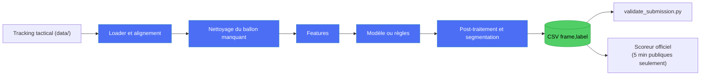
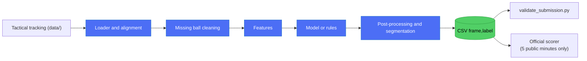

# Stratégie de test / Testing strategy

[Français](#français) | [English](#english)

## Français

> **🎯 Cible.** Rien n'est testé : aucun code n'existe au 2026-11-07. Les cas ci-dessous sont des **spécifications de
> test** à écrire avec le pipeline.
>
> Les jeux de test versionnés dans le dépôt public sont **synthétiques**. Les tests qui lisent `data/` (fichiers fournis)
> tournent seulement en local et sont ignorés si `MTAH_DATA_DIR` n'est pas défini 🎯.
>
> Les 5 minutes publiques ne servent qu'à la **plomberie** (D-006) : elles ne départagent jamais deux options.

---

### 1. Couches de test

| Couche | Ce que l'on teste | Comment | Quand |
|---|---|---|---|
| Loader et alignement | lecture du tracking, `frame = frame_id - 1`, périodes notées, smart tagging, homographie (§2) | tests unitaires sur fixtures synthétiques ; tests locaux sur `data/` | à chaque changement du chargement |
| Validation CSV | format du fichier produit (§3) | `validate_submission.py` officiel sur le fichier exact | avant chaque envoi |
| Propriétés des possessions | règles de possession, `D` sans propriétaire, `X` permis (§4) | tests de propriété sur sorties construites à la main et générées avec graine fixe | à chaque changement de segmentation ou de post-traitement |
| Scoreur et baselines | métriques spellF1 et macroF1 (§5) | recalcul sur les 4 baselines officielles, comparaison aux valeurs publiées | à chaque changement du module de métriques |
| Déterminisme et règles du défi | même CSV à chaque régénération ; garde-fous (§6) | double exécution ; agent `rules-guard` | à chaque commit touchant le pipeline |
| Logs | marqueurs de flux, absence de données brutes (§7) | capture de la sortie | à chaque changement d'un flux |
| Bout en bout | chaîne complète, de `data/` au CSV validé | diagramme ci-dessous | avant chaque jalon (`ROADMAP_NEXT_STEPS.md` §4) |

Chaîne de bout en bout (🎯 cible) :

---

### 2. Cas de référence : loader et alignement

| # | Cas | Donnée | Résultat attendu |
|---|---|---|---|
| 1 | Fichier manquant | `data/tactical/` sans `BAR-ATH_tactical_atd.txt` | erreur explicite nommant le fichier et le dossier ; aucun CSV écrit (`KNOWN_ISSUES.md` §1) |
| 2 | Alignement | fixture où `frame_id = k` porte la valeur `k` | la ligne de soumission `i` correspond à `frame_id = i + 1` ; `frame_id` 199 319 correspond à la ligne 199 318 |
| 3 | Périodes notées | `half_video_blocks("BAR-ATH")` | `[(1, 11185, 90651), (2, 110808, 190197)]` (valeurs d'ARENA.md §4.7) ; le loader ne lit pas ces bornes en dur |
| 4 | Coordonnées | x = 0,5 normalisé | 52,65 m en longueur (0,5 × 105,3) ; conversion depuis `games.py` |
| 5 | Ballon manquant | lignes où le ballon vaut `NaN` | aucun crash ; la valeur reste `NaN` à cette étape, jamais remplacée en silence ; proportion mesurée sur les frames notées, à comparer aux 41 % d'ARENA.md §4.3 (tolérance 🎯) |
| 6 | Homographie tactical | fichier d'homographie | 199 319 lignes, `valid` à 1 partout (100 % d'ARENA.md §4.5) ; `valid` à 0 donne une matrice `NaN` |
| 7 | Smart tagging | `Max Players in the box` = `"7+"` ; tags en Title Case ; codes en MAJUSCULES | valeur lue comme chaîne ; comparaison insensible à la casse ; `N/A` conservé ; `frame = round(sec * 25)` |
| 8 | Effectifs | emplacements du tracking | 46 emplacements ; environ 20,5 objets suivis par frame notée (tolérance 🎯) |

---

### 3. Validation du CSV

Contrôles à passer sur le fichier **exact** envoyé (ARENA.md §6.1). Le validateur officiel `evaluation/validate_submission.py` fait foi ; nos contrôles locaux ne le remplacent pas.

| Contrôle | Attendu |
|---|---|
| En-tête | exactement `frame,label` |
| Nombre de lignes | 199 319 lignes de données (nombre exact à confirmer avec le validateur officiel 🎯) |
| Numérotation | `frame` de 0 à 199318, dans l'ordre, sans trou |
| Labels | `H`, `A`, `D` ou `X` ; la casse est tolérée |
| Cellules | aucune cellule vide ; `X` pour s'abstenir |
| Encodage | UTF-8, sans colonne d'index (taille attendue d'environ 1,9 Mo) |

Pratique : la même empreinte SHA-256 doit apparaître pour le fichier validé et pour le fichier envoyé (🎯 à instaurer).

---

### 4. Tests de propriété sur les possessions

- **Une possession = une suite maximale d'une même équipe, ballon vivant.** `H H H A A` donne 2 possessions ; `H H D D H H` donne 2 possessions séparées par un arrêt (ARENA.md §3).
- **Le ballon mort n'est jamais une possession.** Une suite de `D` produit zéro possession ; aucune possession ne contient de frame `D`.
- **`D` n'a jamais de propriétaire.** Le post-traitement ne rattache jamais une frame `D` à `H` ou `A`.
- **`X` est permis.** Une sortie contenant `X` est valide. Pour le scoreur, chaque `X` est remplacé par le dernier label non-`X` de la même mi-temps : `H H X X H` devient `H H H H H`, soit 1 possession (ARENA.md §5). Test sur la segmentation après ce remplacement.
- **Un changement de possession exige un contrôle.** Une simple touche ou une passe déviée ne change pas l'équipe (ARENA.md §3). Test sur un scénario synthétique 🎯.
- **Aucune possession ne traverse une frontière de mi-temps.** Test sur la frontière entre les deux mi-temps notées.

---

### 5. Scoreur et baselines

- **Reproduction des baselines.** Recalculer spellF1 et macroF1 sur les 4 baselines du dossier `evaluation/results/`, et comparer aux valeurs publiées par ARENA.md §5, à 4 décimales près (précision de publication) :

| baseline | macroF1 (match) | spellF1 (match) | spellF1 (5 min publiques) |
|---|---|---|---|
| raw | 0,6532 | 0,0486 | 0,0378 |
| smooth25 | 0,6752 | 0,1996 | 0,2868 |
| smooth50 | 0,6724 | 0,2433 | 0,3256 |
| smooth125 | 0,6356 | 0,2242 | 0,4242 |

- **Limite importante.** La vérité terrain du match complet est privée : seule la colonne « 5 min publiques » est **recalculable localement**. Les colonnes « match » sont des valeurs publiées, à citer comme référence, pas à reproduire.
- **Bruit.** Sur le match complet, un écart de macroF1 inférieur à 0,01 et un écart de spellF1 inférieur à 0,04 sont du bruit (ARENA.md §5). Comparer deux versions avec `--bootstrap 1000`.
- **Plancher.** Une prédiction constante ou aléatoire donne spellF1 = 0 ; le plancher de macroF1 est d'environ 0,16. Test : une sortie constante obtient spellF1 = 0 sur la fenêtre publique.
- **Sensibilité au décalage** (ARENA.md §5) : retard de 1 frame 1,0000 ; 3 frames 0,98 ; 8 frames 0,89 ; 1 seconde 0,65. Le jeu exact de ces valeurs n'est pas précisé dans ARENA.md : à confirmer avant d'en faire un test.
- **Appariement.** Les possessions sont appariées par IoU temporel, et spellF1 moyenne les seuils 0,3 / 0,4 / 0,5 / 0,6 / 0,7 (ARENA.md §5). Le code officiel `evaluation/possession_metrics.py` fait foi sur la doc.

---

### 6. Déterminisme et règles du défi

**Déterminisme (D-004).** Deux régénérations depuis un clone propre (même commit, mêmes données, même graine fixe) produisent un CSV identique (même SHA-256). 🎯

**Règles du défi (agent `rules-guard`, 🎯).** Tests automatiques à lancer avant chaque commit :

| Règle testée | Méthode | Source |
|---|---|---|
| Aucune donnée commitée | `git ls-files` ne contient ni `data/`, ni `*.mp4`, ni export frame par frame | ARENA.md §7, interdit 5 |
| `data/` ignoré | `.gitignore` contient `data/` et `*.mp4` | ARENA.md §4.2 |
| Pas de LLM hébergé dans le cloud | aucun import ni URL d'un client de LLM cloud dans le code (test par motifs) ; un LLM local reste permis | ARENA.md §7, interdit 6 |
| Pas de lecture de la vérité terrain par le pipeline | le pipeline n'ouvre jamais `evaluation/gt/` ; seul le scoreur officiel le lit | ARENA.md §7 ; mail des organisateurs |
| Pas de lecture de la vidéo | le pipeline ne lit aucun `*.mp4` | mail des organisateurs |
| Pas de constante liée à une frame précise | aucun numéro de frame du match dans le code du pipeline, hors `games.py` officiel et tests d'alignement | ARENA.md §7, interdit 1 |
| Réglage sur données externes seulement | le jeu de réglage est déclaré (D-003) ; toute entrée issue de `evaluation/gt/` ou de la vidéo est refusée | mail des organisateurs |

---

### 7. Tests de logs

- Le pipeline émet, dans l'ordre : `[START]`, `[ENTITY]`, `[CALL]`, `[RESULT]`, `[STATE]`, avec l'identifiant du match et de la mi-temps traitée.
- Un échec (fichier manquant, nombre de lignes faux, label invalide) émet `[RESULT]` avec la cause et le fichier concerné.
- Les logs ne contiennent ni données frame par frame, ni contenu de `data/`.

---

### 8. Critères d'achèvement

- Couches 1 à 7 vertes ; aucun test désactivé sans entrée dans `KNOWN_ISSUES.md`.
- `validate_submission.py` vert sur le fichier exact envoyé.
- Régénération identique depuis un clone propre (§6).
- `rules-guard` vert (§6).
- Aucun score revendiqué sans l'avoir exécuté ; le score du match complet vient des organisateurs.
- Les 5 minutes publiques n'ont servi qu'à la plomberie (D-006) ; aucun paramètre n'a été réglé dessus.
- Le document technique couvre les rubriques d'ARENA.md §6.2 (approche, données utilisées et abandonnées, données d'entraînement, règles de possession, tracking manquant, limites, reproduction).

Règle générale : on n'affirme pas qu'un changement fonctionne sans l'avoir exécuté.

---

## English

> **🎯 Target.** Nothing is tested yet: no code exists as of 2026-11-07. The cases below are **test specifications** to
> write with the pipeline.
>
> Test datasets versioned in the public repository are **synthetic**. Tests that read `data/` (the provided files)
> run only locally and are skipped if `MTAH_DATA_DIR` is not set 🎯.
>
> The 5 public minutes serve only for **plumbing** (D-006): they never separate two options.

---

### 1. Test layers

| Layer | What we test | How | When |
|---|---|---|---|
| Loader and alignment | tracking read, `frame = frame_id - 1`, scored periods, smart tagging, homography (§2) | unit tests on synthetic fixtures; local tests on `data/` | on every change to loading |
| CSV validation | format of the produced file (§3) | official `validate_submission.py` on the exact file | before each submission |
| Possession properties | possession rules, `D` without owner, `X` allowed (§4) | property tests on hand-built outputs and seeded random outputs | on every change to segmentation or post-processing |
| Scorer and baselines | spellF1 and macroF1 metrics (§5) | recomputation on the 4 official baselines, comparison with published values | on every change to the metrics module |
| Determinism and challenge rules | same CSV on every regeneration; guard-rails (§6) | double run; `rules-guard` agent | on every commit touching the pipeline |
| Logs | flow markers, absence of raw data (§7) | output capture | on every change to a flow |
| End to end | full chain, from `data/` to the validated CSV | diagram below | before each milestone (`ROADMAP_NEXT_STEPS.md` §4) |

End-to-end chain (🎯 target):

---

### 2. Reference cases: loader and alignment

| # | Case | Data | Expected result |
|---|---|---|---|
| 1 | Missing file | `data/tactical/` without `BAR-ATH_tactical_atd.txt` | explicit error naming the file and the folder; no CSV written (`KNOWN_ISSUES.md` §1) |
| 2 | Alignment | fixture where `frame_id = k` carries the value `k` | submission line `i` matches `frame_id = i + 1`; `frame_id` 199,319 matches line 199,318 |
| 3 | Scored periods | `half_video_blocks("BAR-ATH")` | `[(1, 11185, 90651), (2, 110808, 190197)]` (values from ARENA.md §4.7); the loader does not hard-code these bounds |
| 4 | Coordinates | x = 0.5 normalised | 52.65 m along the length (0.5 × 105.3); conversion from `games.py` |
| 5 | Missing ball | lines where the ball is `NaN` | no crash; the value stays `NaN` at this stage, never silently replaced; share measured on scored frames, to compare with the 41% of ARENA.md §4.3 (tolerance 🎯) |
| 6 | Tactical homography | homography file | 199,319 lines, `valid` at 1 everywhere (100% in ARENA.md §4.5); `valid` at 0 gives a `NaN` matrix |
| 7 | Smart tagging | `Max Players in the box` = `"7+"`; Title Case tags; UPPERCASE codes | value read as a string; case-insensitive comparison; `N/A` kept; `frame = round(sec * 25)` |
| 8 | Squad slots | tracking slots | 46 slots; about 20.5 tracked objects per scored frame (tolerance 🎯) |

---

### 3. CSV validation

Checks to pass on the **exact** file sent (ARENA.md §6.1). The official validator `evaluation/validate_submission.py` is the reference; our local checks do not replace it.

| Check | Expected |
|---|---|
| Header | exactly `frame,label` |
| Line count | 199,319 data lines (exact count to confirm with the official validator 🎯) |
| Numbering | `frame` from 0 to 199318, in order, no gap |
| Labels | `H`, `A`, `D` or `X`; case is tolerated |
| Cells | no empty cell; `X` to abstain |
| Encoding | UTF-8, no index column (expected size about 1.9 MB) |

Practice: the same SHA-256 fingerprint must appear for the validated file and the sent file (🎯 to set up).

---

### 4. Possession property tests

- **One possession = a maximal run of one team, ball in play.** `H H H A A` gives 2 possessions; `H H D D H H` gives 2 possessions separated by a stoppage (ARENA.md §3).
- **A dead ball is never a possession.** A run of `D` produces zero possessions; no possession contains a `D` frame.
- **`D` never has an owner.** Post-processing never attaches a `D` frame to `H` or `A`.
- **`X` is allowed.** An output containing `X` is valid. For the scorer, each `X` is replaced by the last non-`X` label of the same half: `H H X X H` becomes `H H H H H`, i.e. 1 possession (ARENA.md §5). Test on the segmentation after this replacement.
- **A possession change requires control.** A simple touch or a deflected pass does not change the team (ARENA.md §3). Test on a synthetic scenario 🎯.
- **No possession crosses a half boundary.** Test on the boundary between the two scored halves.

---

### 5. Scorer and baselines

- **Baseline reproduction.** Recompute spellF1 and macroF1 on the 4 baselines in `evaluation/results/`, and compare with the values published in ARENA.md §5, to 4 decimals (publication precision):

| baseline | macroF1 (match) | spellF1 (match) | spellF1 (5 public min) |
|---|---|---|---|
| raw | 0.6532 | 0.0486 | 0.0378 |
| smooth25 | 0.6752 | 0.1996 | 0.2868 |
| smooth50 | 0.6724 | 0.2433 | 0.3256 |
| smooth125 | 0.6356 | 0.2242 | 0.4242 |

- **Important limit.** The full-match ground truth is private: only the "5 public minutes" column is **recomputable locally**. The "match" columns are published values, to quote as reference, not to reproduce.
- **Noise.** On the full match, a macroF1 gap below 0.01 and a spellF1 gap below 0.04 are noise (ARENA.md §5). Compare two versions with `--bootstrap 1000`.
- **Floor.** A constant or random prediction gives spellF1 = 0; the macroF1 floor is about 0.16. Test: a constant output gets spellF1 = 0 on the public window.
- **Offset sensitivity** (ARENA.md §5): 1-frame delay 1.0000; 3 frames 0.98; 8 frames 0.89; 1 second 0.65. The exact dataset behind these values is not stated in ARENA.md: to confirm before turning them into a test.
- **Matching.** Possessions are matched by temporal IoU, and spellF1 averages over thresholds 0.3 / 0.4 / 0.5 / 0.6 / 0.7 (ARENA.md §5). The official code `evaluation/possession_metrics.py` is the reference over the doc.

---

### 6. Determinism and challenge rules

**Determinism (D-004).** Two regenerations from a clean clone (same commit, same data, same fixed seed) produce an identical CSV (same SHA-256). 🎯

**Challenge rules (`rules-guard` agent, 🎯).** Automatic tests to run before each commit:

| Rule tested | Method | Source |
|---|---|---|
| No committed data | `git ls-files` contains no `data/`, no `*.mp4`, no frame-by-frame export | ARENA.md §7, forbidden 5 |
| `data/` ignored | `.gitignore` contains `data/` and `*.mp4` | ARENA.md §4.2 |
| No cloud-hosted LLM | no import or URL of a cloud LLM client in the code (pattern test); a local LLM stays allowed | ARENA.md §7, forbidden 6 |
| No ground-truth reading by the pipeline | the pipeline never opens `evaluation/gt/`; only the official scorer reads it | ARENA.md §7; organisers' email |
| No video reading | the pipeline reads no `*.mp4` | organisers' email |
| No constant tied to a specific frame | no match frame number in the pipeline code, except official `games.py` and alignment tests | ARENA.md §7, forbidden 1 |
| Tuning on external data only | the tuning dataset is declared (D-003); any input from `evaluation/gt/` or the video is refused | organisers' email |

---

### 7. Log tests

- The pipeline emits, in order: `[START]`, `[ENTITY]`, `[CALL]`, `[RESULT]`, `[STATE]`, with the identifier of the match and of the half processed.
- A failure (missing file, wrong line count, invalid label) emits `[RESULT]` with the cause and the file concerned.
- Logs contain neither frame-by-frame data nor the content of `data/`.

---

### 8. Completion criteria

- Layers 1 to 7 green; no test disabled without an entry in `KNOWN_ISSUES.md`.
- `validate_submission.py` green on the exact file sent.
- Identical regeneration from a clean clone (§6).
- `rules-guard` green (§6).
- No score claimed without having run it; the full-match score comes from the organisers.
- The 5 public minutes served only for plumbing (D-006); no parameter was tuned on them.
- The technical document covers the sections of ARENA.md §6.2 (approach, data used and abandoned, training data, possession rules, missing tracking, limits, reproduction).

General rule: we do not claim a change works without having run it.
